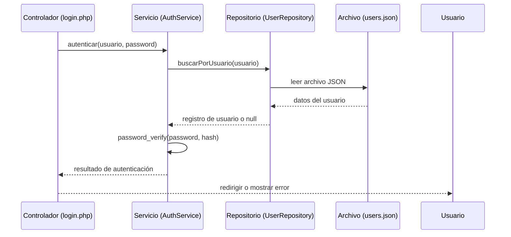

# Arquitectura de Persistencia Documental JSON

**Proyecto:** Mapa Interactivo ITL  
**Estado:** Implementado (capas de servicios, repositorios y almacenamiento en uso)  
**Versión:** 1.1 — actualizada tras la reestructuración (`frontend/`, `backend/`, `database/`)

> Rutas vigentes: el código PHP vive en `backend/`, los JSON privados en `database/runtime/`, los respaldos en `database/backups/` y el único directorio servido por HTTP es `frontend/`. Ver `AGENTS.md`.

---

## 1. Objetivos

Establecer una capa de persistencia documental basada en archivos JSON que permita:

- Almacenar cuentas de administrador de forma estructurada (reemplazando credenciales hardcodeadas).
- Almacenar configuraciones generales del sistema sin secretos expuestos.
- Registrar eventos de auditoría (login, intentos fallidos, cambios administrativos).
- Almacenar sugerencias enviadas desde el mapa público.
- Mantener separación entre almacenamiento, lógica de negocio y controladores.
- Facilitar una futura migración a SQLite o MongoDB sin reescribir controladores.

---

## 2. Justificación Tecnológica

Se eligió un sistema basado en archivos JSON por las siguientes razones:

- **Volumen de operaciones bajo:** El panel administrativo es usado por un número reducido de administradores. No justifica un motor de base de datos.
- **Sin dependencias externas:** PHP 8.4.7 ya está disponible en el entorno. No se requiere instalar ni configurar un servidor de base de datos.
- **Simplicidad operacional:** Los archivos JSON son legibles, editables manualmente si es necesario, y no requieren mantenimiento de esquema complejo.
- **Compatibilidad con el entorno actual:** El proyecto ya utiliza `datos.json` para edificios. Extender el mismo patrón a usuarios y configuración es natural.
- **Facilidad de respaldo:** Los archivos JSON pueden copiarse como cualquier otro archivo.

---

## 3. Arquitectura General

### 3.1 Separación de responsabilidades

```
┌─────────────────────────────────────────────────────────────┐
│                    CAPA DE PRESENTACIÓN                      │
│  frontend/index.html  ←→  backend/admin/panel.php            │
└─────────────────────────────────────────────────────────────┘
                              ↓
┌─────────────────────────────────────────────────────────────┐
│                    CAPA DE CONTROLADORES                      │
│  backend/router.php · backend/admin/* · backend/api/*         │
└─────────────────────────────────────────────────────────────┘
                              ↓
┌─────────────────────────────────────────────────────────────┐
│                    CAPA DE SERVICIOS                          │
│  backend/services/{Auth,Suggestion,Settings}Service.php       │
└─────────────────────────────────────────────────────────────┘
                              ↓
┌─────────────────────────────────────────────────────────────┐
│                  CAPA DE REPOSITORIOS                         │
│  backend/repositories/{User,Settings,AuditLog,Suggestion}…    │
└─────────────────────────────────────────────────────────────┘
                              ↓
┌─────────────────────────────────────────────────────────────┐
│                  CAPA DE ALMACENAMIENTO                        │
│  database/runtime/users.json                                  │
│  database/runtime/settings.json                               │
│  database/runtime/audit-log.jsonl                             │
│  database/runtime/suggestions.json                            │
└─────────────────────────────────────────────────────────────┘
```

### 3.2 Flujo de lectura y escritura (Mermaid)



```mermaid
flowchart TD
    A[Petición HTTP] --> B[Controlador]
    B --> C[Servicio de negocio]
    C --> D[Repositorio JSON]
    D --> E{¿Archivo existe?}
    E -->|Sí| F[Leer con file_get_contents()]
    E -->|No| G[Devolver estructura vacía]
    F --> H[json_decode()]
    H --> I[Operar sobre datos]
    I --> J{¿Operación de escritura?}
    J -->|Sí| K[flock() + escribir temporal + reemplazo atómico]
    J -->|No| L[Devolver resultado]
    K --> M[json_encode() + file_put_contents()]
    M --> L
```

---

## 4. Estructura de Directorios

```
frontend/                     # document root (único servido por HTTP)
├── index.html                # mapa público
├── index.php                 # front controller: carga el bootstrap y el router
├── data/                     # datos públicos que lee el navegador
│   ├── datos.json
│   ├── GeoTec.js
│   └── caminitos.geojson
├── css/ · js/ · img/ · tiles/

backend/                      # PHP privado (no servido)
├── bootstrap.php             # constantes de rutas + comprobación de carpetas
├── router.php                # tabla de rutas `?p=`
├── admin/                    # login · logout · panel · rutas · editores
├── api/                      # endpoints JSON (kebab-case)
├── auth/                     # auth_middleware · csrf · rate_limit
├── services/                 # AuthService · SuggestionService · SettingsService
│                             # BuildingService · RouteService · NetworkService…
├── repositories/             # UserRepository · SettingsRepository
│                             # AuditLogRepository · SuggestionRepository…
└── views/404.php

database/                     # almacenamiento privado (no servido)
├── runtime/                  # users.json · settings.json · audit-log.jsonl
│                             # suggestions.json · rutas.json
├── backups/                  # respaldos (p. ej. backups/caminitos/)
└── sources/                  # fuentes GIS del campus (.geojson)
```

**Nota:** `database/runtime/` está fuera del *document root* (`frontend/`), por lo que no es accesible por HTTP ni siquiera con el servidor embebido. `start-server.ps1` arranca `php -S 127.0.0.1:8000 -t frontend router.php`.

---

## 5. Colecciones JSON

### 5.1 users.json

Almacena cuentas de administrador.

**Estructura de un documento de usuario:**

```json
{
  "admin_001": {
    "id": "admin_001",
    "username": "admin",
    "email": "admin@itllaguna.local",
    "password_hash": "$2y$10$...",
    "role": "administrador",
    "status": "activo",
    "created_at": "2026-11-12T10:00:00-06:00",
    "updated_at": "2026-11-12T10:00:00-06:00",
    "last_login_at": null,
    "schema_version": 1
  }
}
```

**Campos:**

| Campo | Tipo | Descripción |
|-------|------|-------------|
| `id` | string | Identificador único (UUID o similar) |
| `username` | string | Nombre de usuario para login |
| `email` | string | Correo electrónico |
| `password_hash` | string | Hash generado con `password_hash()` |
| `role` | string | Rol del usuario (ej: `administrador`) |
| `status` | string | Estado de la cuenta (`activo`, `inactivo`, `bloqueado`) |
| `created_at` | string | Fecha de creación (ISO 8601) |
| `updated_at` | string | Última modificación (ISO 8601) |
| `last_login_at` | string|null | Último inicio de sesión exitoso |
| `schema_version` | int | Versión del esquema (para migraciones futuras) |

### 5.2 settings.json

Almacena configuraciones generales del sistema.

**Estructura:**

```json
{
  "site_name": "Mapa Interactivo ITL",
  "maintenance_mode": false,
  "session_timeout_hours": 2,
  "max_login_attempts": 5,
  "login_window_hours": 1,
  "suggestions_email": "migel2013+mapa@outlook.com",
  "schema_version": 1
}
```

**Nota:** Este archivo NO debe contener contraseñas SMTP, claves API ni secretos. Esos valores deben ir en variables de entorno.

### 5.3 audit-log.jsonl

Registra eventos importantes en formato JSONL (una línea JSON por registro).

**Estructura de un registro:**

```json
{"event":"login_success","user_id":"admin_001","username":"admin","ip":"127.0.0.1","timestamp":"2026-11-12T10:00:00-06:00"}
{"event":"login_failed","username":"admin","ip":"127.0.0.1","reason":"invalid_credentials","timestamp":"2026-11-12T10:01:00-06:00"}
{"event":"logout","user_id":"admin_001","username":"admin","ip":"127.0.0.1","timestamp":"2026-11-12T10:30:00-06:00"}
{"event":"building_created","user_id":"admin_001","building_id":"5","ip":"127.0.0.1","timestamp":"2026-11-12T11:00:00-06:00"}
{"event":"building_updated","user_id":"admin_001","building_id":"5","ip":"127.0.0.1","timestamp":"2026-11-12T11:30:00-06:00"}
{"event":"suggestion_received","suggestion_id":"sug_001","building":"5","ip":"192.168.1.10","timestamp":"2026-11-12T12:00:00-06:00"}
```

**Campos comunes:**

| Campo | Tipo | Descripción |
|-------|------|-------------|
| `event` | string | Tipo de evento (login_success, login_failed, logout, building_created, etc.) |
| `user_id` | string|null | ID del usuario (si aplica) |
| `username` | string|null | Nombre de usuario (para eventos sin sesión) |
| `ip` | string | Dirección IP del cliente |
| `timestamp` | string | Fecha y hora en ISO 8601 |
| Otros | varies | Campos específicos del evento |

### 5.4 suggestions.json

Almacena sugerencias enviadas desde el mapa público.

**Estructura de un documento de sugerencia:**

```json
{
  "sug_001": {
    "id": "sug_001",
    "type": "building_info",
    "building_id": "5",
    "description": "La aula 5A está cambiada de ubicación",
    "contact_email": "usuario@correo.com",
    "status": "pendiente",
    "created_at": "2026-11-12T12:00:00-06:00",
    "reviewed_at": null,
    "reviewed_by": null,
    "schema_version": 1
  }
}
```

**Campos:**

| Campo | Tipo | Descripción |
|-------|------|-------------|
| `id` | string | Identificador único de la sugerencia |
| `type` | string | Tipo de sugerencia (`building_info`, `new_building`, `correction`, `other`) |
| `building_id` | string|null | ID del edificio relacionado (coincide con `datos.json`) |
| `description` | string | Descripción de la sugerencia |
| `contact_email` | string|null | Correo de contacto opcional |
| `status` | string | Estado de revisión (`pendiente`, `revisada`, `aprobada`, `rechazada`) |
| `created_at` | string | Fecha de creación (ISO 8601) |
| `reviewed_at` | string|null | Fecha de revisión |
| `reviewed_by` | string|null | Usuario que revisó |
| `schema_version` | int | Versión del esquema |

---

## 6. Modelos de Documentos (Resumen)

| Colección | Archivo | Formato | Clave primaria | Índice natural |
|-----------|---------|---------|----------------|----------------|
| Usuarios | `users.json` | JSON objeto | `id` | `username` |
| Configuración | `settings.json` | JSON objeto | clave | clave |
| Auditoría | `audit-log.jsonl` | JSONL | n/a (secuencial) | `timestamp` |
| Sugerencias | `suggestions.json` | JSON objeto | `id` | `status`, `building_id` |

---

## 7. Repositorios

### 7.1 UserRepository

**Responsabilidad:** Persistencia y consulta de cuentas de usuario.

**Operaciones:**

| Operación | Descripción |
|-----------|-------------|
| `buscarPorId(string $id): array|null` | Buscar usuario por ID |
| `buscarPorUsername(string $username): array|null` | Buscar usuario por nombre de usuario |
| `crear(array $datos): string` | Crear nuevo usuario, devolver ID generado |
| `actualizar(string $id, array $datos): bool` | Actualizar campos de usuario |
| `eliminar(string $id): bool` | Eliminar usuario |
| `listar(): array` | Listar todos los usuarios |
| `actualizarUltimoLogin(string $id): bool` | Actualizar `last_login_at` |

### 7.2 SettingsRepository

**Responsabilidad:** Persistencia y consulta de configuración del sistema.

**Operaciones:**

| Operación | Descripción |
|-----------|-------------|
| `obtener(string $clave, mixed $default = null): mixed` | Obtener un valor de configuración |
| `obtenerTodas(): array` | Obtener todas las configuraciones |
| `guardar(string $clave, mixed $valor): bool` | Guardar/actualizar una configuración |
| `eliminar(string $clave): bool` | Eliminar una configuración |

### 7.3 AuditLogRepository

**Responsabilidad:** Registro de eventos de auditoría en formato JSONL.

**Operaciones:**

| Operación | Descripción |
|-----------|-------------|
| `registrar(array $evento): bool` | Agregar un evento al final del archivo |
| `obtener(int $limite = 100): array` | Obtener los últimos N eventos |
| `filtrarPorUsuario(string $userId): array` | Obtener eventos de un usuario |
| `filtrarPorEvento(string $evento): array` | Obtener eventos de un tipo |

### 7.4 SuggestionRepository

**Responsabilidad:** Persistencia y consulta de sugerencias del mapa público.

**Operaciones:**

| Operación | Descripción |
|-----------|-------------|
| `buscarPorId(string $id): array|null` | Buscar sugerencia por ID |
| `crear(array $datos): string` | Crear nueva sugerencia, devolver ID |
| `actualizarEstado(string $id, string $estado, string $revisadoPor): bool` | Cambiar estado de revisión |
| `listar(string $estado = null): array` | Listar sugerencias, opcionalmente filtrar por estado |
| `eliminar(string $id): bool` | Eliminar sugerencia |

---

## 8. Servicios de Negocio

Los servicios encapsulan las reglas de negocio y coordenan los repositorios.

### 8.1 AuthService

- `autenticar(string $username, string $password): array|null` — Verifica credenciales, devuelve datos del usuario o null.
- `registrarLoginExitoso(string $userId): void` — Actualiza `last_login_at` y registra evento de auditoría.
- `registrarLoginFallido(string $username): void` — Registra evento de auditoría de fallo.
- `obtenerUsuario(string $userId): array|null` — Obtiene datos del usuario.

### 8.2 SuggestionService

- `crearSugerencia(array $datos): string` — Valida entradas, crea sugerencia, registra en auditoría.
- `obtenerSugerenciasPendientes(): array` — Obtiene sugerencias con estado `pendiente`.
- `revisarSugerencia(string $id, string $estado, string $revisadoPor): bool` — Cambia estado de revisión.

### 8.3 SettingsService

- `obtenerConfiguracion(string $clave): mixed` — Obtiene valor de configuración con fallback.
- `actualizarConfiguracion(string $clave, mixed $valor): bool` — Actualiza configuración.

---

## 9. Seguridad

### 9.1 Protección de credenciales

- Las contraseñas se almacenan únicamente como hash generado con `password_hash()`.
- Nunca se almacena la contraseña en texto plano.
- Verificación con `password_verify()`.
- `users.json` debe estar fuera del directorio público (`database/runtime/`, nunca en `frontend/`).

### 9.2 Validación del lado del servidor

- Toda entrada recibida por POST/GET se valida y sanitiza antes de persistir.
- Los campos obligatorios se verifican.
- Los correos electrónicos se validan con `filter_var()`.
- Se elimina caracteres de control y saltos de línea en campos usados en cabeceras de correo.

### 9.3 Protección CSRF

- Los formularios de login y escritura incluyen un token CSRF generado por sesión.
- Validación con `hash_equals()` para evitar ataques de temporización.

### 9.4 Control de permisos

- Los repositorios son accedidos únicamente a través de servicios.
- Los servicios son invocados únicamente por controladores.
- Los controladores verifican autenticación mediante `requerirAdmin()` antes de delegar en servicios.

### 9.5 Bloqueo de archivos privados

- `database/` (con `runtime/` y `backups/`) queda **fuera del document root** (`frontend/`), así que no es accesible por HTTP.
- `start-server.ps1` arranca `php -S 127.0.0.1:8000 -t frontend router.php`; sin `-t frontend` los datos privados quedarían expuestos en local.
- `router.php` añade una barrera extra: bloquea por URI `backend/`, `database/`, `DUMP/`, `scripts/`, `tests/`, `docs/` y las extensiones sensibles (`.bak`, `.jsonl`, `.log`, `.ini`, `.env`, `.tmp`, `.lock`, `.md`).
- En producción, el servidor web (Apache/Nginx) debe apuntar su *document root* a `frontend/`.

### 9.6 Prevención de corrupción de datos

- Escritura en archivo temporal + reemplazo atómico (`rename()`).
- Uso de `flock()` para bloqueo exclusivo durante escritura.
- Validación de JSON con `json_decode()` y `json_last_error()` antes de aceptar datos.
- `JSON_PRETTY_PRINT | JSON_UNESCAPED_UNICODE` para consistencia.

### 9.7 Registros de auditoría sin información sensible

- No se almacena contraseñas ni hashes en `audit-log.jsonl`.
- Se registran únicamente IDs de usuario, nombres de usuario, IPs, tipos de evento y timestamps.

---

## 10. Integridad y Concurrencia

### 10.1 Mecanismos de protección

| Mecanismo | Descripción |
|-----------|-------------|
| `flock()` | Bloqueo exclusivo (`LOCK_EX`) durante lectura y escritura de archivos JSON. |
| Archivo temporal | Escritura a `archivo.tmp` seguido de `rename()` atómico para reemplazo. |
| Validación JSON | `json_decode()` con verificación de `json_last_error()` antes de persistir. |
| `schema_version` | Campo en cada documento para rastrear versiones de esquema. |

### 10.2 Limitaciones de concurrencia en Windows

- En Windows, `rename()` sobre un archivo existente puede fallar si el archivo está abierto en otro proceso.
- `flock()` funciona en Windows pero tiene limitaciones en redes compartidas.
- El volumen esperado de operaciones (pocos administradores, uso esporádico) hace que estas limitaciones sean aceptables.

### 10.3 Copias de seguridad y recuperación

- Los archivos JSON pueden copiarse manualmente como respaldo; `database/runtime/` y `database/backups/` no están en Git.
- Respaldos automáticos ya existentes:
  - `rutas.json.bak` junto a `rutas.json` antes de cada escritura.
  - `GeoTec.js.bak` junto a `GeoTec.js` antes de sobrescribir.
  - `database/backups/caminitos/` con los últimos 30 respaldos de la red (retención automática).
- Procedimiento de recuperación: restaurar el archivo JSON desde el respaldo más reciente y volver a comprobar la integridad con las pruebas (`tests/`).

---

## 11. Relación con los datos del mapa (`datos.json`)

- `datos.json` vive en `frontend/data/` (es público: lo lee el navegador y lo escribe PHP).
- **No se migra** `datos.json` al sistema de persistencia privado.
- Los IDs de edificio en `suggestions.json` y en `rutas.json` hacen referencia a claves existentes en `datos.json` cuando corresponde (ej: `building_id` en sugerencias, `origen.ref`/`destino.ref` en rutas).
- Esto evita duplicar información y mantiene una única fuente de verdad para los datos del mapa.

---

## 12. Limitaciones Conocidas

| Limitación | Descripción |
|------------|-------------|
| Sin motor de consultas | Las búsquedas requieren leer todo el archivo en memoria. Aceptable para volúmenes bajos. |
| Sin transacciones ACID | No hay rollback automático si falla una operación multi-archivo. |
| Concurrencia limitada | `flock()` en Windows tiene restricciones; uso exclusivo por un administrador a la vez es el escenario esperado. |
| Sin índices | Cada consulta escanea toda la colección. |
| Respaldo manual | No hay respaldo automático programado. |

---

## 13. Migración Futura (SQLite / MongoDB)

La arquitectura está diseñada con Repository Pattern para facilitar sustitución:

1. Los controladores dependen de servicios, no de repositorios directamente.
2. Los servicios dependen de interfaces de repositorio.
3. Para migrar a SQLite o MongoDB, solo se implementan nuevos repositorios que cumplan la misma interfaz.
4. Los controladores y servicios no requieren cambios.

**No se implementa una abstracción genérica innecesaria.** La interfaz de repositorio se define según las operaciones reales necesarias actualmente.

---

## 14. Decisiones tomadas

1. **Ubicación de los datos privados:** resuelta → `database/runtime/`, fuera del *document root* (`frontend/`).
2. **Credenciales hardcodeadas:** resuelto → `database/runtime/users.json` con `password_hash()`; `credenciales.php` quedó fuera de uso.
3. **Formato JSONL para auditoría:** se mantiene `audit-log.jsonl` (una línea por evento).
4. **Timeout de sesión:** se mantiene en 2 horas con expiración por inactividad.

---

## 15. Resumen de Componentes

| Componente | Tipo | Ruta | Estado |
|------------|------|------|--------|
| UserRepository | Repositorio | `backend/repositories/UserRepository.php` | Implementado |
| SettingsRepository | Repositorio | `backend/repositories/SettingsRepository.php` | Implementado |
| AuditLogRepository | Repositorio | `backend/repositories/AuditLogRepository.php` | Implementado |
| SuggestionRepository | Repositorio | `backend/repositories/SuggestionRepository.php` | Implementado |
| AuthService | Servicio | `backend/services/AuthService.php` | Implementado |
| SuggestionService | Servicio | `backend/services/SuggestionService.php` | Implementado |
| SettingsService | Servicio | `backend/services/SettingsService.php` | Implementado |
| users.json | Almacenamiento | `database/runtime/users.json` | Implementado (fuera de Git) |
| settings.json | Almacenamiento | `database/runtime/settings.json` | Implementado (fuera de Git) |
| audit-log.jsonl | Almacenamiento | `database/runtime/audit-log.jsonl` | Implementado (fuera de Git) |
| suggestions.json | Almacenamiento | `database/runtime/suggestions.json` | Implementado (fuera de Git) |
