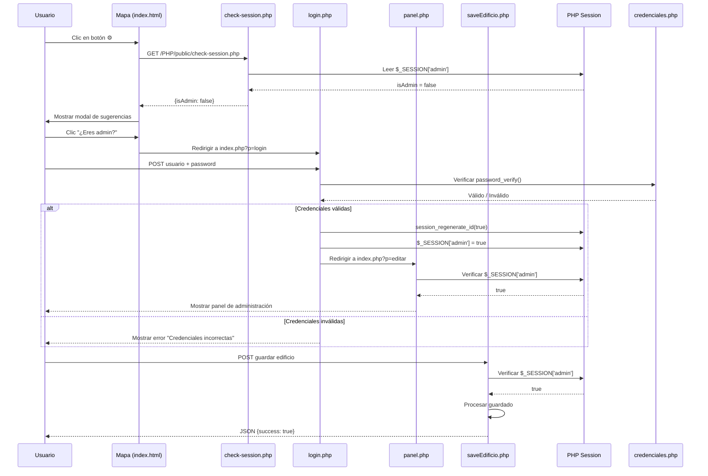

# Plan de Implementación: Autenticación y Control de Permisos para Administradores

> **Documento histórico.** Describe el estado previo a la reestructuración: las rutas `PHP/…`, `index.html` en la raíz y los endpoints sueltos ya no existen. Para la estructura y las rutas vigentes, ver `AGENTS.md` y `docs/plans/PLAN_REESTRUCTURACION_PROYECTO.md`.

**Proyecto:** Mapa Interactivo ITL
**Estado:** Planificación (sin implementar)
**Versión:** 1.0

---

## 1. Objetivo de la Implementación

Establecer un sistema de autenticación y autorización robusto para el panel administrativo del Mapa Interactivo ITL, garantizando que:

- Solo usuarios autenticados como administradores puedan acceder a las rutas y operaciones del panel.
- Las operaciones de escritura (edición, guardado, eliminación de edificios e imágenes) estén protegidas por autorización del servidor.
- El mapa público siga siendo accesible sin autenticación para usuarios comunes.
- Exista una separación clara entre autenticación (verificar identidad) y autorización (verificar permisos).
- La estructura permita incorporar roles adicionales en el futuro sin reescribir el sistema.

---

## 2. Diagnóstico del Sistema Actual

### 2.1 Archivos de autenticación existentes

| Archivo               | Ruta                             | Función actual                                                          | Estado de seguridad                                                      |
| --------------------- | -------------------------------- | ------------------------------------------------------------------------ | ------------------------------------------------------------------------ |
| Credenciales          | `PHP/config/credenciales.php`  | Almacena usuario `admin` y hash de contraseña con `password_hash()` | Credenciales hardcodeadas, un solo usuario                               |
| Login                 | `PHP/admin/login.php`          | Valida credenciales, establece `$_SESSION['admin'] = true`             | Sin CSRF, sin rate limiting, sin regeneración de sesión                |
| Logout                | `PHP/admin/logout.php`         | `session_destroy()` y redirección                                     | Sin limpieza de cookie de sesión, redirige a página edit tras destruir |
| Panel                 | `PHP/admin/panel.php`          | Verifica `$_SESSION['admin']` antes de mostrar                         | Protege visualmente, pero no todas las rutas internas                    |
| Guardado              | `PHP/admin/saveEdificio.php`   | Verifica `$_SESSION['admin']` antes de guardar                         | Protegido, pero sin CSRF                                                 |
| Listado imágenes     | `PHP/public/imagelist.php`     | Lista imágenes de una carpeta vía POST                                 | **Sin verificación de sesión**                                   |
| Router                | `PHP/public/index.php`         | Rutea `?p=mapa                                                           | editar                                                                   |
| Verificación sesión | `PHP/public/check-session.php` | (Etapa 1) Devuelve JSON `{isAdmin, csrf_token}`                        | Nuevo, creado en Etapa 1                                                 |

### 2.2 Vulnerabilidades identificadas

1. **`imagelist.php` sin autenticación:** Cualquier cliente puede hacer POST a `index.php?p=getimages` con cualquier `folder` y obtener listado de archivos sin estar autenticado.
2. **Posible path traversal en `imagelist.php`:** `$_POST['folder']` se usa directamente como ruta de archivo (`"img/" . $folder`) sin sanitización.
3. **Sin protección CSRF:** Los formularios de login, edición de edificios y envío de sugerencias no validan token CSRF.
4. **Sin regeneración de ID de sesión tras login:** Riesgo de fijación de sesión (session fixation).
5. **Sin rate limiting de intentos de login:** Posible ataque de fuerza bruta contra credenciales.
6. **Sin expiración de sesión:** Las sesiones no tienen tiempo de inactividad máximo configurado.
7. **Atributos de cookie de sesión insuficientes:** Sin `HttpOnly`, `Secure`, `SameSite` explícitos en configuración base.
8. **Un solo usuario hardcodeado:** No hay gestión de usuarios ni separación de roles.
9. **`logout.php` redirige a `?p=editar` tras destruir sesión:** Puede generar redirección inesperada o bucle si el usuario intenta acceder nuevamente sin login.

### 2.3 Lo que ya funciona y debe conservarse

- `password_hash()` / `password_verify()` para verificación de contraseña.
- `$_SESSION['admin']` como marcador de autenticación.
- `session_start()` en todos los archivos protegidos.
- `check-session.php` (Etapa 1) para verificación AJAX desde el mapa principal.
- Redirección a login cuando no hay sesión válida en `panel.php` y `saveEdificio.php`.

---

## 3. Arquitectura Propuesta

### 3.1 Separación de responsabilidades

```
┌─────────────────────────────────────────────────────────────┐
│                    CAPA DE PRESENTACIÓN                      │
│  index.html (mapa público)  ←→  PHP/admin/panel.php (admin) │
└─────────────────────────────────────────────────────────────┘
                              ↓
┌─────────────────────────────────────────────────────────────┐
│                    CAPA DE AUTENTICACIÓN                      │
│  PHP/admin/login.php  →  verifica credenciales → $_SESSION   │
│  PHP/admin/logout.php →  destruye sesión                            │
│  PHP/public/check-session.php → verifica sesión vía AJAX          │
└─────────────────────────────────────────────────────────────┘
                              ↓
┌─────────────────────────────────────────────────────────────┐
│                    CAPA DE AUTORIZACIÓN                        │
│  Middleware de verificación en cada ruta protegida           │
│  $_SESSION['admin'] === true  →  acceso permitido            │
└─────────────────────────────────────────────────────────────┘
                              ↓
┌─────────────────────────────────────────────────────────────┐
│                  CAPA DE DATOS / OPERACIONES                   │
│  saveEdificio.php, imagelist.php, panel.php                  │
└─────────────────────────────────────────────────────────────┘
```

### 3.2 Flujo de autenticación (Mermaid)



### 3.3 Flujo de autorización por operación (Mermaid)

```mermaid
flowchart TD
    A[Request llega al servidor] --> B{¿Ruta protegida?}
  
    B -->|Sí| C{¿$_SESSION['admin'] === true?}
    B -->|No| D[Procesar normalmente<br/>mapa público, sugerencias]
  
    C -->|Sí| E[Ejecutar operación protegida<br/>editar, guardar, eliminar]
    C -->|No| F[Devolver 403 / Redirigir a login]
  
    E --> G[Responder éxito o error de operación]
    F --> H[Mostrar formulario de login]
  
    D --> I[Responder contenido público]
```

---

## 4. Flujo de Autenticación Detallado

### 4.1 Login

1. Usuario accede a `index.php?p=login`.
2. Muestra formulario con campos `usuario` y `password`.
3. Al enviar (POST):
   - Validar que ambos campos estén presentes.
   - Buscar usuario en `credenciales.php`.
   - Verificar contraseña con `password_verify()`.
   - Si es válida: `session_regenerate_id(true)`, establecer `$_SESSION['admin'] = true`, `$_SESSION['auth_time'] = time()`, `$_SESSION['auth_ip'] = $_SERVER['REMOTE_ADDR']`.
   - Redirigir a `index.php?p=editar`.
   - Si es inválida: mostrar error genérico sin revelar qué campo falló.

### 4.2 Verificación de sesión (para el mapa principal)

1. El mapa llama a `PHP/public/check-session.php` vía AJAX.
2. El endpoint verifica `$_SESSION['admin']`.
3. Devuelve JSON `{isAdmin: bool, csrf_token: string}`.
4. El mapa usa el resultado para decidir si abrir el panel o el formulario de sugerencias.

### 4.3 Logout

1. Usuario accede a `index.php?p=logout`.
2. `session_destroy()`.
3. Eliminar cookie de sesión (`setcookie(session_name(), '', time()-3600, '/')`).
4. Redirigir a `index.php?p=login` (no a `editar`).

### 4.4 Sesión expirada

- Cada request protegido verifica `$_SESSION['admin']`.
- Si no existe o es falso, devolver 403 (para AJAX) o redirigir a login (para navegador).
- Opcional: agregar `$_SESSION['auth_time']` y verificar tiempo de inactividad (ej. 2 horas).

---

## 5. Modelo de Roles y Permisos

### 5.1 Roles definidos

| Rol               | Descripción                | Permisos                                                                                 |
| ----------------- | --------------------------- | ---------------------------------------------------------------------------------------- |
| `usuario_comun` | Visitante del mapa público | Ver mapa, buscar, sugerir cambios (no auth)                                              |
| `administrador` | Gestor del panel            | Ver panel, editar edificios, guardar, subir/eliminar imágenes, ver listado de imágenes |

### 5.2 Estructura futura (extensible)

El diseño usa un solo rol (`administrador`) por ahora, pero la verificación se implementa como una función `tienePermiso($rol, $operacion)` que permite agregar roles futuros sin modificar el núcleo:

```php
// Estructura propuesta para el futuro (no implementar aún)
$roles = [
    'administrador' => ['editar_edificios', 'gestionar_imagenes', 'ver_panel'],
    'editor' => ['editar_edificios'],
    'visor' => ['ver_panel'],
];
```

---

## 6. Protección de Rutas y Operaciones

### 6.1 Matriz de protección

| Ruta / Operación         | Método  | Requiere auth | Requiere CSRF | Protección actual           | Protección propuesta                                   |
| ------------------------- | -------- | ------------- | ------------- | ---------------------------- | ------------------------------------------------------- |
| `index.php?p=mapa`      | GET      | No            | No            | Pública                     | Sin cambios                                             |
| `index.php?p=login`     | GET/POST | No            | Sí (POST)    | Sin CSRF                     | Agregar CSRF + rate limiting                            |
| `index.php?p=logout`    | GET      | Sí           | No            | Verifica sesión             | Agregar limpieza de cookie                              |
| `index.php?p=editar`    | GET      | Sí           | No            | Verifica en panel.php        | Middleware de verificación                             |
| `index.php?p=getimages` | POST     | **No**  | **No**  | **Ninguna**            | Agregar verificación de sesión + sanitizar `folder` |
| `index.php?p=saveData`  | POST     | Sí           | **No**  | Verifica en saveEdificio.php | Agregar CSRF + validación de entradas                  |
| `check-session.php`     | GET      | No            | No            | Pública                     | Sin cambios                                             |

### 6.2 Operaciones que requieren protección del servidor

1. **Edición de edificios** (`panel.php`): Verificar sesión antes de mostrar el formulario.
2. **Guardado de información** (`saveEdificio.php`): Verificar sesión + CSRF antes de escribir `datos.json`.
3. **Eliminación de imágenes** (`saveEdificio.php`): Verificar sesión + CSRF antes de `unlink()`.
4. **Subida de imágenes** (`saveEdificio.php`): Verificar sesión + CSRF + validar tipo MIME y extensión.
5. **Listado de imágenes** (`imagelist.php`): **Agregar** verificación de sesión y sanitizar `folder` contra path traversal.
6. **Acceso al panel** (`index.php?p=editar`): Verificar sesión antes de incluir `panel.php`.

---

## 7. Archivos Existentes que Requieren Modificaciones

| Archivo                         | Cambios requeridos                                                                                                                                                                  |
| ------------------------------- | ----------------------------------------------------------------------------------------------------------------------------------------------------------------------------------- |
| `PHP/config/credenciales.php` | Mover credenciales a variables de entorno o archivo externo no versionado (`.env` o similar). No almacenar contraseñas en el repositorio.                                        |
| `PHP/admin/login.php`         | Agregar token CSRF al formulario, rate limiting de intentos fallidos, `session_regenerate_id(true)` tras login exitoso, cookies seguras (`HttpOnly`, `Secure`, `SameSite`). |
| `PHP/admin/logout.php`        | Limpiar cookie de sesión explícitamente, redirigir a login en lugar de a `editar`.                                                                                              |
| `PHP/admin/panel.php`         | Extraer verificación de sesión a función reutilizable, agregar middleware de protección.                                                                                        |
| `PHP/admin/saveEdificio.php`  | Agregar validación CSRF, validar y sanitizar todas las entradas, limitar tamaño de archivos subidos.                                                                              |
| `PHP/public/imagelist.php`    | **Agregar** verificación de sesión de administrador, sanitizar parámetro `folder` contra path traversal.                                                                 |
| `PHP/public/index.php`        | Agregar middleware de verificación de sesión para rutas protegidas (`editar`, `saveData`, `getimages`).                                                                     |
| `index.html`                  | No se requieren cambios (ya usa `check-session.php` desde Etapa 1).                                                                                                               |
| `js/main.js`                  | No se requieren cambios (ya consume `check-session.php` desde Etapa 1).                                                                                                           |

---

## 8. Archivos Nuevos que Será Necesario Crear

| Archivo                                       | Propósito                                                                                                                 |
| --------------------------------------------- | -------------------------------------------------------------------------------------------------------------------------- |
| `docs/plans/PLAN_AUTENTICACION_PERMISOS.md` | Este documento de planificación.                                                                                          |
| `PHP/auth/auth_middleware.php`              | Función reutilizable `requerirAdmin()` que verifica `$_SESSION['admin']` y devuelve 403 o redirige a login.           |
| `PHP/auth/csrf.php`                         | Funciones para generar y validar tokens CSRF en sesiones.                                                                  |
| `PHP/auth/rate_limit.php`                   | Función para limitar intentos de login por IP o sesión.                                                                  |
| `.env` (plantilla)                          | Ejemplo de variables de entorno para credenciales (`ADMIN_USER`, `ADMIN_PASSWORD_HASH`). No versionar el archivo real. |

---

## 9. Descripción de Cada Cambio

### 9.1 Middleware de autenticación (`PHP/auth/auth_middleware.php`)

Crear función `requerirAdmin()` que:

- Llame a `session_start()`.
- Verifique `$_SESSION['admin'] === true`.
- Si no es admin: si es petición AJAX (header `X-Requested-With`), devolver HTTP 403 con JSON. Si es navegador, redirigir a `index.php?p=login`.
- Se incluya al inicio de `panel.php`, `saveEdificio.php`, `imagelist.php`.

### 9.2 CSRF (`PHP/auth/csrf.php`)

- Función `generarTokenCSRF()`: crea token aleatorio con `random_bytes()`, almacena en `$_SESSION['csrf_token']`.
- Función `validarTokenCSRF($token)`: compara con `hash_equals()` contra `$_SESSION['csrf_token']`.
- Agregar campo oculto `<input type="hidden" name="csrf_token">` en formularios de login y edición.
- Validar en `login.php` (POST) y `saveEdificio.php` (POST).

### 9.3 Rate limiting de login (`PHP/auth/rate_limit.php`)

- Almacenar intentos fallidos en `$_SESSION['login_attempts']` con timestamps.
- Máximo 5 intentos por hora. Si se excede, devolver HTTP 429.
- Reiniciar contador tras login exitoso.

### 9.4 Credenciales por variable de entorno

- `credenciales.php` lee `ADMIN_USER` y `ADMIN_PASSWORD_HASH` de `$_ENV` o `getenv()`.
- Si no están definidas, usar valores por defecto solo para desarrollo local (documentar que no usar en producción).
- Proveer archivo `.env.example` con variables requeridas.

### 9.5 Cookies de sesión seguras

- En `login.php` y `auth_middleware.php`: `session_set_cookie_params([ 'lifetime' => 7200,  // 2 horas 'path' => '/', 'domain' => '', 'secure' => true,    // solo HTTPS 'httponly' => true, 'samesite' => 'Lax' ])`.

### 9.6 Sanitización de `imagelist.php`

- Validar que `folder` contenga solo caracteres alfanuméricos, guion bajo y guion medio.
- Rechazar `..`, `/`, `\` y otros caracteres de path traversal.
- Verificar sesión de administrador antes de devolver listado.

---

## 10. Orden de Implementación por Fases

### Fase 1: Infraestructura de seguridad base

1. Crear `PHP/auth/auth_middleware.php` con `requerirAdmin()`.
2. Crear `PHP/auth/csrf.php` con generación y validación de tokens.
3. Crear `PHP/auth/rate_limit.php` con límite de intentos de login.
4. Actualizar `PHP/config/credenciales.php` para leer de variables de entorno.

### Fase 2: Protección de rutas y endpoints

5. Modificar `PHP/public/index.php` para incluir middleware en rutas protegidas.
6. Modificar `PHP/admin/panel.php` para usar `requerirAdmin()`.
7. Modificar `PHP/admin/saveEdificio.php` para usar `requerirAdmin()` + CSRF.
8. Modificar `PHP/public/imagelist.php` para usar `requerirAdmin()` + sanitizar `folder`.
9. Modificar `PHP/admin/logout.php` para limpiar cookie y redirigir a login.

### Fase 3: Hardening de login y sesiones

10. Modificar `PHP/admin/login.php` con CSRF, rate limiting, `session_regenerate_id(true)`, cookies seguras.
11. Agregar expiración de sesión por inactividad (`$_SESSION['auth_time']`).

### Fase 4: Documentación y validación

12. Actualizar `.gitignore` para excluir `.env` y archivos de credenciales.
13. Actualizar `AGENTS.md` con nuevos archivos y procedimientos de autenticación.
14. Pruebas manuales de los flujos definidos en la sección 13.

---

## 11. Riesgos Técnicos y de Seguridad

| Riesgo                                      | Impacto | Probabilidad | Mitigación                                                                       |
| ------------------------------------------- | ------- | ------------ | --------------------------------------------------------------------------------- |
| Path traversal en `imagelist.php`         | Alto    | Alta         | Sanitizar `folder` con whitelist de caracteres antes de usar en ruta de archivo |
| Sesión hardcodeada sin expiración         | Medio   | Media        | Agregar `$_SESSION['auth_time']` y verificar inactividad                        |
| Credenciales en repositorio                 | Alto    | Baja         | Mover a `.env` no versionado, usar `password_hash()`                          |
| CSRF en formularios de escritura            | Medio   | Media        | Agregar token CSRF validado con `hash_equals()`                                 |
| Fuerza bruta en login                       | Medio   | Media        | Agregar rate limiting por sesión/IP                                              |
| Sesión fijada antes del login              | Medio   | Baja         | `session_regenerate_id(true)` tras autenticación exitosa                       |
| Acceso directo a `imagelist.php` sin auth | Alto    | Alta         | Agregar `requerirAdmin()` al inicio del archivo                                 |

### Decisiones que requieren aprobación del usuario

1. **Ubicación de credenciales:** ¿Usar variables de entorno (`$_ENV`) o un archivo `.env` fuera del repositorio?
2. **Expiración de sesión:** ¿Cuánto tiempo de inactividad antes de cerrar sesión automáticamente (sugerido: 2 horas)?
3. **Rate limiting:** ¿Límite de 5 intentos por hora por IP o por sesión?
4. **Redirección post-logout:** ¿Redirigir a login o a la página principal del mapa público?
5. **Cookies seguras:** `secure = true` requiere HTTPS. ¿El entorno de producción usará HTTPS o solo localhost?

---

## 12. Estrategia de Pruebas

### 12.1 Pruebas manuales (sin automatización)

| Prueba                             | Paso                                     | Resultado esperado                               |
| ---------------------------------- | ---------------------------------------- | ------------------------------------------------ |
| Acceso sin sesión al panel        | Ir a `index.php?p=editar` sin login    | Redirigir a `index.php?p=login`                |
| Login válido                      | Ingresar admin/contraseña               | Redirigir a panel, `$_SESSION['admin'] = true` |
| Login inválido                    | Ingresar credenciales incorrectas        | Mostrar error genérico, no redirigir            |
| Sesión expirada                   | Esperar expiración (o manipular tiempo) | Redirigir a login en siguiente request protegido |
| Logout                             | Clic en "Cerrar sesión"                 | Destruir sesión, redirigir a login              |
| Acceso a `saveData` sin sesión  | POST directo a `index.php?p=saveData`  | Devolver 403 o redirigir a login                 |
| Acceso a `getimages` sin sesión | POST directo a `index.php?p=getimages` | Devolver 403 (tras agregar protección)          |
| Path traversal                     | Enviar `folder=../../etc/passwd`       | Rechazar entrada, no listar archivos             |
| CSRF inválido                     | Enviar POST sin token CSRF               | Devolver 403                                     |
| Mapa público sin auth             | Abrir `index.html`                     | Cargar normalmente sin sesión                   |

### 12.2 Pruebas de integración mapa-panel

1. Abrir mapa sin sesión → clic en ⚙️ → abrir modal de sugerencias.
2. Abrir mapa con sesión de admin → clic en ⚙️ → redirigir a panel.
3. Abrir mapa con sesión expirada → clic en ⚙️ → `check-session.php` devuelve `isAdmin: false` → abrir modal de sugerencias (o redirigir a login si se prefiere).

---

## 13. Criterios de Aceptación

- [X] Un usuario sin sesión no puede acceder a `index.php?p=editar` (redirige a login).
- [X] Un usuario autenticado como admin puede acceder al panel y editar edificios.
- [X] `saveEdificio.php` rechaza peticiones POST sin sesión válida ni CSRF token.
- [X] `imagelist.php` rechaza peticiones sin sesión válida y sanitiza `folder`.
- [X] Login fallido después de 5 intentos bloquea por tiempo definido.
- [X] `session_regenerate_id(true)` se ejecuta tras login exitoso.
- [X] Cookies de sesión tienen `HttpOnly` y `SameSite`.
- [X] Mapa público (`index.html`) funciona sin autenticación.
- [X] Botón ⚙️ del mapa redirige correctamente según estado de sesión.
- [X] No hay credenciales ni hashes de contraseña versionados en GitHub.

---

## 14. Dependencias y Configuraciones Necesarias

- PHP 8.4.7 (ya disponible en el entorno).
- `session` habilitado (ya está).
- `filter` y `hash` habilitados (ya están, usados para `filter_var` y `hash_equals`).
- Variables de entorno para credenciales (definir antes de desplegar en producción).
- HTTPS en producción para cookie `secure = true`.
- No se requieren nuevas dependencias externas ni gestores de paquetes.

---

## 15. Consideraciones para Futuros Ampliaciones

- **Múltiples usuarios:** Reemplazar `$_SESSION['admin']` por `$_SESSION['usuario']['rol']` y tabla de roles/permisos.
- **Recuperación de contraseña:** Agregar flujo de restablecimiento por correo electrónico.
- **Autenticación de dos factores (2FA):** Agregar paso secundario tras validar contraseña.
- **Logs de auditoría:** Registrar quién editó qué edificio y cuándo.
- **API REST:** Si se expone el panel como API, usar tokens JWT en lugar de sesiones PHP.

---

## 16. Resultado Entregable (este documento)

1. ✅ Archivo `docs/plans/PLAN_AUTENTICACION_PERMISOS.md` (este archivo).
2. ✅ Diagnóstico breve del estado actual (sección 2).
3. ✅ Explicación de arquitectura propuesta (sección 3).
4. ✅ Lista de archivos que deberán modificarse (sección 7).
5. ✅ Lista de riesgos y decisiones que requieren aprobación (sección 11).

**IMPORTANTE:** No se ha modificado ningún archivo PHP, JavaScript ni de configuración. Este es únicamente un plan de implementación para revisión y aprobación antes de comenzar el desarrollo.
