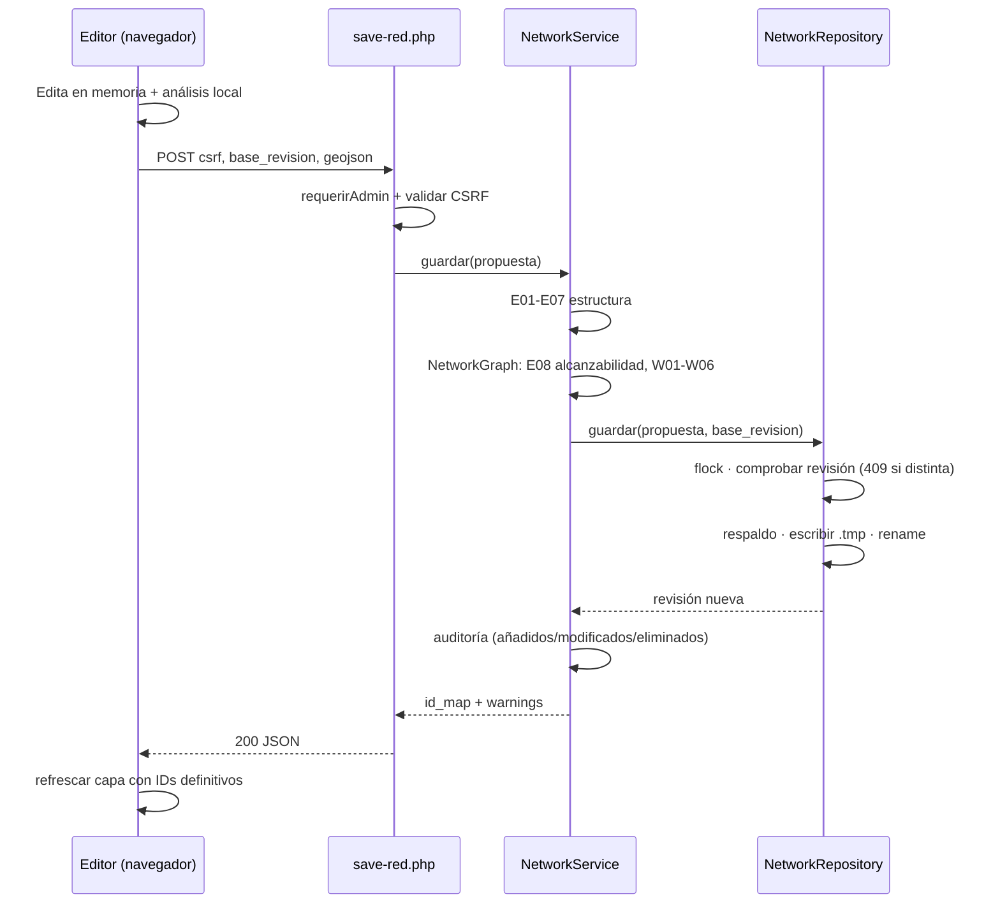

# PLAN DE IMPLEMENTACIÓN — GESTIÓN DE LA RED DE CAMINOS

> **Documento histórico.** Describe el estado previo a la reestructuración: las rutas `PHP/…`, `index.html` en la raíz y los endpoints sueltos ya no existen. Para la estructura y las rutas vigentes, ver `AGENTS.md` y `docs/plans/PLAN_REESTRUCTURACION_PROYECTO.md`.

> **Estado:** ✅ implementado y verificado (E0–E6 completadas).
> **Fecha:** 2026-11-16 · **Rama de trabajo:** `RaMaik`
> **Relación con otros documentos:**
> - `PLAN_MODULO_GESTION_RUTAS.md` (OpenCode) entendió "rutas" como recorridos nombrados. Este plan **no lo reemplaza por completo**: cubre lo que ese plan dejó como *Fase 3 opcional* ("edición gráfica de la red") y lo convierte en el objetivo principal.
> - `PLAN_REESTRUCTURACION_PROYECTO.md` define la nueva estructura de carpetas. **Las rutas de archivos de este plan usan la estructura nueva**; la tabla de equivalencias está en el apartado 14.

---

## 0. Seguimiento de ejecución

> **Cómo usar esta sección.** Marca `[x]` al terminar una tarea y actualiza **Punto de retorno** antes de interrumpir el trabajo. Los identificadores `E<etapa>.<tarea>` se usan en los mensajes de progreso para saber exactamente dónde se quedó la implementación.
>
> **Punto de retorno actual:** plan completado (E0–E6). No queda trabajo pendiente de este plan.

| Etapa | Estado |
|---|---|
| E0 · Preparación del entorno de pruebas | ✅ completada |
| E1 · Backend de datos y validación | ✅ completada |
| E2 · Endpoints, router e integración con el panel | ✅ completada |
| E3 · Análisis topológico en el cliente | ✅ completada |
| E4 · Editor gráfico (vista, JS y CSS) | ✅ completada |
| E5 · Pruebas de integridad, validación y seguridad | ✅ completada |
| E6 · Documentación y cierre | ✅ completada |

### E0 · Preparación del entorno de pruebas

- [x] **E0.1** Cifras de referencia verificadas: `nodos=238 aristas=309 grado1=19 componentes=1`, `rutas=348/348`, `features=313 vertices=644` (`node tests/grafo-huella.mjs --geometria`).
- [x] **E0.2** Extraer `distanciaMetros()` a `js/geo-utils.js` y cargarlo antes de `pathfinding.js` en `index.html`, `beacons-simulation.js` y las pruebas.

### E1 · Backend de datos y validación

- [x] **E1.1** `PHP/services/NetworkGraph.php`: port PHP de `buildGraph`, Dijkstra, componentes, extremos libres, aristas, métricas y alcanzabilidad.
- [x] **E1.2** `PHP/repositories/NetworkRepository.php`: formato v2 estricto, lectura fail-closed, `flock`, control de revisión (409), respaldo con retención de 30 y `rename` atómico.
- [x] **E1.3** `PHP/repositories/PathNetworkRepository.php`: patrón de ID ampliado para aceptar `seg-\d{6}` además de los históricos `seg-<8hex>`.
- [x] **E1.4** `PHP/services/NetworkService.php`: validación E01–E08, advertencias W01–W06, asignación de IDs, diferencias, auditoría y pares de referencia.
- [x] **E1.5** `scripts/migrar_red_v2.php`: migración idempotente con `--apply`, respaldo y verificación de huella. Migración real aplicada (`revision=1`, `next_seq=314`).
- [x] **E1.6** Endpoints `save-red.php` (POST, CSRF, 400/403/409/500) y `PHP/admin/getRed.php` (GET estado vigente).
- [x] **E1.7** Prueba de paridad JS/PHP: `tests/red/paridad-grafo.mjs` + `tests/red/_grafo-php.php` (26 redes).

### E2 · Endpoints, router e integración con el panel

- [x] **E2.1** Registrar en `index.php` las rutas `editar-red` → `PHP/admin/editar-red.php`, `getRed` → `PHP/admin/getRed.php`, `save-red` → `save-red.php`.
- [x] **E2.2** Añadir el botón **🗺️ Red de caminos** en el header de `PHP/admin/panel.php`.
- [x] **E2.3** Revisar `router.php` y `.gitignore` para excluir `.lock`, `.tmp.*` y `PHP/data/backups/`.

### E3 · Análisis topológico en el cliente

- [x] **E3.1** `js/network-analysis.js`: `redClaveNodo`, `redLongitud`, `redComponentes`, `redExtremosLibres`, `redParesAlcanzables`, `redAjustarPuntoARed`, `redAnalizarRed` (E08 local + W01–W06), intersección de segmentos y recuadro.
- [x] **E3.2** Verificar paridad del análisis cliente con `NetworkGraph`/`NetworkService` sobre la red real (`tests/red/analisis-cliente.mjs`, 30 comprobaciones).

### E4 · Editor gráfico

- [x] **E4.1** `PHP/admin/editar-red.php`: layout, toolbar de modos, leyenda, lista, panel de validación y datos embebidos.
- [x] **E4.2** `css/red-editor.css`: layout sidebar/mapa, toolbar, leyenda, lista, badges, avisos, mensaje, detalle y responsive.
- [x] **E4.3** `js/network-editor.js`: estado y capas, modos consultar/dibujar/editar/eliminar, snapping, Geoman, lista/buscador, panel de validación en vivo, guardar/descartar y `beforeunload`.
- [x] **E4.4** Manejo de respuestas 400/403/409/500 (mensajes, refresco de revisión y `id_map`).

### E5 · Pruebas de integridad, validación y seguridad

- [x] **E5.1** `tests/red/integridad-red.php`: archivo ausente/corrupto/v1, respaldo, conflicto de revisión, IDs `tmp-` y retención de respaldos (21/21).
- [x] **E5.2** `tests/red/validacion-red.php`: un caso por cada E01–E08 y W01–W06, incluida la regresión de alcanzabilidad (28/28).
- [x] **E5.3** `tests/red/seguridad-red.ps1`: sin sesión (403), sin CSRF (403), método incorrecto (405), revisión obsoleta (409) y petición sobredimensionada (400).
- [x] **E5.4** Regresión: `php -l` de los archivos nuevos, `node --check`, `node tests/grafo-huella.mjs --geometria`, `node tests/red/paridad-grafo.mjs`, `node tests/red/analisis-cliente.mjs`, `php tests/rutas-repository.php`, `php tests/rutas-service.php` y `powershell -File tests/regresion-general.ps1`.

### E6 · Documentación y cierre

- [x] **E6.1** Actualizar `AGENTS.md` con el módulo de red (archivos, rutas, formato v2, respaldos y pruebas).
- [x] **E6.2** Actualizar este plan (estado, decisiones tomadas y punto de retorno final).
- [x] **E6.3** Revisar que `PHP/public/`, `js/main.js` y el cálculo del mapa público siguen intactos (cubierto por `tests/regresion-general.ps1`).

---

## 1. Resumen ejecutivo

El mapa público ya calcula recorridos (puerta → edificio) con Dijkstra. Ese sistema **no se toca**. Lo que falta es una forma de que un administrador **agregue, edite y elimine los segmentos de la red de caminos** desde una interfaz gráfica, sin editar `caminitos.geojson` a mano en QGIS.

Hallazgos que determinan el diseño (todos verificados sobre el código y los datos reales del fork):

1. **El grafo no se persiste: se deriva en el navegador** de `caminitos.geojson` con `buildGraph()` (snapping de 2,5 m y división de segmentos por proyección). Por eso la red **no necesita una entidad "nodo" ni una entidad "ruta"**: basta con segmentos bien identificados.
2. **`caminitos.geojson` es un único `MultiLineString` de 235 partes sin identificadores** (`properties.id = null`). Es el verdadero obstáculo para gestionarlo: no se puede seleccionar, editar ni eliminar "un segmento" si no existe como entidad.
3. **Se puede dar identidad a cada segmento sin alterar el grafo.** Prueba ejecutada: al convertir las 235 partes en 235 `LineString` (mismo orden), el grafo resultante es **idéntico** (238 nodos, 309 aristas, 1 componente). No hace falta la "normalización topológica" (314 features) que propuso el plan anterior.
4. **Un segmento nuevo desconectado pasa inadvertido:** al añadir un segmento aislado el grafo pasa de 1 a 2 componentes y nada falla visiblemente; al añadir uno que toca la red a ≤ 2,5 m sigue en 1. La validación de conectividad es, por tanto, **la función crítica del módulo**.
5. **No existe ningún endpoint que escriba `caminitos.geojson`**, y `BaseRepository` *falla abierto* (si el JSON está corrupto, `leer()` devuelve `[]`): usarlo tal cual para la red podría **sobrescribir toda la red con un solo segmento**. El repositorio de la red debe fallar cerrado.

**Propuesta en una línea:** conservar `caminitos.geojson` como única fuente de verdad (formato v2: un `LineString` con ID estable por segmento), añadir un editor gráfico en el panel (Leaflet + Geoman, ya vendorizado), validar con el mismo algoritmo `buildGraph` en cliente y servidor, y guardar de forma atómica con respaldo, control de revisión y auditoría.

**Complejidad relativa global:** media. Dijkstra y el mapa público no cambian; la complejidad está en la validación topológica y en la escritura segura.

---

## 2. Alcance

| Incluido (MVP) | Fase 2 | Fuera de alcance |
|---|---|---|
| Visualizar la red en el panel | División de un segmento en un punto | Rutas nombradas / entidad "ruta administrativa" |
| Seleccionar y consultar un segmento | Inserción automática de nodos en cruces | Pesos, sentido único, accesibilidad en Dijkstra |
| Dibujar segmentos nuevos | Metadatos (`nombre`, `tipo`, `activo`) | Cambiar la base JSON por otro motor |
| Editar vértices de un segmento | Deshacer / rehacer en sesión | Publicar la red en el mapa público |
| Eliminar segmentos | Historial de respaldos y restauración | |
| Validación de conectividad y alcanzabilidad | | |
| Guardado atómico, respaldo y auditoría | | |

---

## 3. Diagnóstico verificado

| Elemento | Estado real | Evidencia |
|---|---|---|
| Red de caminos | 1 feature `MultiLineString`, 235 partes, 603 vértices, `properties: {id: null}` | `caminitos.geojson` (101 KB) |
| Cobertura | lng −103.43698 … −103.43405 · lat 25.52933 … 25.53546 | cálculo sobre el archivo |
| Carga en el mapa | `fetch('caminitos.geojson')` → `L.geoJSON` con color `#ffffff00` (**invisible**) → `buildGraph(data)` | `js/main.js:120-137` |
| Grafo | 238 nodos, 309 aristas, **1 componente** | ejecutado con `buildGraph` real |
| Construcción del grafo | Snapping 2,5 m a nodos ya registrados + división de cada segmento por los nodos a ≤ 2,5 m (proyección) | `js/pathfinding.js:55-143` |
| Conectividad de un cruce | Dos segmentos que se cruzan **sin vértice común** solo se conectan si hay un nodo a ≤ 2,5 m del otro segmento | lectura del algoritmo |
| Dijkstra | No dirigido, sin pesos variables, grafo `{nodo: {vecino: metros}}` | `js/pathfinding.js:162-209` |
| Dependencia oculta | `pathfinding.js` usa `distanciaMetros()`, que **está definida en `beacons-simulation.js`** | `js/beacons-simulation.js:122` |
| Endpoint de escritura de red | **No existe** | búsqueda en `index.php` y raíz |
| Patrón de escritura reutilizable | `BuildingGeometryRepository` (reescribe `GeoTec.js` con respaldo `.bak`) | `PHP/repositories/BuildingGeometryRepository.php:81-115` |
| `BaseRepository` | flock + `.tmp` + `rename` (bien) pero `leer()` devuelve `[]` si el JSON está corrupto (**falla abierto**) | `PHP/repositories/BaseRepository.php:23-45` |
| Control de acceso | Solo `requerirAdmin()`; no hay roles granulares en el código | `PHP/auth/auth_middleware.php:18` |
| Auditoría | `AuditLogRepository::registrar(array $evento)` disponible | `PHP/repositories/AuditLogRepository.php:20` |
| Editor de geometrías existente | Página completa con Leaflet + Geoman (`editar-geometria.php` + `js/editor.js`, 601 líneas) | reutilizable como patrón |

**Pendiente de verificar (no lo comprobé yo):** que las 348 combinaciones puerta→edificio sean alcanzables (cifra del plan anterior). En la Fase 1 se genera como número de referencia ("golden") con el mismo criterio de `calcularRuta()`.

---

## 4. Qué se reutiliza, qué es nuevo y qué se descarta

**Se reutiliza sin cambios:** `buildGraph`, `findClosestNode`, `dijkstra`, `calcularDistanciaRuta`; Leaflet 1.9.4 y Geoman vendorizado; sesión, CSRF y `requerirAdmin()`; `AuditLogRepository`; el patrón visual de `panel.php` / `editar-geometria.php`; el mapa público (solo se lee el mismo archivo).

**Nuevo:**
- Formato v2 de `caminitos.geojson` (IDs estables, `schema_version`, `revision`, `next_seq`).
- `NetworkRepository`, `NetworkService`, `NetworkGraph` (port PHP de `buildGraph`) y endpoint de guardado.
- Vista `editar-red` y `network-editor.js`.
- `network-analysis.js` (análisis topológico, **no** modifica `pathfinding.js`).
- Script de migración y pruebas reproducibles.

**Se descarta del plan anterior:** `rutas.json` y la entidad "ruta administrativa" (no son lo que se necesita); la normalización a 314 features (innecesaria: demostrado que el grafo es idéntico sin ella); permisos finos por rol en el MVP (ver decisión D5).

---

## 5. Funcionalidad

### 5.1 Visualización
- Ver toda la red sobre el mapa satelital, con color por estado del segmento.
- Listar los segmentos (ID, nº de vértices, longitud en metros) con búsqueda por ID.
- Seleccionar un segmento desde la lista **o** haciendo clic en el mapa; se resalta y se centra.
- Mostrar extremos libres (grado 1) y componentes aisladas.

### 5.2 Creación
- Dibujar una polilínea (Geoman `Line`) con *snapping* a vértices y segmentos existentes.
- Al terminar, el segmento queda **pendiente** (no persistido) con ID provisional.
- Aviso inmediato si el segmento queda aislado o con un extremo "casi conectado" (entre 2,5 m y 8 m de la red).

### 5.3 Edición
- Mover, añadir o quitar vértices de un segmento (Geoman `Edit`).
- El segmento editado pasa a estado **modificado**; su ID no cambia.
- (Fase 2) Dividir un segmento en un punto; propiedades descriptivas.

### 5.4 Eliminación
- Marcar segmentos para eliminar (borrado **diferido**: se aplica al guardar).
- Antes de guardar se muestra el efecto: componentes resultantes y edificios que quedarían sin ruta.
- No existe "papelera" en el MVP; la protección es el **respaldo automático** previo a cada guardado.

### 5.5 Guardado
- Un único botón **Guardar cambios** envía el estado completo de la red; el servidor valida, respalda, escribe y audita.
- **Descartar** recarga el estado persistido.

---

## 6. Diseño de la interfaz

**Decisión:** página independiente `editar-red`, como `editar-geometria`, enlazada desde el panel con un botón **"Red de caminos"** junto a "Agregar edificio". No se mezcla con el panel de edificios para evitar ediciones accidentales cruzadas.

```
┌──────────────────────────────────────────────────────────────┐
│ ← Volver al panel   Red de caminos   rev. 7    [Guardar] [Descartar]
├───────────────┬──────────────────────────────────────────────┤
│ [Segmentos]   │  Modo: (•Consultar) (Dibujar) (Editar) (Eliminar)
│ [Validación]  │                                              │
│ buscar ID…    │              M A P A  (satelital)            │
│ seg-000001    │   edificios: gris, NO interactivos           │
│ seg-000002    │   red: segmentos coloreados por estado       │
│ …             │                                              │
└───────────────┴──────────────────────────────────────────────┘
```

### 6.1 Estados y capas

| Modo | Seleccionable | Editable | Bloqueado |
|---|---|---|---|
| Consultar | segmentos | nada | edificios, accesos |
| Dibujar | — | crea una línea nueva | todo lo demás |
| Editar | segmentos | vértices del seleccionado | edificios, accesos |
| Eliminar | segmentos | marca/desmarca | edificios, accesos |

Edificios y accesos se cargan con `interactive: false` y `pmIgnore: true`: **no pueden modificarse ni capturarse por error**.

### 6.2 Código de color

| Estado | Estilo |
|---|---|
| Existente | cian |
| Nuevo sin guardar | verde |
| Modificado | naranja |
| Seleccionado | amarillo, trazo grueso |
| Marcado para eliminar | rojo, discontinuo |
| Extremo libre | círculo amarillo |
| Componente aislada | rojo |

### 6.3 Panel "Validación"
Lista **Errores** (bloquean el guardado) y **Advertencias** (el administrador decide). Cada elemento es clicable y centra el mapa en el problema. Se recalcula con *debounce* de ~300 ms tras cada cambio (el análisis completo es del orden de milisegundos: ~143 000 proyecciones).

### 6.4 Confirmaciones
- Eliminar con efecto sobre alcanzabilidad: diálogo que enumera los edificios afectados (es además un **error bloqueante**, ver 8).
- Salir con cambios sin guardar: aviso del navegador (`beforeunload`).

---

## 7. Persistencia

### 7.1 Decisión
Se **conserva `caminitos.geojson`** como fuente única de verdad. El mapa público ya lo consume y no hay motivo para duplicar la información en otro archivo. Se actualiza a **formato v2**.

### 7.2 Formato v2

```json
{
  "type": "FeatureCollection",
  "name": "caminitos",
  "crs": { "type": "name", "properties": { "name": "urn:ogc:def:crs:OGC:1.3:CRS84" } },
  "schema_version": 2,
  "revision": 1,
  "next_seq": 236,
  "features": [
    {
      "type": "Feature",
      "properties": { "id": "seg-000001" },
      "geometry": { "type": "LineString", "coordinates": [[-103.43591, 25.53012], [-103.43580, 25.53020]] }
    }
  ]
}
```

| Campo | Tipo | Regla |
|---|---|---|
| `schema_version` | int | `2`. Un valor desconocido se rechaza. |
| `revision` | int | Se incrementa en cada guardado. Es el control de concurrencia. |
| `next_seq` | int | Contador de IDs. **Nunca se reutiliza un ID**, aunque se elimine el segmento. |
| `properties.id` | string | `seg-` + 6 dígitos. Lo asigna el **servidor**; el cliente usa IDs provisionales `tmp-…`. |
| `geometry` | LineString | ≥ 2 vértices, coordenadas `[lng, lat]` finitas dentro del recuadro permitido. |

Los campos extra (`schema_version`, `revision`, `next_seq`) son *foreign members* válidos en GeoJSON; Leaflet los ignora y `buildGraph` solo lee `features[].geometry`. **Compatibilidad verificada** para `LineString` (el código ya contempla `LineString` y `MultiLineString`).

Fase 2 añade en `properties`: `nombre` (string|null), `tipo` (`peatonal`|`escaleras`|`rampa`), `activo` (bool). Requeriría que `buildGraph` ignore `activo === false` (cambio pequeño y aislado, a aprobar entonces).

### 7.3 Migración v1 → v2 (una sola vez)
`tools/migrar-red-v2.php`, con `--dry-run` por defecto:

1. Leer v1 y comprobar que tiene el formato esperado.
2. Respaldar a `database/backups/caminitos/caminitos-v1-<fecha>.geojson`.
3. Explotar cada parte del `MultiLineString` en un `LineString` **conservando el orden** (el orden importa: el snapping registra primero los nodos que aparecen antes).
4. Asignar `seg-000001…seg-000235`, `revision: 1`, `next_seq: 236`.
5. **Verificar equivalencia:** construir el grafo antes y después; abortar si difiere el número de nodos, aristas o componentes (valores esperados: 238 / 309 / 1).
6. Con `--apply`, escribir de forma atómica.

### 7.4 Respaldos
`database/backups/caminitos/caminitos-YYYYmmdd-HHMMSS-revN.geojson` antes de cada guardado; se conservan los últimos 30. (Fase 2: pantalla de restauración.)

### 7.5 Integridad
- Lectura **fallando cerrado**: archivo ausente o JSON inválido ⇒ excepción, nunca `[]`.
- Escritura con `flock` sobre un archivo de bloqueo, archivo temporal y `rename` atómico.
- Control de revisión **dentro del bloqueo**: si `base_revision ≠ revision` actual ⇒ HTTP 409 con la revisión vigente.
- Una única operación de guardado modifica **un solo archivo de datos**; no hay escrituras multi-archivo que puedan quedar a medias (el respaldo y la auditoría son auxiliares).

---

## 8. Validaciones

### 8.1 Errores (bloquean el guardado)

| Código | Regla |
|---|---|
| E01 | JSON o GeoJSON inválido; tipo distinto de `FeatureCollection` |
| E02 | Feature que no es `LineString` |
| E03 | Menos de 2 vértices, o longitud total 0 |
| E04 | Coordenada no numérica/no finita o fuera del recuadro del campus (+ margen) |
| E05 | IDs duplicados o con formato inválido |
| E06 | `base_revision` obsoleta (409) |
| E07 | Tamaño de la petición > 2 MB o > 2 000 segmentos |
| E08 | **Regresión de alcanzabilidad:** un par puerta→edificio alcanzable en la red actual deja de serlo |

### 8.2 Advertencias (el administrador decide)

| Código | Regla |
|---|---|
| W01 | **Componente aislada**: hay > 1 componente conexa (se informa cuántos segmentos y dónde) |
| W02 | **Extremo casi conectado:** extremo libre a entre 2,5 m y 8 m de otro segmento |
| W03 | **Cruce sin nodo:** dos segmentos se cruzan y ninguno tiene nodo a ≤ 2,5 m del cruce (no hay conexión) |
| W04 | Segmento muy corto (< 2,5 m: sus extremos se fusionarán por snapping) |
| W05 | Segmentos solapados / casi idénticos |
| W06 | Vértices consecutivos duplicados |

> **Por qué E08 es error y W01 es advertencia:** una isla suelta no afecta a Dijkstra mientras ningún edificio quede asignado a ella, pero `findClosestNode` no tiene umbral de distancia, así que una isla *sí* puede capturar un edificio. Lo que se bloquea es el daño real (edificio inalcanzable), no la forma de la red; así el administrador puede dibujar un tramo en dos pasos.

---

## 9. Algoritmos

### 9.1 Sin cambios
`buildGraph`, `findClosestNode`, `dijkstra`, `calcularDistanciaRuta`. **No se modifica `pathfinding.js`.**

### 9.2 Nuevos (en `frontend/js/shared/network-analysis.js`, solo cargado por el editor)

| Algoritmo | Problema que resuelve | Complejidad |
|---|---|---|
| `componentes(grafo)` (DFS iterativo) | W01, y base de E08 | O(V+E) |
| `extremosLibres(grafo)` (nodos grado 1) | mostrar extremos, W02 | O(V) |
| `casiConectados(extremos, segmentos)` | W02 | O(extremos × segmentos) |
| `cruces(segmentos)` (intersección de segmentos) | W03 | O(S²), S ≈ 600 |
| `alcanzabilidad(grafo, pares)` | E08: reutiliza `findClosestNode` y `dijkstra` con el criterio de `calcularRuta()` | pares × Dijkstra |

### 9.3 Paridad cliente/servidor
La validación **no puede depender solo del navegador** (la interfaz no es un control de seguridad). Se porta `buildGraph` a PHP (`NetworkGraph.php`, ≈ 150 líneas).

**Riesgo conocido:** `buildGraph` usa claves `lat.toFixed(6) + ',' + lng.toFixed(6)`; `toFixed` de JavaScript y el redondeo de PHP pueden diferir en empates binarios. Mitigación: prueba de paridad (apartado 15) sobre los datos reales y sobre casos generados al azar. Si apareciera una discrepancia, se prefiere una función de redondeo común explícita en ambos lados.

### 9.4 Cambio menor recomendado
Mover `distanciaMetros()` de `beacons-simulation.js` a `frontend/js/shared/geo-utils.js`, cargado antes de `pathfinding.js` (elimina la dependencia oculta; el editor no necesita cargar la simulación de beacons).

---

## 10. Backend

### 10.1 Piezas

| Archivo | Responsabilidad |
|---|---|
| `backend/repositories/NetworkRepository.php` | Lee/escribe `frontend/data/caminitos.geojson`; **falla cerrado**; bloqueo, temporal, `rename`, respaldo, control de revisión |
| `backend/services/NetworkGraph.php` | Port de `buildGraph`, componentes, alcanzabilidad |
| `backend/services/NetworkService.php` | Orquesta: validar → asignar IDs → calcular diferencias → guardar → auditar |
| `backend/api/save-red.php` | Endpoint `POST`; `requerirAdmin()` + CSRF; respuesta JSON |
| `backend/admin/editar-red.php` | Vista con token CSRF embebido (patrón de `editar-geometria.php`) |

`BaseRepository` **no se modifica** en esta tarea. Endurecer su `leer()` es un cambio separado que afectaría a usuarios, ajustes y sugerencias.

### 10.2 Contrato del endpoint

`POST index.php?p=save-red` (`application/x-www-form-urlencoded` o JSON):

| Parámetro | Descripción |
|---|---|
| `csrf_token` | token de sesión |
| `base_revision` | revisión sobre la que se editó |
| `geojson` | FeatureCollection completa propuesta |

Respuestas: `200 {success, revision, id_map, warnings[]}` · `400 {errors[]}` · `403` (sesión/CSRF) · `409 {revision}` · `500`.
`id_map` traduce los IDs provisionales `tmp-…` a los definitivos `seg-…`.

### 10.3 Diferencias para auditoría
El servidor compara la red guardada con la propuesta y registra IDs **añadidos / modificados / eliminados** (no la geometría completa) con usuario, revisión anterior y nueva, y advertencias aceptadas. El formato exacto del evento se alinea con el de `BuildingService` al implementar.



---

## 11. Integración con Leaflet y el mapa público

- El editor carga `caminitos.geojson`, crea una `L.geoJSON` **visible** (la pública es transparente) con `onEachFeature` para registrar `id → capa`, y usa un `L.layerGroup` por estado.
- Geoman se configura con `snappable`, `snapDistance` ≈ 12 px y solo sobre la capa de la red; edificios/accesos llevan `pmIgnore: true`.
- Tras guardar, la capa se **reconstruye desde la respuesta** (`id_map`) sin recargar la página.
- **Mapa público:** no requiere cambios funcionales. Único retoque opcional: `fetch('data/caminitos.geojson', {cache: 'no-cache'})` para que una red recién editada no se vea con caché antigua.
- Reutilización de `js/editor.js`: configuración de capa base de teselas, controles Geoman, patrón de envío con `FormData` + CSRF y redirecciones. El código de polígonos de edificios **no** se reutiliza.

---

## 12. Seguridad y permisos

- **Backend obligatorio:** `requerirAdmin()` + `validarTokenCSRF()` en el endpoint; el editor no es un control de seguridad.
- **Validación de entrada** completa en el servidor (E01–E08), límite de tamaño y de número de segmentos.
- **Escape:** IDs y mensajes se insertan en el DOM con `textContent`, no con `innerHTML`.
- **Auditoría** de cada guardado (usuario, revisión, IDs afectados).
- **Roles:** el código solo distingue "administrador autenticado" (`requerirAdmin()`); los roles Master/Operador mencionados en el plan anterior **no existen** en el código. El MVP usa `requerirAdmin()`. Introducir permisos granulares se deja como decisión D5.
- **Exposición de archivos:** `database/` y `backend/` quedan fuera del *document root* con la reestructuración (ver plan 2). Mientras no se aplique, `PHP/data/` es accesible por HTTP si se usa `php -S` desde la raíz; compruébalo con `curl.exe -I http://127.0.0.1:8000/PHP/data/users.json`.

---

## 13. Plan por fases

### Fase 0 — Preparación
- **Objetivo:** base verificable antes de tocar datos.
- **Tareas:** crear `tests/red/` con las cifras de referencia; ejecutar `buildGraph` sobre la red actual y guardar 238/309/1; generar el número de pares alcanzables con el criterio de `calcularRuta()`.
- **Aceptación:** cifras de referencia documentadas y reproducibles con un comando.
- **Complejidad:** baja.

### Fase 1 — Datos y backend
- **Tareas:** `NetworkGraph.php`; `NetworkRepository.php` (falla cerrado); `NetworkService.php`; `save-red.php` y ruta en el router; `tools/migrar-red-v2.php`; pruebas de paridad.
- **Reutiliza:** `BuildingGeometryRepository` (patrón), `AuditLogRepository`, `requerirAdmin`, CSRF.
- **Aceptación:** migración en `--dry-run` reporta 238/309/1 idénticos; `POST` válido guarda y sube la revisión; `POST` con revisión vieja devuelve 409; JSON corrupto en disco **no** se sobrescribe; un guardado que desconecta un edificio devuelve 400 (E08).
- **Riesgos:** paridad de redondeo JS/PHP; escritura concurrente.
- **Complejidad:** media-alta.

### Fase 2 — Editor: consulta y dibujo
- **Tareas:** `editar-red.php`; `network-editor.js` (carga, listado, selección, dibujo, estados de color); `network-analysis.js` (componentes, extremos libres); botón en el panel.
- **Aceptación:** se ve toda la red; se selecciona por lista y por clic; se dibuja un segmento nuevo y se guarda; el mapa público calcula una ruta que usa el segmento nuevo; edificios no se pueden mover ni capturar.
- **Complejidad:** media.

### Fase 3 — Edición y eliminación
- **Tareas:** edición de vértices; eliminación diferida; panel de validación con errores/advertencias clicables; diálogo de efecto sobre alcanzabilidad; W02–W06.
- **Aceptación:** modificar y eliminar funcionan; eliminar un segmento puente se bloquea con lista de edificios afectados; un cruce sin nodo aparece como W03.
- **Complejidad:** media.

### Fase 4 — Cierre
- **Tareas:** pruebas de regresión del mapa público; actualización de `AGENTS.md` y documentación; decisión sobre extras de Fase 2 (dividir segmentos, metadatos, deshacer, restauración).
- **Aceptación:** checklist del apartado 15 completo; `php -l` limpio.
- **Complejidad:** baja.

> **Si el tiempo aprieta, orden de recorte:** primero Fase 2 del plan (metadatos/dividir/deshacer), luego W02–W06, nunca E08 ni el respaldo/revisión.

---

## 14. Archivos

### Equivalencia de rutas (estructura actual → nueva)

| Actual | Nueva (usada en este plan) |
|---|---|
| `caminitos.geojson` | `frontend/data/caminitos.geojson` |
| `js/pathfinding.js` | `frontend/js/shared/pathfinding.js` |
| `js/editor.js` | `frontend/js/admin/editor.js` |
| `PHP/repositories/*`, `PHP/services/*` | `backend/repositories/*`, `backend/services/*` |
| `PHP/admin/*.php` (vistas) | `backend/admin/*.php` |
| `index.php` (router) | `frontend/index.php` + `backend/router.php` |
| `PHP/data/*` | `database/runtime/*` |

### Nuevos
`backend/repositories/NetworkRepository.php` · `backend/services/NetworkGraph.php` · `backend/services/NetworkService.php` · `backend/api/save-red.php` · `backend/admin/editar-red.php` · `frontend/js/admin/network-editor.js` · `frontend/js/shared/network-analysis.js` · `frontend/js/shared/geo-utils.js` · `frontend/css/admin/network-editor.css` · `tools/migrar-red-v2.php` · `tests/red/*`

### Modificados
`frontend/data/caminitos.geojson` (migración v2) · router (rutas `editar-red` y `save-red`) · `backend/admin/panel.php` (botón) · `frontend/index.html` (orden de scripts si se extrae `geo-utils.js`) · `frontend/js/public/beacons-simulation.js` (se quita `distanciaMetros`) · `AGENTS.md` · `.gitignore` (`database/backups/`)

### No se modifican
`dijkstra`, `buildGraph`, `findClosestNode` y el mapa público (salvo el retoque opcional de caché).

---

## 15. Pruebas

El proyecto no tiene marco de pruebas; se usan **scripts reproducibles sin dependencias**.

| Tipo | Caso |
|---|---|
| Paridad | `buildGraph` (JS) vs `NetworkGraph` (PHP): mismos nodos, aristas y distancias sobre la red real y sobre 200 redes aleatorias |
| Migración | v1 → v2 conserva 238/309/1; el ordenamiento se preserva |
| Integridad | JSON corrupto en disco; archivo ausente; guardado con revisión vieja (409); dos guardados simultáneos |
| Validación | un caso por cada E01–E08 y W01–W06 |
| Alcanzabilidad | eliminar un segmento puente (debe bloquear E08); eliminar uno redundante (debe permitir) |
| Seguridad | sin sesión (403), sin CSRF (403), petición > 2 MB (400) |
| Regresión | mapa público: carga, ruta puerta→edificio, popup, sugerencias |
| Manual | checklist de humo del editor: dibujar, guardar, recargar, ver el cambio en el mapa público |

---

## 16. Riesgos y dependencias

| Riesgo | Impacto | Mitigación |
|---|---|---|
| Diferencia de redondeo JS/PHP | Validación servidor ≠ cliente | Prueba de paridad; redondeo común explícito |
| Sobrescribir la red por JSON corrupto | Pérdida de datos | `NetworkRepository` falla cerrado + respaldo previo |
| Migración que altera el grafo | Mapa público roto | Verificación 238/309/1 antes de escribir; respaldo v1 |
| Dibujar segmento que parece conectado y no lo está | Rutas inexistentes | W01/W02/W03 + E08 |
| Dos administradores editando | Pérdida de cambios | Control de revisión (409) |
| Caché del navegador | Red antigua en el mapa público | `cache: 'no-cache'` (opcional) |
| Final de línea CRLF/LF mezclado en archivos existentes | Diffs enormes | Respetar el final de línea de cada archivo al editar |

**Dependencias:** PHP CLI (ya disponible, 8.4.7) para la migración y pruebas; Node (opcional) para la prueba de paridad del lado JS.

---

## 17. Decisiones pendientes de aprobación

| ID | Decisión | Opciones | Recomendación |
|---|---|---|---|
| D1 | Validación en servidor | (a) port PHP de `buildGraph` · (b) solo validación estructural y confiar en el cliente | **(a)**: la interfaz no es un control de seguridad |
| D2 | Formato de la red | (a) explotar a 235 `LineString` con ID · (b) conservar `MultiLineString` | **(a)**: verificado sin cambios en el grafo |
| D3 | Modelo de guardado | (a) lote completo con control de revisión · (b) una operación por petición | **(a)**: más simple y atómico |
| D4 | Islas desconectadas | (a) advertencia + error si rompe alcanzabilidad · (b) error siempre | **(a)** |
| D5 | Roles | (a) `requerirAdmin()` para todo · (b) introducir permiso `gestionar_red` | **(a)** en el MVP |
| D6 | Metadatos (`nombre`, `tipo`, `activo`) | MVP · Fase 2 | **Fase 2** |
| D7 | Recuadro válido de coordenadas | caja de la red actual + margen · caja del campus fija | caja de la red + margen de ~300 m |
| D8 | Orden respecto a la reestructuración | reestructurar primero · red primero con tabla de equivalencias | reestructurar primero si el plazo lo permite |
