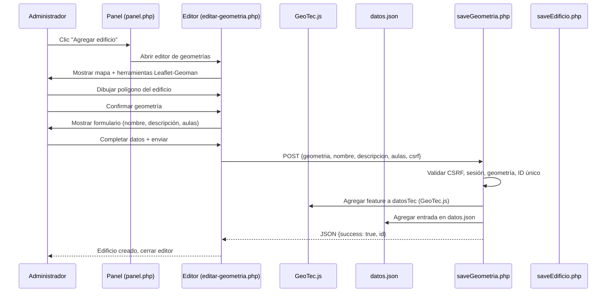
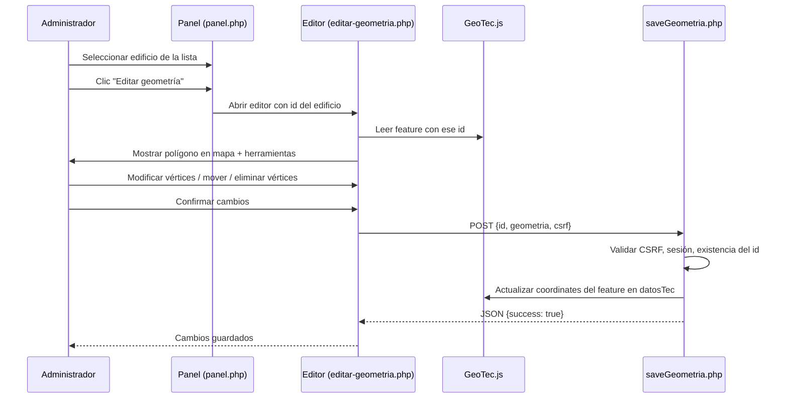

# Plan de Implementación: Módulo de Consulta y Administración de Edificios

**Proyecto:** Mapa Interactivo ITL
**Estado:** Planificación (sin implementar)
**Versión:** 1.0

---

## 1. Diagnóstico del CRUD Existente

### 1.1 Archivos del panel administrativo

| Archivo    | Ruta                             | Función actual                                                                                                          | Estado    |
| ---------- | -------------------------------- | ------------------------------------------------------------------------------------------------------------------------ | --------- |
| Router     | `PHP/public/index.php`         | Rutea `?p=editar                                                                                                         | login     |
| Panel      | `PHP/admin/panel.php`          | Lista edificios de `datos.json`, formulario de edición (nombre, descripción, aulas, imágenes), buscador client-side | Funcional |
| Guardado   | `PHP/admin/saveEdificio.php`   | Crea y edita edificios en `datos.json`, gestiona imágenes, CSRF, auditoría                                           | Funcional |
| Login      | `PHP/admin/login.php`          | Autentica contra `users.json` (AuthService), CSRF, rate limiting                                                       | Funcional |
| Logout     | `PHP/admin/logout.php`         | Destruye sesión, redirige a login                                                                                       | Funcional |
| Imágenes  | `PHP/admin/imagelist.php`      | Lista imágenes de carpeta (POST, autenticado, path traversal protegido)                                                 | Funcional |
| Middleware | `PHP/auth/auth_middleware.php` | `requerirAdmin()` protege rutas                                                                                        | Funcional |

### 1.2 Estructura de datos actual

**`datos.json`** (metadatos):

- Clave: ID del edificio (ej: `"5"`, `"1A"`, `"P6"`)
- Valor: `{ nombre, descripcion, aulas[], imagenes[], carpeta }`

**`GeoTec.js`** (geometrías):

- Variable global `datosTec` (GeoJSON FeatureCollection)
- Cada feature: `{ properties: { id, Nombre }, geometry: { type: "Polygon", coordinates: [...] } }`
- El `id` en `properties` debe coincidir con las claves de `datos.json`

**Relación**: `datos.json[id]` ←→ `GeoTec.js feature.properties.id`

### 1.3 Funcionalidades ya implementadas

| Funcionalidad                        | Estado | Archivo                                                   |
| ------------------------------------ | ------ | --------------------------------------------------------- |
| Listar edificios                     | ✅     | `panel.php`                                             |
| Buscar edificio por nombre/ID/aula   | ✅     | `panel.php` (client-side)                               |
| Editar nombre, descripción, aulas   | ✅     | `panel.php` → `saveEdificio.php`                     |
| Subir/eliminar imágenes de edificio | ✅     | `panel.php` → `saveEdificio.php` / `imagelist.php` |
| Autenticación de administrador      | ✅     | `login.php` → `AuthService` → `users.json`        |
| Autorización de rutas protegidas    | ✅     | `requerirAdmin()` en `index.php` router               |
| Registro de auditoría de cambios    | ✅     | `AuditLogRepository` en `saveEdificio.php`            |

### 1.4 Funcionalidades FALTANTES (críticas)

| Funcionalidad                                      | Estado | Problema                                          |
| -------------------------------------------------- | ------ | ------------------------------------------------- |
| Dibujar geometría de edificio en el mapa          | ❌     | No existe editor de polígonos                    |
| Editar geometría existente                        | ❌     | `GeoTec.js` es estático, no editable desde PHP |
| Agregar edificio con geometría desde el navegador | ❌     | No hay interfaz para definir polígonos           |
| Eliminar edificio (geometría + metadatos)         | ❌     | No hay operación de eliminación                 |
| Ver geometría de edificio desde el panel          | ❌     | El panel solo muestra metadatos, no el polígono  |

---

## 2. Tecnología Seleccionada para el Editor Geométrico

### 2.1 Comparativa de librerías

| Criterio                          | Leaflet-Geoman                   | Leaflet.draw                                              |
| --------------------------------- | -------------------------------- | --------------------------------------------------------- |
| Compatibilidad Leaflet 1.9.4      | ✅ Oficialmente compatible       | ⚠️ Última versión 1.0.4, soporte limitado para L1.9.4 |
| Dibujo de polígonos              | ✅ Nativo                        | ✅ Nativo                                                 |
| Edición de vértices             | ✅ Nativo (markers arrastrables) | ⚠️ Básico, menos flexible                              |
| Movimiento de geometría completa | ✅ Nativo                        | ❌ No incluido                                            |
| Eliminación de vértices         | ✅ Nativo                        | ⚠️ Limitado                                             |
| Snapping / ajuste                 | ✅ Opcional (complemento)        | ❌ No                                                     |
| Mantenimiento                     | ✅ Activamente mantenido         | ⚠️ Mantenimiento limitado                               |
| Dependencias                      | Solo Leaflet                     | Solo Leaflet (pero menos funcional)                       |

### 2.2 Decisión: Leaflet-Geoman

**Justificación:**

1. **Compatibilidad verificada con Leaflet 1.9.4** — la versión del proyecto.
2. **Edición completa de polígonos** — crear, editar vértices, agregar/eliminar vértices, mover geometría completa, todo nativo.
3. **Interfaz intuitiva para no-GIS** — herramientas visuales claras (dibujar, editar, borrar).
4. **Mantenimiento activo** — menor riesgo de obsolescencia que Leaflet.draw.
5. **Una sola dependencia externa** — solo necesita su CSS y JS desde CDN.

---

## 3. Estrategia de Almacenamiento

### 3.1 Decisión: Mantener separación entre geometrías y metadatos

El análisis del código confirma que la arquitectura actual ya separa estas responsabilidades:

- **`GeoTec.js`** → Geometrías (GeoJSON, polígonos)
- **`datos.json`** → Metadatos (nombre, descripción, aulas, imágenes)

**Esta separación se mantiene.** No se migra a una estructura documental unificada ni se crea `geometrias.geojson` separado. Razones:

- Compatibilidad total con el mapa público existente (`index.html` carga `GeoTec.js` + `datos.json`)
- El frontend actual ya espera `datosTec` como variable global
- No se duplica información
- El panel admin solo necesita un mecanismo seguro para escribir en `GeoTec.js`

### 3.2 Flujo de persistencia de geometrías

```
Administrador dibuja en Leaflet-Geoman
        ↓
GeoJSON de la geometría (coordenadas [lng, lat])
        ↓
AJAX POST a PHP (ruta protegida)
        ↓
PHP lee GeoTec.js, inyecta/actualiza el feature con el id del edificio
        ↓
PHP escribe GeoTec.js (archivo .js, no .json)
        ↓
Mapa público recarga y muestra la nueva geometría
```

---

## 4. Arquitectura Propuesta

### 4.1 Capas (reutilizando Repository Pattern existente)

```
┌─────────────────────────────────────────────────────────────┐
│                    CAPA DE PRESENTACIÓN                      │
│  PHP/admin/panel.php (listado + edición)                    │
│  PHP/admin/editar-geometria.php (NUEVO: editor de polígonos) │
└─────────────────────────────────────────────────────────────┘
                              ↓
┌─────────────────────────────────────────────────────────────┐
│                    CAPA DE CONTROLADORES                      │
│  saveEdificio.php (ya existe, se extiende)                   │
│  saveGeometria.php (NUEVO)                                    │
│  deleteEdificio.php (NUEVO)                                   │
└─────────────────────────────────────────────────────────────┘
                              ↓
┌─────────────────────────────────────────────────────────────┐
│                    CAPA DE SERVICIOS                          │
│  BuildingService (NUEVO)                                      │
└─────────────────────────────────────────────────────────────┘
                              ↓
┌─────────────────────────────────────────────────────────────┐
│                  CAPA DE REPOSITORIOS                          │
│  BuildingGeometryRepository (NUEVO) — lee/escribe GeoTec.js  │
│  BuildingRepository (existente) — lee/escribe datos.json      │
└─────────────────────────────────────────────────────────────┘
                              ↓
┌─────────────────────────────────────────────────────────────┐
│                  CAPA DE ALMACENAMIENTO                        │
│  GeoTec.js (geometrías)                                       │
│  datos.json (metadatos)                                       │
└─────────────────────────────────────────────────────────────┘
```

### 4.2 Flujo de creación de edificio (Mermaid)



### 4.3 Flujo de edición de geometría existente (Mermaid)



---

## 5. Validaciones

### 5.1 Validaciones frontend (JavaScript)

| Validación                   | Descripción                                                      |
| ----------------------------- | ----------------------------------------------------------------- |
| Polígono no vacío           | Al menos 3 vértices distintos                                    |
| Polígono cerrado             | El primer y último punto coinciden (Leaflet-Geoman lo maneja)    |
| ID no duplicado               | Verificar que el id no exista en datos.json ni GeoTec.js          |
| Coordenadas dentro del campus | Validar que los puntos estén dentro del bounds del área del ITL |
| Nombre requerido              | Campo nombre no vacío                                            |

### 5.2 Validaciones backend (PHP obligatorio)

| Validación              | Descripción                                           |
| ------------------------ | ------------------------------------------------------ |
| Sesión de admin válida | `requerirAdmin()` en cada ruta protegida             |
| CSRF token               | `validarTokenCSRF()` en POST                         |
| ID único                | Verificar que el id no exista ya en `datos.json`     |
| Geometría válida       | JSON parseable, tipo Polygon, coordinates no vacíos   |
| Coordenadas numéricas   | Cada punto [lng, lat] son números válidos            |
| Área mínima            | El polígono tiene área > 0 (evitar líneas o puntos) |
| Sanitización de ID      | Solo alfanumérico, guion bajo, guion medio            |

### 5.3 División de responsabilidades

- **Frontend**: Experiencia de usuario, validación inmediata, retroalimentación visual
- **Backend**: Autoridad final, seguridad, integridad de datos, persistencia

---

## 6. Seguridad

| Medida                    | Implementación                                                                                                        |
| ------------------------- | ---------------------------------------------------------------------------------------------------------------------- |
| Validación de sesión    | `requerirAdmin()` en `saveGeometria.php`, `deleteEdificio.php`                                                   |
| Protección CSRF          | Token en formularios AJAX, validado con `hash_equals()`                                                              |
| Validación de entrada    | Todos los campos sanitizados en PHP antes de escribir                                                                  |
| Validación de geometría | Estructura GeoJSON verificada antes de inyectar en `GeoTec.js`                                                       |
| Protección de escritura  | Solo POST a rutas protegidas, no archivos estáticos directamente                                                      |
| Registro de auditoría    | `AuditLogRepository` registra `building_created`, `building_updated`, `building_deleted`, `geometry_updated` |
| No confiar en frontend    | Todas las validaciones críticas se repiten en PHP                                                                     |

---

## 7. Archivos Nuevos

| Archivo                  | Ruta                                                | Descripción                                                      |
| ------------------------ | --------------------------------------------------- | ----------------------------------------------------------------- |
| Editor de geometrías    | `PHP/admin/editar-geometria.php`                  | Vista con Leaflet + Leaflet-Geoman para dibujar/editar polígonos |
| Guardado de geometría   | `PHP/public/saveGeometria.php`                    | Endpoint POST para persistir geometrías en `GeoTec.js`         |
| Eliminación de edificio | `PHP/public/deleteEdificio.php`                   | Endpoint POST para eliminar edificio (metadatos + geometría)     |
| Servicio edificios       | `PHP/services/BuildingService.php`                | Lógica de negocio para edificios                                 |
| Repositorio geometrías  | `PHP/repositories/BuildingGeometryRepository.php` | Lectura/escritura de `GeoTec.js`                                |
| CSS editor               | `PHP/public/css/editor.css`                       | Estilos del editor de geometrías                                 |
| JS editor                | `PHP/public/js/editor.js`                         | Lógica de Leaflet-Geoman en el editor                            |

### Recursos externos (CDN, no se instalan)

| Recurso            | URL                                                                           | Propósito                       |
| ------------------ | ----------------------------------------------------------------------------- | -------------------------------- |
| Leaflet-Geoman CSS | `https://unpkg.com/leaflet-geoman@2.13.0/dist/leaflet-geoman.min.css`       | Estilos del editor               |
| Leaflet-Geoman JS  | `https://unpkg.com/leaflet-geoman@2.13.0/dist/leaflet-geoman.min.bundle.js` | Funcionalidad de dibujo/edición |

---

## 8. Archivos Existentes que Requieren Modificaciones

| Archivo                        | Cambios requeridos                                                                            |
| ------------------------------ | --------------------------------------------------------------------------------------------- |
| `PHP/admin/panel.php`        | Agregar botón "Agregar edificio" y "Editar geometría" en la lista; enlace al editor         |
| `PHP/admin/saveEdificio.php` | Ya existe; no requiere cambios para este módulo (maneja metadatos)                           |
| `PHP/public/index.php`       | Agregar rutas `?p=saveGeometria` y `?p=deleteEdificio` protegidas con `requerirAdmin()` |
| `AGENTS.md`                  | Documentar nuevos archivos y rutas del módulo de edificios                                   |

### Archivos NO modificados (por restricción)

- `GeoTec.js` — se lee y escribe vía PHP, no se edita manualmente
- `datos.json` — se lee y escribe vía `saveEdificio.php`, sin cambios de estructura
- `js/main.js` — carga `datosTec` y `datos.json` como ahora

---

## 9. Fases de Implementación

### Fase 1: Infraestructura del editor

| Tarea | Descripción                                              | Dependencias | Resultado esperado                     |
| ----- | --------------------------------------------------------- | ------------ | -------------------------------------- |
| 1.1   | Crear `PHP/repositories/BuildingGeometryRepository.php` | Ninguna      | Clase para leer/escribir `GeoTec.js` |
| 1.2   | Crear `PHP/services/BuildingService.php`                | 1.1          | Lógica de negocio para edificios      |
| 1.3   | Crear `PHP/admin/editar-geometria.php`                  | 1.2          | Vista con mapa + Leaflet-Geoman        |
| 1.4   | Crear `PHP/public/css/editor.css`                       | 1.3          | Estilos del editor                     |
| 1.5   | Crear `PHP/public/js/editor.js`                         | 1.3          | Lógica de dibujo y edición           |

### Fase 2: Endpoints de persistencia

| Tarea | Descripción                               | Dependencias | Resultado esperado                                      |
| ----- | ------------------------------------------ | ------------ | ------------------------------------------------------- |
| 2.1   | Crear `PHP/public/saveGeometria.php`     | 1.1, 1.2     | Guarda geometría en `GeoTec.js`                      |
| 2.2   | Crear `PHP/public/deleteEdificio.php`    | 1.1          | Elimina edificio de `datos.json` y `GeoTec.js`      |
| 2.3   | Agregar rutas en `PHP/public/index.php`  | 2.1, 2.2     | `?p=saveGeometria` y `?p=deleteEdificio` protegidas |
| 2.4   | Agregar botones en `PHP/admin/panel.php` | 2.3          | "Agregar edificio", "Editar geometría", "Eliminar"     |

### Fase 3: Validaciones y seguridad

| Tarea | Descripción                                  | Dependencias | Resultado esperado                                  |
| ----- | --------------------------------------------- | ------------ | --------------------------------------------------- |
| 3.1   | Validaciones frontend en `editor.js`        | 1.5          | Polígono válido, ID único, coordenadas en campus |
| 3.2   | Validaciones backend en `saveGeometria.php` | 2.1          | CSRF, sesión, geometría válida, ID único        |
| 3.3   | Registro de auditoría en todos los endpoints | 2.1, 2.2     | Eventos en `audit-log.jsonl`                      |

### Fase 4: Pruebas y documentación

| Tarea | Descripción                                | Dependencias | Resultado esperado                      |
| ----- | ------------------------------------------- | ------------ | --------------------------------------- |
| 4.1   | Probar creación de edificio con geometría | 2.4, 3.2     | Edificio nuevo aparece en mapa y panel  |
| 4.2   | Probar edición de geometría existente     | 2.4, 3.2     | Polígono modificado se refleja en mapa |
| 4.3   | Probar eliminación de edificio             | 2.2, 3.2     | Edificio eliminado de mapa y panel      |
| 4.4   | Probar acceso sin sesión                   | 2.3          | Redirigido a login                      |
| 4.5   | Actualizar `AGENTS.md`                    | 4.1-4.4      | Documentación completa del módulo     |

---

## 10. Pruebas

| Prueba               | Paso                                                                                      | Resultado esperado                                |
| -------------------- | ----------------------------------------------------------------------------------------- | ------------------------------------------------- |
| Crear edificio       | Abrir panel → "Agregar edificio" → dibujar polígono → completar formulario → guardar | Edificio aparece en lista y mapa con su polígono |
| Editar geometría    | Seleccionar edificio → "Editar geometría" → mover vértice → guardar                  | Polígono actualizado en mapa                     |
| Eliminar edificio    | Seleccionar edificio → "Eliminar" → confirmar                                           | Edificio removido de lista y mapa                 |
| Acceso sin sesión   | Ir a `?p=editar` sin login                                                              | Redirigir a login                                 |
| Geometría inválida | Intentar guardar polígono con 2 puntos                                                   | Error de validación                              |
| ID duplicado         | Crear edificio con ID existente                                                           | Error "ID ya existe"                              |
| Mapa público        | Recargar `index.html`                                                                   | Nuevas geometrías se muestran correctamente      |

---

## 11. Criterios de Aceptación

- [X] Un administrador puede consultar los edificios existentes desde el panel
- [X] Un administrador puede buscar un edificio por nombre o ID
- [X] Un administrador puede crear un edificio dibujando su geometría en el mapa (sin QGIS)
- [X] Un administrador puede modificar la geometría de un edificio existente
- [X] Un administrador puede modificar los metadatos del edificio (nombre, descripción, aulas)
- [X] El sistema valida que la geometría sea un polígono válido
- [X] El sistema valida que el ID no esté duplicado
- [X] Los cambios persisten en `GeoTec.js` y `datos.json` después de recargar
- [X] El mapa público (`index.html`) representa correctamente las nuevas geometrías
- [X] Un usuario sin permisos no puede acceder a operaciones administrativas
- [X] Todas las operaciones de escritura tienen protección CSRF
- [X] Las funcionalidades existentes (lista, búsqueda, imágenes) continúan funcionando

---

## 12. Riesgos y Dependencias

| Riesgo                                         | Impacto | Probabilidad | Mitigación                                                          |
| ---------------------------------------------- | ------- | ------------ | -------------------------------------------------------------------- |
| Leaflet-Geoman no compatible con Leaflet 1.9.4 | Alto    | Baja         | La versión 2.13.0 declara soporte para L1.9.x; verificar en pruebas |
| Escritura concurrente a `GeoTec.js`          | Medio   | Baja         | `flock()` + reemplazo atómico en `BaseRepository`               |
| Corrupción de `GeoTec.js` al escribir       | Medio   | Baja         | Validar JSON antes de escribir; respaldo manual antes de cambios     |
| ID duplicado entre geometría y metadatos      | Bajo    | Media        | Validación en backend antes de escribir                             |

### Decisiones que requieren aprobación

1. **Leaflet-Geoman vs Leaflet.draw**: Se selecciona Leaflet-Geoman por mejor soporte de edición de polígonos y compatibilidad con L1.9.4.
2. **Mantener separación GeoTec.js / datos.json**: Se confirma que esta separación encaja con la arquitectura actual; no se unifica.
3. **GeoTec.js como archivo .js no .json**: Se escribe como archivo JS (variable global `datosTec`) para mantener compatibilidad con el mapa público.
4. **Eliminación de edificio**: Se elimina tanto de `datos.json` como de `GeoTec.js` en una sola operación atómica.

---

## 13. Resultado Entregable (este documento)

1. ✅ Diagnóstico del CRUD actual (sección 1)
2. ✅ Funcionalidades existentes y faltantes (sección 1.3, 1.4)
3. ✅ Tecnología recomendada para dibujar geometrías: Leaflet-Geoman (sección 2)
4. ✅ Arquitectura propuesta (sección 4)
5. ✅ Estrategia de almacenamiento: separación GeoTec.js / datos.json (sección 3)
6. ✅ Flujo de trabajo del administrador (sección 4.2, 4.3)
7. ✅ Plan de implementación en 4 fases (sección 9)
8. ✅ Criterios de aceptación (sección 11)
9. ✅ Documento Markdown generado: `docs/plans/PLAN_MODULO_ADMINISTRACION_EDIFICIOS.md`
10. ✅ Decisiones que requieren aprobación (sección 12)

**IMPORTANTE:** No se ha modificado ningún archivo PHP, JavaScript ni de configuración. Este es únicamente un plan de implementación para revisión y aprobación antes de comenzar el desarrollo.
