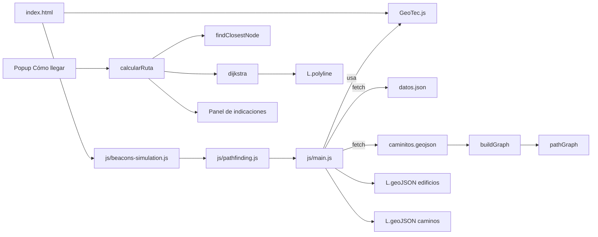
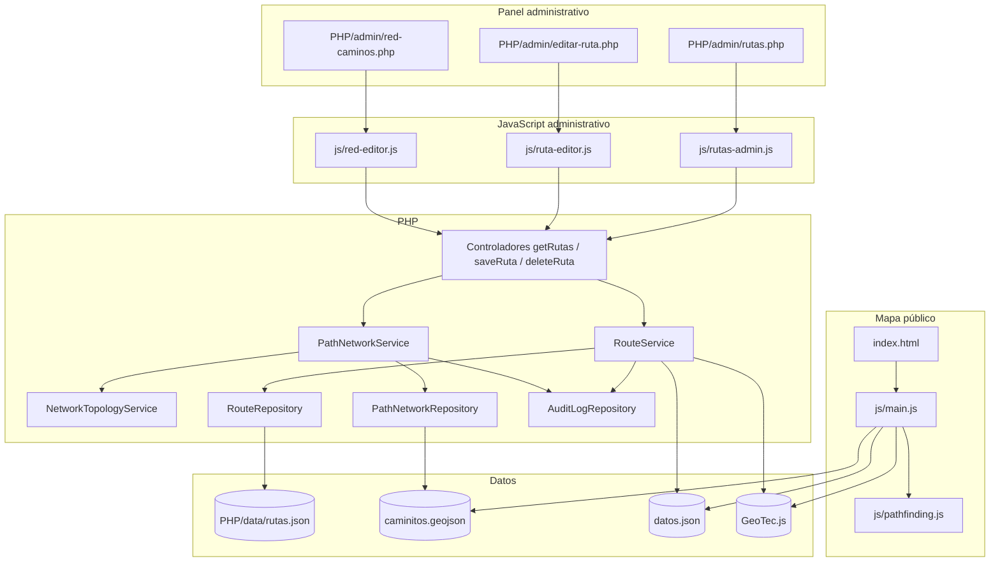
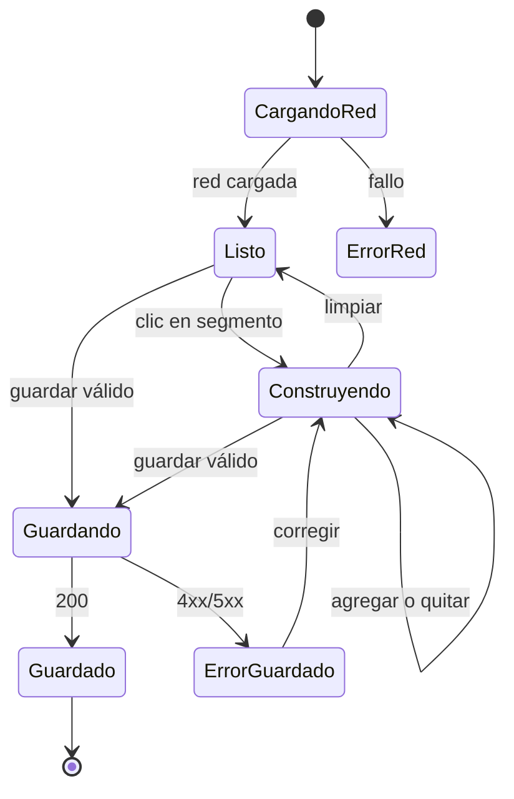
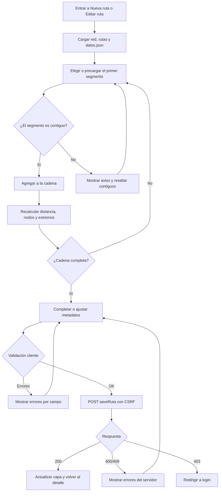
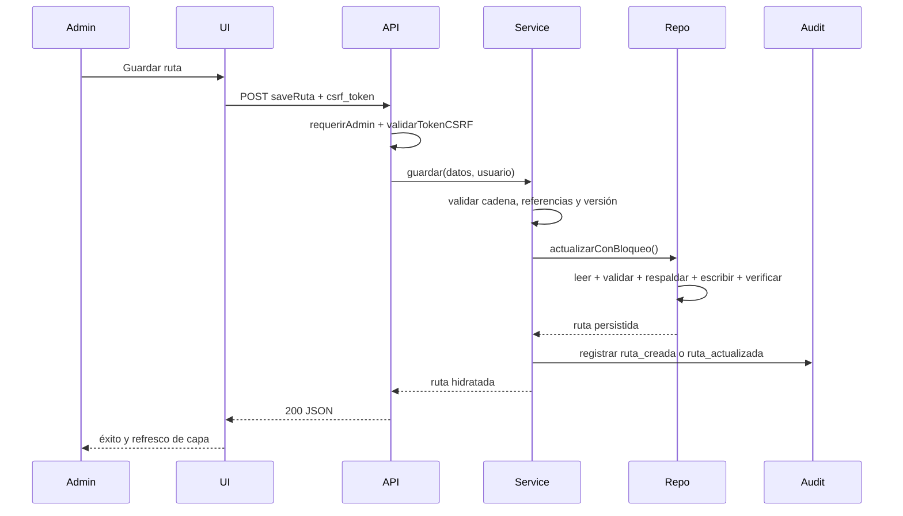
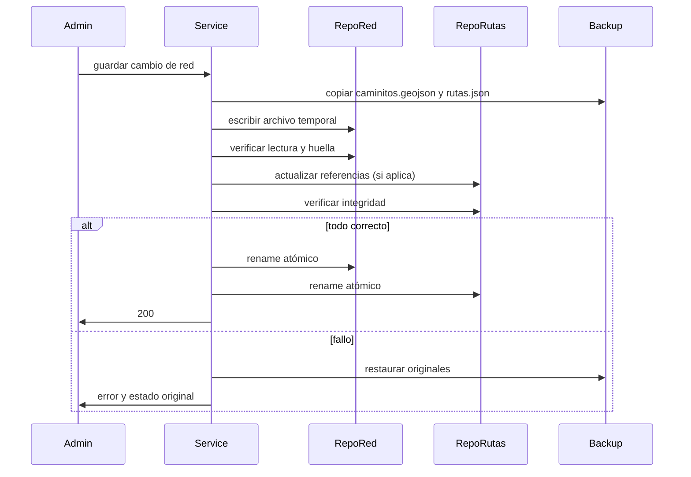
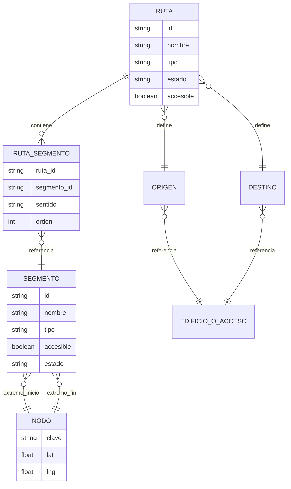
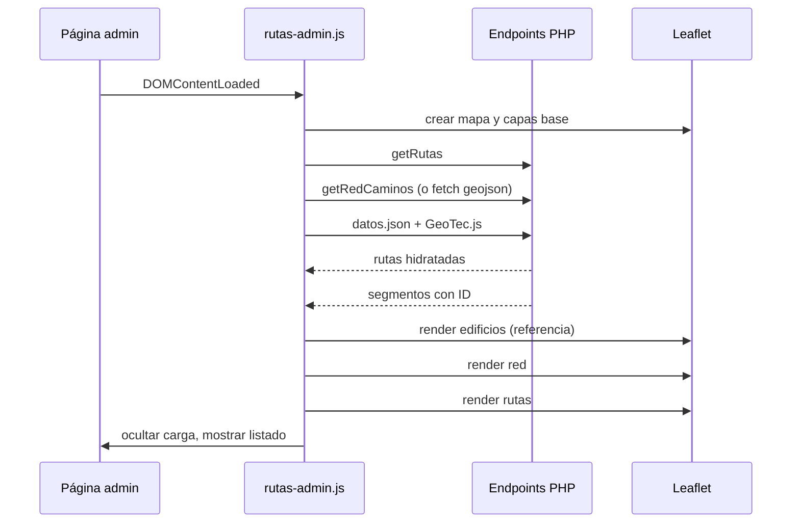

# PLAN DE IMPLEMENTACIÓN — MÓDULO DE VISUALIZACIÓN Y GESTIÓN DE RUTAS

> **Documento histórico.** Describe el estado previo a la reestructuración: las rutas `PHP/…`, `index.html` en la raíz y los endpoints sueltos ya no existen. Para la estructura y las rutas vigentes, ver `AGENTS.md` y `docs/plans/PLAN_REESTRUCTURACION_PROYECTO.md`.

> **Estado:** planificación. **No implementado.**
> **Fecha:** 2026-11-14
> **Proyecto:** Mapa Interactivo ITL — TecNM Campus Laguna
> **Rama de referencia:** `RaMaik`
> **Análisis base:** `docs/analysis/HALLAZGOS_MODULO_RUTAS.md`
> **Alcance:** visualización, creación, edición y eliminación de rutas administrativas sobre el mapa, respetando la arquitectura JSON existente.
> **Restricción:** este documento no autoriza cambios de código, datos, dependencias ni configuración. Cada etapa requiere aprobación.

---

## 1. Resumen ejecutivo

### 1.1. Situación

El mapa público ya calcula recorridos peatonales con Dijkstra, pero **no existe un módulo de rutas administrativas**. Lo que hay es un cálculo efímero: el usuario elige una puerta y un edificio, se dibuja una polilínea y se muestra la distancia. Al limpiar el recorrido, no queda nada.

La red de caminos es un único `MultiLineString` de 235 partes y 603 vértices, sin IDs de segmento ni metadatos. El grafo se construye al vuelo y tiene 238 nodos, 309 aristas y una sola componente conexa. Las 348 combinaciones puerta→edificio son alcanzables.

Un hallazgo decisivo: **la red no es conexa por extremos**. Si solo se consideran extremos exactos, hay **31 componentes**; la conectividad actual depende de proyecciones interiores y del snapping de 2,5 m. Por eso la migración propuesta no es solo de formato: incluye una **normalización topológica** que produce **314 features**, 646 vértices, 238 nodos, 309 aristas y 1 componente, preservando la huella del grafo.

### 1.2. Decisión arquitectónica principal

Separar dos conceptos que hoy están mezclados:

| Concepto | Naturaleza | Persistencia |
|---|---|---|
| **Red de caminos** | Geometría + grafo para Dijkstra | `caminitos.geojson` (raíz) |
| **Ruta administrativa** | Entidad nombrada y descriptiva | `PHP/data/rutas.json` (nuevo) |

Una ruta administrativa **no duplica geometría**: referencia una secuencia ordenada y orientada de segmentos de la red. Así:

- varias rutas pueden compartir segmentos;
- eliminar una ruta no altera la red ni otras rutas;
- editar la red se refleja automáticamente en todas las rutas;
- la integridad se valida por referencias, no por copias.

### 1.3. Qué se reutiliza

- Autenticación, sesión, CSRF y auditoría existentes.
- `BaseRepository` para persistencia JSON (con correcciones locales en el repositorio de rutas).
- Patrón de `BuildingService` y `BuildingGeometryRepository`.
- Patrón visual y de interacción del panel y del editor de geometrías.
- Leaflet 1.9.4 y Leaflet-Geoman vendorizado.
- `buildGraph()`, `findClosestNode()`, `dijkstra()`, `calcularDistanciaRuta()`, `distanciaMetros()`.
- `datos.json` y `GeoTec.js` como fuente de edificios y accesos.

### 1.4. Qué es nuevo

- Entidad y persistencia de rutas.
- Segmentos de red con ID estable (migración controlada de `caminitos.geojson`).
- Vistas administrativas de listado, detalle, alta y edición.
- Validación de cadenas de segmentos en cliente y servidor.
- Validación de conectividad y referencias.
- Endpoints protegidos y auditoría de rutas.
- Pruebas reproducibles (sin framework).

### 1.5. Alcance recomendado

| Fase | Incluido | Prioridad |
|---|---|---|
| MVP | Rutas: listar, ver, crear, editar, eliminar, visualizar y filtrar | Obligatoria |
| Fase 2 | Metadatos de red (tipo, accesibilidad, estado) y validaciones topológicas avanzadas | Recomendada |
| Fase 3 | Edición gráfica de la red (segmentos, división de intersecciones) | Opcional, aprobación aparte |
| Fase 4 | Publicación de rutas en el mapa público | Opcional, aprobación aparte |

**Complejidad relativa global:** media-alta. La mayor complejidad no está en Dijkstra, sino en la integridad referencial y en la migración del formato de red sin romper el mapa público.

---

## 2. Diagnóstico del sistema actual

### 2.1. Arquitectura actual del mapa público



> Diagrama **del estado actual**, no de la propuesta.

### 2.2. Datos y métricas verificadas

| Elemento | Valor actual |
|---|---|
| Features en `caminitos.geojson` | 1 (`MultiLineString`) |
| Partes de la red | 235 |
| Vértices | 603 |
| Propiedades por camino | solo `id: null` |
| Nodos del grafo | 238 |
| Aristas únicas | 309 |
| Componentes conexas (grafo) | 1 |
| Componentes por extremos exactos | **31** |
| Pares de partes con conexión interior ≤2,5 m | **149** |
| Partes que se dividen al normalizar | **69** |
| Features tras normalización | **314** |
| Vértices tras normalización | **646** |
| Nodos de grado 1 | 19 |
| Rutas puerta→edificio alcanzables | 348/348 |
| Registros en `datos.json` | 58 |
| Features en `GeoTec.js` | 58 |
| Accesos P1–P6 | `tipo: "acceso"` en `datos.json` |

### 2.3. Cómo se calcula un recorrido hoy

1. `iniciarRuta(destId)` obtiene origen desde la puerta seleccionada o la ubicación del usuario (`js/main.js:388-431`).
2. `calcularRuta()` obtiene el centro del edificio destino (`js/main.js:445`).
3. `findClosestNode()` enlaza origen y destino al nodo más cercano (`js/main.js:449-450`).
4. `dijkstra()` devuelve la secuencia de nodos (`js/main.js:458`).
5. Se antepone el origen exacto y se añade el destino exacto (`js/main.js:466-467`).
6. Se dibuja una `L.polyline` y se muestra un panel con la distancia (`js/main.js:473-536`).
7. `limpiarRuta()` elimina la capa (`js/main.js:538-561`).

### 2.4. Limitaciones que condicionan el diseño

| Limitación | Consecuencia para el módulo |
|---|---|
| Red sin IDs de segmento | Las rutas no pueden referenciar segmentos sin una migración de formato. |
| Nodos derivados de coordenadas | No se deben persistir nodos; se derivan de los segmentos. |
| Dijkstra no dirigido y sin pesos variables | El MVP no puede ofrecer rutas accesibles o restringidas. |
| `findClosestNode` sin umbral | Hay que validar la distancia de enlace y advertir. |
| Sin detección de intersecciones | El MVP solo conecta por extremos; la división de segmentos queda para fase posterior. |
| Grafo construido una vez | El editor debe reconstruir el grafo tras cambios de red. |
| `BaseRepository` falla abierto | El repositorio de rutas debe sobrescribir `leer()` y fallar cerrado. |
| Sin roles granulares | El MVP usa `requerirAdmin()`; permisos finos requieren aprobación. |
| Sin pruebas | Hay que añadir scripts reproducibles de regresión. |

### 2.5. Conclusión del diagnóstico

No hay que reconstruir el mapa, el grafo ni Dijkstra. Hay que construir **la capa de gestión** y **dar identidad estable a los segmentos de red**. El resto es reutilización.

---

## 3. Inventario de funcionalidades implementadas

| # | Funcionalidad | Archivos / funciones | Evidencia | Reutilizable |
|---|---|---|---|---|
| 1 | Render de edificios y accesos | `js/main.js:76-117`, `GeoTec.js` | `L.geoJSON(datosTec)` con tooltip y etiqueta de ID | Sí, como capa de referencia |
| 2 | Metadatos de edificios | `datos.json`, `js/main.js:66-73` | 58 registros, `tipo` edificio/acceso | Sí, para origen/destino |
| 3 | Popup de edificio | `js/main.js:318-380` | Nombre, descripción, aulas, imágenes | Parcial (XSS a corregir) |
| 4 | Carga de la red | `js/main.js:120-137` | `fetch('caminitos.geojson')` + `L.geoJSON` | Sí |
| 5 | Construcción del grafo | `js/pathfinding.js:55-143` | 238 nodos, 309 aristas, 1 componente | Sí, con extensión aditiva |
| 6 | Búsqueda de nodo más cercano | `js/pathfinding.js:146-159` | Distancia mínima sobre todo el grafo | Sí, añadir umbral |
| 7 | Dijkstra | `js/pathfinding.js:162-208` | Ruta más corta no dirigida | Sí, sin cambios para MVP |
| 8 | Distancia de ruta | `js/pathfinding.js:211-219` | Suma Haversine | Sí |
| 9 | Selección de puerta | `js/main.js:607-661` | `#doors-select`, fallbacks P1–P6 | Sí, para origen |
| 10 | Panel de indicaciones | `js/main.js:513-536` | Origen, destino, distancia | Sí, como base del detalle |
| 11 | Limpiar recorrido | `js/main.js:538-561` | Elimina capa y estado | Sí, adaptar a rutas |
| 12 | Login | `PHP/admin/login.php`, `AuthService.php` | `password_verify`, `session_regenerate_id` | Sí |
| 13 | Middleware de sesión | `PHP/auth/auth_middleware.php` | `requerirAdmin()` | Sí |
| 14 | CSRF | `PHP/auth/csrf.php` | `generarTokenCSRF`, `validarTokenCSRF` | Sí |
| 15 | Rate limiting | `PHP/auth/rate_limit.php` | Intentos de login por sesión | Sí (opcional para rutas) |
| 16 | Persistencia JSON | `PHP/repositories/BaseRepository.php` | `flock` + temporal + `rename` | Sí, con extensión |
| 17 | CRUD de edificios | `BuildingService.php`, `saveGeometria.php` | Crear/actualizar/eliminar con rollback | Sí, como patrón |
| 18 | Editor de geometrías | `PHP/admin/editar-geometria.php`, `js/editor.js` | Leaflet + Geoman + capa de referencia | Sí, como patrón |
| 19 | Panel y buscador | `PHP/admin/panel.php` | Listado, búsqueda, acciones | Sí, como patrón |
| 20 | Auditoría | `AuditLogRepository.php` | JSONL con `flock` | Sí |
| 21 | Rutas protegidas | `index.php:13-43` | `requerirAdmin()` por ruta | Sí, ampliar |

---

## 4. Funcionalidades parcialmente implementadas

| Funcionalidad | Estado actual | Brecha | Decisión |
|---|---|---|---|
| Visualización de rutas | Polilínea efímera de un cálculo | No hay ruta persistente, listado ni resaltado | Crear capa de rutas y selección |
| Consulta de una ruta | Panel con origen/destino/distancia | No hay detalle, segmentos ni edificios vinculados | Añadir vista de detalle |
| Origen/destino | Puertas y edificios | No hay nodos ni coordenadas libres | Mantener puertas/edificios en MVP |
| Red de caminos | Geometría completa | Sin IDs ni metadatos por segmento | Migrar a features con ID |
| Persistencia | Repositorio genérico | Sin repositorio de rutas ni fail-closed | Crear `RouteRepository` |
| Auditoría | Eventos de edificios | Sin eventos de rutas | Instrumentar CRUD |
| Búsqueda | Edificios y aulas | Sin búsqueda de rutas | Filtro client-side |
| Autorización | Rol administrador | Sin Master/Operador | MVP con admin; roles a decisión |
| Conectividad | Grafo conexo de hecho | Sin validación explícita | Añadir BFS de componentes |

---

## 5. Funcionalidades inexistentes

| # | Funcionalidad | Etapa propuesta |
|---|---|---|
| 1 | Entidad `ruta` y su esquema | 2 |
| 2 | `RouteRepository` | 2 |
| 3 | `RouteService` | 3 |
| 4 | IDs estables de segmento | 2 |
| 5 | Listado de rutas | 1 |
| 6 | Detalle de ruta | 1 |
| 7 | Alta de ruta | 1, 3, 4 |
| 8 | Edición de ruta | 1, 3, 4 |
| 9 | Eliminación de ruta | 1, 3, 4 |
| 10 | Validación de cadena de segmentos | 3 |
| 11 | Validación de referencias a edificios/accesos | 3 |
| 12 | Validación de conectividad | 3 |
| 13 | Capa Leaflet de rutas y selección | 4 |
| 14 | Endpoints `getRutas`, `saveRuta`, `deleteRuta` | 3 |
| 15 | Auditoría de rutas | 3 |
| 16 | CRUD de segmentos de red | 6 (opcional) |
| 17 | División de segmentos en intersecciones | 6 (opcional) |
| 18 | Publicación pública de rutas | 7 (opcional) |
| 19 | Pruebas y huella del grafo | 5 |

---

## 6. Arquitectura actual relacionada con rutas

### 6.1. Componentes y responsabilidades actuales

| Capa | Componente | Responsabilidad |
|---|---|---|
| Vista pública | `index.html`, `js/main.js` | Mapa, edificios, puertas, cálculo y dibujo de recorrido |
| Algoritmos | `js/pathfinding.js` | Grafo, snapping, Dijkstra, distancia |
| Simulación | `js/beacons-simulation.js` | `Beacon`, `distanciaMetros`, ubicación simulada |
| Vista admin | `PHP/admin/panel.php`, `editar-geometria.php` | CRUD de edificios y editor de geometrías |
| Router | `index.php` | Despacho de rutas administrativas y públicas |
| Auth | `PHP/auth/*` | Sesión, CSRF, rate limiting |
| Servicios | `PHP/services/*` | Reglas de negocio |
| Repositorios | `PHP/repositories/*` | Persistencia JSON |
| Datos | `datos.json`, `GeoTec.js`, `caminitos.geojson` | Metadatos, geometrías, red |
| Datos privados | `PHP/data/*` | Usuarios, settings, auditoría, sugerencias |

### 6.2. Separación propuesta



> Diagrama **propuesto**. El mapa público no cambia en el MVP; solo cambia el formato interno de `caminitos.geojson`, que `main.js` ya sabe consumir.

### 6.3. Principios de diseño

1. **Una sola fuente de verdad por dato.**
   - Geometría de red: `caminitos.geojson`.
   - Metadatos de edificios: `datos.json`.
   - Geometría de edificios: `GeoTec.js`.
   - Rutas: `PHP/data/rutas.json`.
2. **Las rutas referencian, no copian.**
3. **El servidor es la autoridad.** El cliente valida para UX; el backend revalida todo.
4. **El módulo no modifica la red en el MVP.** La red es de solo lectura para el editor de rutas.
5. **Los datos derivados no se persisten** (nodos, distancia, geometría de la ruta).
6. **Ninguna operación deja el sistema inconsistente.** Respaldo + verificación + rollback.
7. **La red se normaliza una vez** para que la conectividad sea explícita por extremos compartidos y no dependa del snapping implícito.

---

## 7. Diseño funcional de ventanas e interfaces

### 7.1. Mapa de vistas

| Vista | Ruta propuesta | Objetivo | Fase |
|---|---|---|---|
| Gestión de rutas | `index.php?p=rutas` | Listar, buscar, seleccionar y previsualizar rutas | MVP |
| Detalle de ruta | `index.php?p=rutas&accion=ver&id=<id>` o panel lateral | Consultar metadatos, segmentos y edificios | MVP |
| Nueva ruta | `index.php?p=rutas&accion=nueva` | Crear una ruta encadenando segmentos | MVP |
| Editar ruta | `index.php?p=rutas&accion=editar&id=<id>` | Modificar trazado y metadatos | MVP |
| Eliminar ruta | Modal en la vista principal | Confirmar borrado seguro | MVP |
| Red de caminos | `index.php?p=red-caminos` | Consultar y editar segmentos | Fase 6 |
| Editor de segmento | `index.php?p=red-caminos&accion=editar&id=<seg>` | Dibujar/editar un segmento | Fase 6 |

Se propone **una sección independiente** dentro del panel, no incrustar todo en `panel.php`. Motivo: el mapa de edificios ya es denso y el editor de rutas necesita mapa grande, estados propios y capas interactivas. `panel.php` solo añade un botón de navegación.

### 7.2. Ventana principal — Gestión de rutas

**Objetivo:** que el administrador encuentre, compare y seleccione rutas sin salir del mapa.

**Distribución:**

```
┌──────────────────────────────────────────────────────────────────────┐
│ Encabezado: Rutas del campus        [← Panel] [➕ Nueva ruta]        │
├──────────────────────────────┬───────────────────────────────────────┤
│ Buscador y filtros           │                                       │
│ [Buscar ruta...]             │                                       │
│ Tipo: [Todas ▾]              │          MAPA LEAFLET                 │
│ Estado: [Todas ▾]            │   edificios (referencia, no clic)     │
│ Accesible: [ ]               │   red de caminos (gris)               │
│                              │   ruta seleccionada (azul)            │
│ ┌──────────────────────────┐ │   marcadores inicio/fin               │
│ │ Ruta P1 → Edificio 5     │ │                                       │
│ │ principal · activa       │ │                                       │
│ │ 412 m · 18 segmentos     │ │                                       │
│ │ [Ver] [Editar] [Eliminar]│ │                                       │
│ └──────────────────────────┘ │                                       │
│ ┌──────────────────────────┐ │                                       │
│ │ Ruta P2 → Biblioteca     │ │                                       │
│ │ ...                      │ │                                       │
│ └──────────────────────────┘ │                                       │
│ (vacío / cargando / error)   │                                       │
└──────────────────────────────┴───────────────────────────────────────┘
```

| Atributo | Definición |
|---|---|
| **Información mostrada** | Nombre, origen→destino, tipo, estado, distancia de red, número de segmentos, accesibilidad. |
| **Controles** | Buscador, filtros, lista, botones Ver/Editar/Eliminar, botón Nueva ruta, selector de capas (red, otras rutas). |
| **Acciones** | Seleccionar ruta (clic en tarjeta o en la línea), ver detalle, editar, eliminar, crear. |
| **Relación con el mapa** | Al seleccionar, resalta la ruta, ajusta `fitBounds` y muestra marcadores. Las demás rutas se atenúan. |
| **Datos consultados** | `getRutas` (lista hidratada), `datos.json` (nombres de edificios/accesos), `caminitos.geojson`. |
| **Datos modificados** | Ninguno en esta vista. |
| **Estados** | Cargando, listo, vacío, error de carga, seleccionado, filtro sin resultados. |
| **Validaciones** | Ninguna de escritura; validar que la ruta seleccionada existe antes de editar/eliminar. |
| **Relación con otras vistas** | Abre detalle, editor y modal de eliminación. |

**Comportamiento del mapa:**

- Edificios: capa de referencia `interactive: false` (no clicables).
- Red: línea gris fina, no editable.
- Rutas no seleccionadas: opacidad baja (0,25).
- Ruta seleccionada: azul, grosor 6, animación de guiones, `bringToFront()`.
- Marcadores: inicio verde y fin rojo (recuperar el marcador de fin hoy comentado en `main.js:495-501`).
- Sin Geoman. Sin dibujo. Sin edición de geometría.

### 7.3. Ventana / panel de detalle de ruta

Puede ser un panel lateral o una vista `accion=ver`. Se recomienda **panel lateral** para no perder el contexto del mapa.

| Atributo | Definición |
|---|---|
| **Objetivo** | Consultar toda la información de una ruta y sus relaciones. |
| **Información** | Nombre, descripción, tipo, estado, accesibilidad, origen, destino, distancia de red, nodos, segmentos ordenados (ID, nombre, tipo, longitud, sentido), edificios vinculados, fechas y autor. |
| **Controles** | Cerrar, Editar, Eliminar, copiar ID, centrar en mapa, recorrer segmentos (hover resalta el segmento). |
| **Acciones** | Seleccionar un segmento y resaltarlo; saltar al editor. |
| **Relación con el mapa** | Muestra la ruta completa; al hacer hover en un segmento, lo resalta y muestra su longitud. |
| **Datos consultados** | `getRutas?id=<id>`, red, `datos.json`. |
| **Datos modificados** | Ninguno. |
| **Estados** | Cargando, listo, ruta no encontrada, error. |
| **Validaciones** | ID válido y existente. |
| **Relación** | Puente entre listado y edición. |

### 7.4. Ventana de creación de ruta

**Objetivo:** construir una ruta válida sin conocimientos de GeoJSON.

**Distribución:** mapa a la izquierda (70 %), formulario a la derecha (380 px).

**Modo principal: encadenar segmentos existentes.**

1. El administrador hace clic en un segmento de la red.
2. El segmento se marca como "1" y se resaltan los segmentos contiguos (los que comparten un extremo).
3. Cada clic posterior añade el segmento al final de la cadena.
4. Un clic sobre el último segmento lo quita (deshacer).
5. Los segmentos no contiguos se atenúan y no son clicables.
6. La ruta se dibuja en vivo y se calculan distancia y número de nodos.
7. El formulario se completa con nombre, descripción, tipo, estado, accesibilidad y origen/destino.
8. El origen y el destino se autocompletan con el edificio o acceso más cercano a los extremos de la cadena; el administrador puede cambiarlos.
9. Guardar solo se habilita si la cadena es válida.

| Atributo | Definición |
|---|---|
| **Información mostrada** | Cadena actual, orden, distancia, nodos, extremos, avisos de validación. |
| **Controles** | Deshacer, invertir cadena, limpiar, zoom a la cadena, guardar, cancelar. |
| **Acciones** | Seleccionar segmentos, reordenar (invertir), completar metadatos, guardar. |
| **Relación con el mapa** | Segmentos clicables solo en modo construcción; edificios no clicables; sin Geoman. |
| **Datos consultados** | `getRedCaminos` (o `caminitos.geojson`), `datos.json`. |
| **Datos modificados** | `rutas.json` vía `saveRuta`. |
| **Estados** | Cargando red, listo, construyendo, guardando, error, cambios sin guardar. |
| **Validaciones** | Nombre obligatorio; cadena ≥1 segmento; continuidad; sin duplicados; origen/destino existentes; longitud máxima. |
| **Relación** | Vuelve al listado o al detalle tras guardar. |

**Formulario:**

| Campo | Tipo | Obligatorio | Regla |
|---|---|---|---|
| `nombre` | texto | Sí | 3–80 caracteres, único (case-insensitive) |
| `descripcion` | textarea | No | ≤500 caracteres |
| `tipo` | select | Sí | `principal`, `alterna`, `acceso`, `emergencia`, `institucional` |
| `estado` | select | Sí | `activa`, `inactiva`, `borrador` |
| `accesible` | checkbox | No | Booleano; por defecto `true` |
| `origen.tipo` | select | Sí | `acceso`, `edificio`, `nodo` |
| `origen.ref` | select/texto | Sí | Debe existir en `datos.json` o en la red |
| `destino.tipo` | select | Sí | Igual que origen |
| `destino.ref` | select/texto | Sí | Igual que origen |
| `segmentos` | oculto | Sí | JSON de `[{id, sentido}]` |

**Estados de interacción:**



**Flujo de creación y edición:**



### 7.5. Ventana de edición de ruta

Reutiliza la vista de creación con `accion=editar&id=<id>`.

| Atributo | Definición |
|---|---|
| **Objetivo** | Modificar trazado y metadatos sin romper referencias. |
| **Información** | La misma que creación, precargada. |
| **Controles** | Los mismos + "Revertir cambios". |
| **Acciones** | Extender, recortar, invertir, cambiar metadatos, guardar. |
| **Relación con el mapa** | Carga la cadena existente orientada; permite editar desde los extremos. |
| **Datos consultados** | `getRutas?id=<id>`, red, `datos.json`. |
| **Datos modificados** | `rutas.json` vía `saveRuta`. |
| **Estados** | Cargando, listo, modificado, guardando, error, conflicto de versión. |
| **Validaciones** | Las mismas + `updated_at` para detectar conflicto. |
| **Relación** | Vuelve al detalle o al listado. |

**Reglas de edición del trazado:**

- Se puede quitar el último segmento o el primero.
- Se puede extender por cualquiera de los dos extremos.
- "Invertir" cambia el orden y el sentido de cada referencia.
- No se permite dejar una cadena discontinua.
- No se permite duplicar un segmento en la misma ruta (MVP).
- Si la ruta está referenciada por otra entidad futura, se avisa (hoy no existe).

### 7.6. Confirmación de eliminación

**Modal:**

```
┌─────────────────────────────────────────────┐
│ Eliminar ruta                               │
│                                             │
│ ¿Eliminar "Acceso norte al Edificio 5"?     │
│                                             │
│ Se eliminará únicamente la definición de    │
│ la ruta. Los caminos de la red y otras      │
│ rutas que los compartan NO se modificarán.  │
│                                             │
│ [Cancelar]                 [Eliminar ruta]  │
└─────────────────────────────────────────────┘
```

| Atributo | Definición |
|---|---|
| **Objetivo** | Evitar borrados accidentales y explicar el alcance. |
| **Información** | Nombre, origen→destino, número de segmentos. |
| **Controles** | Cancelar, Eliminar. |
| **Acciones** | POST a `deleteRuta` con CSRF. |
| **Relación con el mapa** | La ruta se atenúa mientras el modal está abierto; al confirmar, se elimina la capa. |
| **Datos modificados** | `rutas.json`. |
| **Estados** | Confirmación, eliminando, error. |
| **Validaciones** | ID existente; CSRF; sesión. |
| **Relación** | Vuelve al listado. |

**Semántica:** borrado **físico** de la ruta (no de la red).

- No se eliminan nodos: son derivados y compartidos.
- No se eliminan segmentos: pueden estar en uso por otras rutas.
- No se modifican otras rutas que compartan segmentos.
- Dijkstra no se ve afectado: el cálculo de recorridos usa la red, no las rutas administrativas.
- No hay referencias entrantes que actualizar en el MVP (las rutas no son referenciadas por otros documentos).

Si se aprueba borrado lógico, se añade `eliminada_en` y un filtro "papelera"; no se recomienda para el MVP.

### 7.7. Herramientas de selección y edición sobre el mapa

| Modo | Capa edificios | Capa red | Capa rutas | Geoman | Clic en segmento |
|---|---|---|---|---|---|
| Listado | Referencia, no clic | Visible, no clic | Visible | No | Selecciona ruta si está en modo selección |
| Detalle | Referencia | Visible, no clic | Ruta resaltada | No | Resalta segmento en el panel |
| Crear | Referencia | **Clicable** | Otras atenuadas | No | Añade/quita de la cadena |
| Editar | Referencia | **Clicable** | Ruta actual | No | Añade/quita de la cadena |
| Red (fase 6) | Referencia | **Editable** | Otras atenuadas | Sí | Selecciona segmento |

**Prevención de modificaciones accidentales:**

- Edificios siempre `interactive: false` en el módulo de rutas.
- Geoman deshabilitado salvo en el editor de red (fase 6).
- `beforeunload` si hay cambios sin guardar.
- Confirmación al salir de una cadena a medio construir.
- Sin doble clic para cerrar cadenas (evita clics accidentales).

### 7.8. Ventana de gestión de la red (fase 6, opcional)

No forma parte del MVP. Se documenta para no confundirla con la gestión de rutas.

| Atributo | Definición |
|---|---|
| **Objetivo** | Crear, editar y eliminar segmentos de la red. |
| **Información** | Listado de segmentos con ID, nombre, tipo, longitud, estado, rutas que lo usan. |
| **Controles** | Dibujar, editar vértices, dividir, eliminar, guardar. |
| **Relación con el mapa** | Red editable con Geoman; edificios de referencia. |
| **Datos modificados** | `caminitos.geojson`. |
| **Validaciones** | Extremos válidos, sin duplicados, conectividad, rutas afectadas. |
| **Riesgo** | Alto: puede romper rutas y el mapa público. Requiere aprobación y pruebas específicas. |

---

## 8. Propuesta de estructuras JSON

### 8.1. Auditoría de estructuras actuales

| Archivo | Formato | Clave | Uso | ¿Reutilizable? |
|---|---|---|---|---|
| `datos.json` | Objeto `id → metadatos` | `id` | Edificios y accesos | Sí, para origen/destino |
| `GeoTec.js` | JS `var datosTec = FeatureCollection` | `properties.id` | Geometrías de edificios | Sí, referencia visual |
| `caminitos.geojson` | `FeatureCollection` | sin clave | Red de caminos | Sí, con migración |
| `PHP/data/users.json` | Objeto | `id` | Usuarios | Sí, auth |
| `PHP/data/settings.json` | Objeto clave-valor | clave | Configuración | Sí, parámetros del módulo |
| `PHP/data/audit-log.jsonl` | JSONL | secuencial | Auditoría | Sí |
| `PHP/data/suggestions.json` | Objeto | `id` | Sugerencias | No relacionado |
| `PHP/data/rutas.json` | **nuevo** | `id` | Rutas administrativas | — |

### 8.2. Decisión sobre `caminitos.geojson`

**Se conserva como fuente de verdad de la red**, pero se propone **normalizarlo topológicamente** y migrarlo de **1 `MultiLineString`** (235 partes) a **314 `LineString`** con ID estable.

**Por qué:**

- Permite que las rutas referencien segmentos.
- `buildGraph()` ya soporta `LineString` (`pathfinding.js:68-72`), por lo que el cambio es compatible.
- `main.js` dibuja cualquier `FeatureCollection` (`main.js:124-131`).
- No se duplica geometría.

**Por qué no un archivo auxiliar índice→ID:**

- El orden de las partes no es estable ante ediciones externas.
- Un índice no es una identidad; renumerar rompe rutas.

**Por qué no guardar rutas como secuencias de nodos:**

- Duplica coordenadas.
- No permite saber qué segmentos comparten las rutas.
- Una edición de red deja rutas huérfanas sin detección clara.

**Normalización topológica (hallazgo medido):**

La red actual **no es conexa por extremos**. Si solo se convierte cada parte en un feature, el editor de rutas vería una red fragmentada:

| Métrica | Valor medido |
|---|---|
| Componentes por extremos exactos | **31** |
| Pares de partes que se conectan por proyección interior ≤2,5 m | **149** |
| Partes que deben dividirse al normalizar | **69** |
| Features resultantes | **314** |
| Vértices resultantes | **646** |
| Nodos | **238** |
| Aristas únicas | **309** |
| Componentes | **1** |
| Distribución de grado | 1:19, 2:73, 3:131, 4:15 |

Por eso la migración no es solo de formato: debe **normalizar la topología**.

**Algoritmo de normalización:**

1. Obtener los 238 nodos canónicos del grafo actual.
2. Asignar cada vértice original al nodo canónico más cercano dentro de 2,5 m.
3. Para cada parte, insertar un punto de corte en cada nodo canónico que proyecte sobre ella dentro de 2,5 m.
4. Partir la polilínea en esos puntos, usando las coordenadas canónicas del nodo.
5. Generar un feature por sub-polilínea, con ID estable e inmutable.
6. Verificar el resultado: **314 features, 646 vértices, 238 nodos, 309 aristas, 1 componente** y la misma distribución de grado.

**Efecto geométrico:** los extremos pueden desplazarse hasta 2,5 m para coincidir con el nodo canónico. Es el mismo grado de idealización que ya usa `buildGraph()` para calcular rutas, y alinea la visualización con el grafo. La alternativa (no normalizar) deja 31 componentes y haría inviable la creación de rutas por extremos.

**Formato propuesto por feature:**

```json
{
  "type": "Feature",
  "id": "seg-1a2b3c4d",
  "properties": {
    "id": "seg-1a2b3c4d",
    "nombre": "Andador norte 01",
    "tipo": "peatonal",
    "accesible": true,
    "estado": "activa",
    "creado_en": "2026-11-14T18:00:00-06:00",
    "actualizado_en": "2026-11-14T18:00:00-06:00"
  },
  "geometry": {
    "type": "LineString",
    "coordinates": [
      [-103.436157, 25.532701],
      [-103.436200, 25.532750],
      [-103.436240, 25.532810]
    ]
  }
}
```

**Reglas de migración:**

1. Crear respaldo `caminitos.geojson.bak` antes de escribir.
2. Ejecutar primero en modo `--dry-run` y comparar el informe con la tabla anterior.
3. Normalizar la topología (pasos 1–5 del algoritmo) antes de asignar IDs.
4. Generar IDs deterministas **solo en la primera migración**, a partir de la geometría normalizada: `seg-` + primeros 8 hex de `sha1` de las coordenadas.
5. Si un feature ya tiene un `properties.id` válido, **conservarlo**. La migración debe ser idempotente.
6. Verificar colisiones; si hay, ampliar el hash. Si dos segmentos tienen geometría idéntica (colisión inevitable), añadir un sufijo ordinal estable (`seg-<hash>-01`, `seg-<hash>-02`).
7. **El ID es inmutable:** editar las coordenadas de un segmento no cambia su ID. Solo se genera un ID nuevo al crear un segmento nuevo o al dividir uno existente.
8. No alterar el orden de los vértices originales; solo insertar cortes y ajustar los extremos a los nodos canónicos.
9. Verificar que la huella del grafo no cambia: **314 features, 646 vértices, 238 nodos, 309 aristas, 1 componente, 348/348 rutas**.
10. Escribir con temporal + `rename`.
11. Registrar la migración en auditoría.

**Compatibilidad:** el archivo sigue siendo GeoJSON estándar. `buildGraph` y `L.geoJSON` no requieren cambios para leerlo. La forma visual puede ajustarse hasta 2,5 m en los nodos normalizados; el trazado de Dijkstra no cambia.

### 8.3. Archivo `PHP/data/rutas.json`

**Responsabilidad:** almacenar las rutas administrativas y sus referencias ordenadas a segmentos.

**Estructura:**

```json
{
  "schema_version": 1,
  "updated_at": "2026-11-14T18:30:00-06:00",
  "rutas": {
    "ruta-7f3a1c2e": {
      "id": "ruta-7f3a1c2e",
      "nombre": "Acceso norte al Edificio 5",
      "descripcion": "Recorrido principal desde la puerta P1.",
      "tipo": "principal",
      "estado": "activa",
      "accesible": true,
      "origen": {
        "tipo": "acceso",
        "ref": "P1"
      },
      "destino": {
        "tipo": "edificio",
        "ref": "5"
      },
      "segmentos": [
        { "id": "seg-1a2b3c4d", "sentido": "normal" },
        { "id": "seg-5e6f7a8b", "sentido": "inverso" },
        { "id": "seg-9c0d1e2f", "sentido": "normal" }
      ],
      "creado_en": "2026-11-14T18:00:00-06:00",
      "actualizado_en": "2026-11-14T18:30:00-06:00",
      "creado_por": "usr-admin",
      "actualizado_por": "usr-admin"
    }
  }
}
```

**Campos:**

| Campo | Tipo | Obligatorio | Regla |
|---|---|---|---|
| `schema_version` | entero | Sí | `1` en la versión inicial |
| `updated_at` | string ISO 8601 | Sí | Última escritura del archivo |
| `rutas` | objeto | Sí | Clave = `id` de ruta |
| `rutas.*.id` | string | Sí | `^ruta-[a-f0-9]{8}$`, único |
| `rutas.*.nombre` | string | Sí | 3–80 caracteres, único case-insensitive |
| `rutas.*.descripcion` | string | No | ≤500 caracteres |
| `rutas.*.tipo` | enum | Sí | `principal`, `alterna`, `acceso`, `emergencia`, `institucional` |
| `rutas.*.estado` | enum | Sí | `activa`, `inactiva`, `borrador` |
| `rutas.*.accesible` | booleano | Sí | Por defecto `true` |
| `rutas.*.origen` | objeto | Sí | `{tipo, ref}` |
| `rutas.*.destino` | objeto | Sí | `{tipo, ref}` |
| `rutas.*.segmentos` | arreglo | Sí | 1–500 elementos `{id, sentido}` |
| `rutas.*.creado_en` | string ISO 8601 | Sí | Inmutable |
| `rutas.*.actualizado_en` | string ISO 8601 | Sí | Se actualiza en cada guardado |
| `rutas.*.creado_por` | string | Sí | `id` de usuario de sesión |
| `rutas.*.actualizado_por` | string | Sí | `id` de usuario de sesión |

**Campos derivados (NO se persisten):**

| Campo | Cálculo |
|---|---|
| `nodos` | Secuencia de claves `lat,lng` obtenida al orientar y concatenar segmentos |
| `distancia_m` | Suma Haversine de la polilínea hidratada |
| `geometria` | `LineString` construido desde los segmentos |
| `segmentos_detalle` | Nombre, tipo, longitud y estado de cada segmento |
| `edificios_vinculados` | Resolución de `origen`/`destino` contra `datos.json` |

**Justificación:** evitar que un cambio de geometría deje distancias o nodos obsoletos. El servidor hidrata en lectura.

**Operaciones:**

| Operación | Endpoint | Método | Autorización |
|---|---|---|---|
| Listar | `index.php?p=getRutas` | GET | Admin |
| Obtener | `index.php?p=getRutas&id=<id>` | GET | Admin |
| Crear | `index.php?p=saveRuta` | POST | Admin + CSRF |
| Actualizar | `index.php?p=saveRuta` con `id` | POST | Admin + CSRF |
| Eliminar | `index.php?p=deleteRuta` | POST | Admin + CSRF |

**Secuencia de persistencia de una ruta:**



### 8.4. Configuración del módulo

No se propone un archivo nuevo. Se reutiliza `PHP/data/settings.json` con claves opcionales:

```json
{
  "rutas": {
    "tolerancia_continuidad_m": 0.5,
    "max_segmentos_por_ruta": 500,
    "max_salto_enlace_m": 80,
    "permitir_rutas_sin_edificio": true
  }
}
```

Si `settings.json` no existe o no contiene `rutas`, se usan los valores por defecto del `RouteService`. No se requiere migración.

### 8.5. Integridad y consistencia

| Regla | Validación | Momento | Error o advertencia |
|---|---|---|---|
| ID de ruta único | `isset($rutas[$id])` | Guardar | Error bloqueante |
| Nombre único | Comparación normalizada, excluyendo el propio ID al editar | Guardar | Error bloqueante |
| Segmentos existentes | Índice `id → segmento` | Guardar | Error bloqueante |
| Cadena continua | Último punto del segmento N = primero del N+1 (≤0,5 m) | Guardar | Error bloqueante |
| Sin duplicados | Set de IDs | Guardar | Error bloqueante |
| Sentido válido | `normal` o `inverso` | Guardar | Error bloqueante |
| Origen/destino existentes | `datos.json` + tipo | Guardar | Error bloqueante |
| Ruta con ≥1 segmento | Conteo | Guardar | Error bloqueante |
| Límite de segmentos | ≤500 | Guardar | Error bloqueante |
| Extremos de cadena vs origen/destino | Distancia > `max_salto_enlace_m` (80 m) | Guardar | Advertencia revisable |
| Ruta accesible con segmento no accesible | Cruce de `accesible` | Guardar | Advertencia revisable |
| Ruta activa con segmento inactivo | Cruce de `estado` | Guardar | Error bloqueante |
| Ruta existente con segmento eliminado o inactivo | Cruce de índices | Lectura | Marcar como `inconsistente` y advertir; no borrar automáticamente |
| Nodo huérfano | Grado 0 en el grafo | Validación de red | Advertencia |
| Componente desconectada | BFS | Validación de red | Advertencia/error según operación |
| Ruta que referencia segmento inexistente | Cruce de índices | Lectura y guardado | Error bloqueante |
| Segmento usado por rutas | Índice inverso | Eliminar segmento (fase 6) | Error bloqueante |
| Conflicto de versión | `updated_at` enviado vs actual | Guardar | Error 409 |
| JSON corrupto | `json_decode` + validación | Lectura | Excepción, nunca `[]` |
| Escritura parcial | Temporal + verificación + `rename` | Escritura | Rollback |

**Concurrencia:**

- `RouteRepository` debe exponer `actualizarConBloqueo(callable $fn)`.
- El bloqueo debe cubrir lectura, modificación y escritura, no solo la escritura.
- Alternativa aceptable: bloqueo optimista con `updated_at` y reintento.
- Se recomienda **bloqueo pesimista** por simplicidad y bajo volumen.

**Recuperación:**

- Respaldo `rutas.json.bak` antes de cada escritura.
- Si la verificación posterior falla, restaurar `.bak`.
- Si el archivo no existe, devolver estructura vacía válida (no error).
- Si el archivo existe pero es inválido, lanzar excepción y no escribir.

**Versionado:**

- `schema_version` en la raíz.
- Migraciones idempotentes en `RouteRepository::migrar()`.
- Si la versión es mayor que la soportada, rechazar escritura y avisar.

### 8.6. Transacciones que afectan varios archivos

En el MVP, `saveRuta` y `deleteRuta` solo escriben `rutas.json` y `audit-log.jsonl`. La auditoría es best-effort: si falla, la operación principal no se revierte, pero se registra en `error_log`.

La migración de red y la futura división de segmentos sí afectan varios archivos. Estrategia:



**Journal propuesto para operaciones multiarchivo (fase 6):**

`PHP/data/.txn-red-<timestamp>.json` con:

```json
{
  "id": "txn-red-20261114-001",
  "estado": "pendiente",
  "inicio": "2026-11-14T18:40:00-06:00",
  "archivos": [
    { "ruta": "caminitos.geojson", "backup": "caminitos.geojson.bak" },
    { "ruta": "PHP/data/rutas.json", "backup": "PHP/data/rutas.json.bak" }
  ]
}
```

Al iniciar la aplicación, si hay una transacción `pendiente`, se restaura desde los backups y se marca `abortada`. Esto evita estados mixtos.

### 8.7. Relaciones entre entidades



> `NODO` es **derivado** y no se persiste. Se muestra para explicar la relación lógica.

---

## 9. Modelo de nodos, segmentos y conexiones

### 9.1. Definiciones

| Concepto | Definición | Persistencia |
|---|---|---|
| **Segmento** | `Feature` `LineString` de la red, con `properties.id` estable y metadatos. | `caminitos.geojson` |
| **Nodo** | Punto extremo o vértice compartido entre segmentos. Su identidad es la coordenada canónica. | Derivado, no persistido |
| **Arista** | Par de nodos consecutivos dentro de un segmento, con peso de distancia. | Derivada, no persistida |
| **Conexión** | Dos segmentos que comparten un nodo extremo. | Derivada de los extremos |
| **Ruta administrativa** | Entidad nombrada con una secuencia ordenada y orientada de segmentos. | `PHP/data/rutas.json` |

### 9.2. Identidad de nodos

- Clave canónica: `lat.toFixed(6) + "," + lng.toFixed(6)`.
- Se mantiene la misma convención que `buildGraph()` para no romper el grafo.
- **Regla del editor:** al conectar un segmento nuevo o al construir una ruta, los extremos deben coincidir exactamente. Si el administrador hace clic cerca de un extremo existente, el editor copia las coordenadas exactas de ese extremo (snapping ≤1 m), no las del clic.
- **Tolerancia de grafo:** `buildGraph()` sigue fusionando a ≤2,5 m para compatibilidad con la red actual.
- **Tolerancia de ruta:** la validación de continuidad usa ≤0,5 m. Es más estricta a propósito: una ruta no debe depender del snapping tolerante del grafo.

### 9.3. Derivación de nodos

```text
derivarNodos(segmentos):
  nodos = mapa vacío
  para cada segmento s:
    inicio = clave(s.coordenadas[0])
    fin    = clave(s.coordenadas[-1])
    nodos[inicio].segmentos += s.id
    nodos[fin].segmentos    += s.id
  para cada nodo n:
    n.grado = cantidad de segmentos distintos que lo tocan
  retornar nodos
```

Complejidad: `O(S)` con `S` = cantidad de segmentos. Para 314 segmentos es instantáneo.

### 9.4. Del segmento al grafo

`buildGraph()` ya resuelve la mayor parte:

1. Extrae pares consecutivos de cada `LineString`.
2. Normaliza extremos a claves canónicas.
3. Divide segmentos en los nodos cercanos.
4. Crea aristas bidireccionales con peso Haversine.

**Extensión propuesta (aditiva):**

- Nuevo `buildGraphConMetadatos(geojson, opciones)` que devuelve:

```js
{
  graph: { "lat,lng": { "lat,lng": distancia } },
  edgeMeta: {
    "lat1,lng1|lat2,lng2": {
      segmentoId: "seg-1a2b3c4d",
      tipo: "peatonal",
      accesible: true,
      estado: "activa"
    }
  },
  nodes: { "lat,lng": { segmentos: ["seg-..."] } }
}
```

- `buildGraph()` se conserva como envoltorio que devuelve solo `graph`, para no romper `main.js`.
- Si una arista es compartida por varios segmentos por solapamiento, se conserva el primero y se emite una advertencia en la validación de red.

### 9.5. Direccionalidad y sentido

- La geometría del segmento tiene un orden canónico (primer vértice → último).
- Una ruta puede recorrerlo en `sentido: "normal"` o `"inverso"`.
- `hidratarRuta()` invierte las coordenadas cuando el sentido es `inverso`.
- El grafo del MVP sigue siendo **no dirigido**.
- Una futura red con sentido único requeriría:
  - `properties.sentido_unico: true`;
  - que `buildGraph` agregue solo la arista permitida;
  - que la validación de rutas rechace cadenas en contra.
  - **No se implementa en el MVP.**

### 9.6. Pesos y distancias

| Concepto | MVP | Futuro |
|---|---|---|
| Peso de arista | Distancia Haversine | Distancia × factor de costo |
| Distancia de ruta | Suma de la polilínea hidratada | Igual |
| Distancia de enlace | Distancia del origen/destino al nodo | Igual, con umbral |
| Accesibilidad | Metadato informativo | Exclusión de aristas no accesibles |
| Pendiente | No | Requiere DEM o campo manual |
| Tipo de camino | Metadato informativo | Priorización o exclusión |

**Justificación:** no se introducen pesos artificiales sin una fuente de datos. El MVP mide distancia real; la accesibilidad se muestra y se almacena, pero no altera Dijkstra.

### 9.7. Intersecciones

**MVP:** la red solo se conecta por extremos compartidos. No se crean intersecciones nuevas.

**Consecuencia:** si el administrador necesita una ruta que gire en medio de un segmento, no podrá crearla hasta la fase 6. Esto es deliberado para no romper la red ni las rutas existentes.

**Resultado medido:** la red actual tiene **31 componentes** si solo se consideran extremos exactos, y **149 pares de partes** dependen de proyección interior. Por eso la migración de la etapa 2 incluye **normalización topológica**: tras dividir las 69 partes afectadas y usar nodos canónicos, el resultado es **314 features, 238 nodos, 309 aristas y 1 componente**. Con esa base, la validación por extremos es suficiente y el editor puede construir cadenas con confianza.

**Si la normalización se rechaza**, el MVP debe permitir rutas por secuencia de nodos del grafo o adelantar la división de segmentos; de lo contrario, la cobertura de rutas será parcial y no se debe prometer lo contrario.

**Fase 6 — división de segmento:**

1. Detectar el punto de proyección sobre el segmento.
2. Crear dos segmentos: `A→P` y `P→B`, con IDs nuevos.
3. Reemplazar el segmento original en la red.
4. En todas las rutas que lo referenciaban, sustituir la referencia por las dos nuevas, conservando orden y sentido.
5. Validar continuidad y conectividad.
6. Aplicar con journal + backup + rollback.

### 9.8. Caminos compartidos

- Varias rutas pueden incluir el mismo `segmento.id`.
- Una ruta no es dueña de un segmento.
- Eliminar una ruta solo elimina su entrada en `rutas.json`.
- Eliminar un segmento (fase 6) debe bloquearse si alguna ruta lo referencia, salvo que se apruebe una operación de reemplazo.
- Editar un segmento afecta visualmente a todas las rutas que lo usan; es el comportamiento deseado.

### 9.9. Relación con Leaflet y GeoJSON

| Elemento lógico | Representación Leaflet | Identificador |
|---|---|---|
| Segmento | `L.geoJSON` con una capa por feature | `feature.properties.id` |
| Nodo | No se dibuja por defecto; opcional en editor | clave `lat,lng` |
| Ruta | `L.polyline` hidratada | `ruta.id` |
| Origen/destino | `L.marker` | `ruta.origen.ref` / `ruta.destino.ref` |
| Edificio | `L.geoJSON` de referencia | `properties.id` |

La ruta se dibuja desde su polilínea hidratada, no reutilizando las capas de segmento. Así se controla el estilo, el orden y el resaltado sin alterar la red.

---

## 10. Algoritmos necesarios y código reutilizable

### 10.1. Código existente reutilizable

| Función / clase | Archivo | Uso en el módulo | Cambios |
|---|---|---|---|
| `distanciaMetros()` | `js/beacons-simulation.js` | Distancias y validaciones | Ninguno |
| `buildGraph()` | `js/pathfinding.js:55-143` | Grafo para vista previa y validación | Envoltorio compatible; nueva variante con metadatos |
| `findSnappedNode()` | `js/pathfinding.js:22-31` | Snapping de extremos en editor | Corregir a "más cercano" en la variante administrativa |
| `findClosestNode()` | `js/pathfinding.js:146-159` | Enlace origen/destino | Añadir parámetro opcional `maxDist` |
| `dijkstra()` | `js/pathfinding.js:162-208` | Cálculo de recorridos | Ninguno en MVP |
| `calcularDistanciaRuta()` | `js/pathfinding.js:211-219` | Distancia de la polilínea | Ninguno |
| `projectPointOnSegment()` | `js/pathfinding.js:33-52` | Futura división de segmentos | Ninguno |
| `PriorityQueue` | `js/pathfinding.js:1-19` | Dijkstra | Ninguno; reemplazo por heap solo si crece |
| `AuditLogRepository` | `PHP/repositories/AuditLogRepository.php` | Auditoría | Ninguno |
| `BaseRepository` | `PHP/repositories/BaseRepository.php` | Persistencia | Extensión con bloqueo y fail-closed |

### 10.2. Algoritmos nuevos

| ID | Algoritmo | Problema que resuelve | Complejidad |
|---|---|---|---|
| A1 | `indexarRed(geojson)` | Acceso O(1) a segmentos y extremos | `O(S)` |
| A2 | `validarCadena(segmentos, red)` | Evitar rutas discontinuas o con referencias inválidas | `O(N)` |
| A3 | `hidratarRuta(ruta, red)` | Construir geometría, nodos, distancia y detalle | `O(V)` |
| A4 | `componentesConexas(red)` | Detectar islas antes de romper la red | `O(V+E)` |
| A5 | `nodosGrado1(red)` | Señalar callejones sin salida | `O(V+E)` |
| A6 | `validarRed(red)` | IDs duplicados, geometrías vacías, segmentos sin aristas | `O(V+E)` |
| A7 | `invertirCadena(cadena)` | Reordenar y cambiar sentidos | `O(N)` |
| A8 | `dividirSegmento(...)` (fase 6) | Crear intersecciones seguras | `O(V)` + actualización |
| A9 | `detectarConflictoVersion(...)` | Evitar sobrescrituras concurrentes | `O(1)` |

Todos son necesarios para los requisitos de integridad. No se proponen algoritmos de optimización, machine learning ni geometría computacional avanzada.

### 10.3. Pseudocódigo de validación de cadena

```text
validarCadena(cadena, red, tolerancia):
  si cadena está vacía: error "La ruta no tiene segmentos"
  si cadena.length > 500: error "Demasiados segmentos"
  vistos = conjunto vacío
  extremoActual = nulo
  para i desde 0 hasta cadena.length - 1:
    ref = cadena[i]
    seg = red[ref.id]
    si seg no existe: error "Segmento inexistente: " + ref.id
    si ref.sentido no es normal/inverso: error "Sentido inválido"
    si ref.id en vistos: error "Segmento duplicado"
    vistos.agregar(ref.id)
    inicio = ref.sentido == "normal" ? seg.inicio : seg.fin
    fin    = ref.sentido == "normal" ? seg.fin    : seg.inicio
    si i > 0:
      si distancia(extremoActual, inicio) > tolerancia:
        error "Cadena discontinua en el segmento " + ref.id
    extremoActual = fin
  retornar { ok: true, errores: [], advertencias: [] }
```

### 10.4. Pseudocódigo de hidratación

```text
hidratarRuta(ruta, red):
  coordenadas = []
  nodos = []
  detalle = []
  distancia = 0
  para cada ref en ruta.segmentos:
    seg = red[ref.id]
    coords = ref.sentido == "inverso" ? invertir(seg.coordenadas) : seg.coordenadas
    si coordenadas no está vacío:
      coords = coords desde el índice 1  // evitar duplicar el nodo de unión
    coordenadas += coords
    nodos += claves(coords)
    detalle += { id, nombre, tipo, longitud, sentido }
    distancia += longitud(seg)
  retornar {
    geometria: { type: "LineString", coordinates: coordenadas },
    nodos: nodos,
    distancia_m: redondear(distancia, 1),
    segmentos_detalle: detalle
  }
```

### 10.5. Componentes conexas

```text
componentesConexas(red):
  adyacencia = construir desde extremos compartidos
  visitados = conjunto vacío
  componentes = []
  para cada nodo en adyacencia:
    si nodo en visitados: continuar
    cola = [nodo]
    visitados.agregar(nodo)
    tamaño = 0
    mientras cola no esté vacía:
      actual = cola.pop()
      tamaño += 1
      para cada vecino en adyacencia[actual]:
        si vecino no está visitado:
          visitados.agregar(vecino)
          cola.push(vecino)
    componentes.push(tamaño)
  retornar componentes ordenadas descendente
```

**Uso:** validar la red después de una migración o edición; si hay más de una componente con tamaño >1, advertir. No se usa para calcular rutas (eso lo hace Dijkstra).

**Tolerancia:** la validación topológica usa extremos compartidos con ≤0,5 m, no el snapping tolerante de 2,5 m de `buildGraph`. Es intencional: el editor exige continuidad explícita y no debe depender de fusiones implícitas. Si la validación reporta una desconexión que el grafo tolerante sí resuelve, se muestra como advertencia para que el administrador decida si corrige los extremos.

### 10.6. Dijkstra: cambios necesarios

| Necesidad | ¿Requiere cambio? | Decisión |
|---|---|---|
| Calcular ruta entre nodos | No | Reutilizar tal cual |
| Pesos por distancia | No | Reutilizar |
| Excluir segmentos inactivos | Sí (opcional) | Fase 5, filtro previo al grafo |
| Rutas accesibles | Sí (opcional) | Fase 5, filtro por metadatos |
| Sentido único | Sí (fase futura) | Cambio en construcción de aristas |
| Grafo dirigido | Sí (fase futura) | Cambio en `buildGraph` y Dijkstra |
| Metadatos por arista | Sí (aditivo) | Nueva variante, sin romper API |
| Mejor cola de prioridad | No urgente | Solo si el grafo crece |

**Conclusión:** Dijkstra no se modifica en el MVP. Solo se añade una variante de construcción de grafo con metadatos, y se mantiene `buildGraph()` intacto.

### 10.7. Paridad cliente/servidor

Las mismas reglas deben existir en JS y PHP:

| Regla | Cliente | Servidor |
|---|---|---|
| Segmento existe | Sí (UX) | Sí (autoridad) |
| Continuidad | Sí (UX) | Sí (autoridad) |
| Sin duplicados | Sí | Sí |
| Origen/destino válidos | Sí | Sí |
| Nombre único | Sí (aviso) | Sí (autoridad) |
| Límite de segmentos | Sí | Sí |
| Conflicto de versión | No | Sí |

El cliente nunca envía geometría de la ruta; envía IDs y sentidos. El servidor resuelve la geometría desde `caminitos.geojson`.

### 10.8. Rendimiento

- Red actual: 238 nodos, 309 aristas.
- Dijkstra con la cola actual: aceptable.
- Índice de segmentos: 314 entradas.
- Hidratación de una ruta de 500 segmentos: milisegundos.
- Validación de cadena: `O(500)`.
- Componentes conexas: `O(238+309)`.
- Si la red supera ~5.000 nodos, reemplazar `PriorityQueue` por un heap binario y `findClosestNode` por un índice espacial. **No es necesario ahora.**
- Para listados grandes, `getRutas?resumen=1` puede omitir `segmentos_detalle` y devolver solo distancia y conteo. El detalle completo se reserva para `getRutas?id=<id>`.

---

## 11. Integración con Leaflet

### 11.1. Registro de capas

| Capa | Contenido | Interactiva | Se recrea |
|---|---|---|---|
| `capaEdificiosReferencia` | `GeoTec.js` | No | Una vez |
| `capaRed` | Segmentos de `caminitos.geojson` | Solo en modo cadena/red | Al cargar o migrar |
| `capaRutasOtras` | Rutas no seleccionadas | Sí (selección) | Al cambiar filtros |
| `capaRutaActual` | Ruta seleccionada | No | Al seleccionar |
| `capaCadena` | Segmentos en construcción | Sí (clic) | En cada cambio de cadena |
| `capaMarcadores` | Inicio, fin, orden | No | Al cambiar ruta/cadena |
| `capaEtiquetasOrden` | Números de orden | No | Al cambiar cadena |

### 11.2. Secuencia de inicialización



### 11.3. Estilos

| Elemento | Color | Grosor | Opacidad | Notas |
|---|---|---|---|---|
| Red base | `#9e9e9e` | 3 | 0,55 | `smoothFactor: 0` |
| Red contigua | `#43a047` | 5 | 0,9 | Solo en modo cadena |
| Red no contigua | `#bdbdbd` | 2 | 0,25 | No clicable |
| Ruta seleccionada | `#1565c0` | 6 | 0,9 | `animated-route-line` |
| Ruta no seleccionada | `#1565c0` | 4 | 0,25 | — |
| Segmento resaltado | `#ff9800` | 7 | 0,9 | Hover en detalle |
| Inicio | `#4caf50` | — | — | Marcador circular |
| Fin | `#f44336` | — | — | Marcador circular |

Se reutiliza la clase `animated-route-line` de `styles.css` si existe; si no, se define en `css/rutas.css`.

### 11.4. Selección y resaltado

```text
seleccionarRuta(id):
  quitar resaltado anterior
  capaRutaActual.clearLayers()
  ruta = rutas[id]
  polilinea = L.polyline(ruta.geometria, estiloSeleccionada)
  capaRutaActual.addLayer(polilinea)
  polilinea.bringToFront()
  mapa.fitBounds(polilinea.getBounds(), { padding: [40, 40], maxZoom: 19 })
  actualizarPanelDetalle(ruta)
  atenuarOtrasRutas(id)
```

- El clic en una tarjeta y el clic en la línea hacen lo mismo.
- `fitBounds` solo si la ruta no está ya visible.
- En modo edición no se permite seleccionar otra ruta (evita perder cambios).

### 11.5. Construcción de cadena

Estado:

```js
const estado = {
  cadena: [],          // [{ id, sentido }]
  modo: "listo",       // listo | construyendo | guardando
  rutaEditando: null
};
```

Funciones:

| Función | Responsabilidad |
|---|---|
| `extremosCadena()` | Devolver nodo inicial y final de la cadena |
| `esContiguo(segmento, extremo)` | Comparar extremos con tolerancia 0,5 m |
| `sentidoParaConectar(segmento, extremo)` | `normal` o `inverso` |
| `agregarSegmento(id)` | Añadir al final o al inicio según contigüidad |
| `quitarUltimo()` | Deshacer |
| `invertirCadena()` | Invertir orden y sentidos |
| `limpiarCadena()` | Vaciar |
| `renderCadena()` | Estilos, etiquetas y estadísticas |

**Regla de clic:**

1. Si la cadena está vacía → agregar con `sentido: "normal"`.
2. Si el segmento es contiguo al final → agregar con el sentido calculado.
3. Si es contiguo al inicio → anteponer con el sentido calculado.
4. Si es el último segmento → quitarlo.
5. En otro caso → mostrar aviso "El segmento no es contiguo; elige uno resaltado en verde".

**Etiquetas de orden:** `L.divIcon` con el número, en el punto medio del segmento. Se ocultan si la cadena supera 50 segmentos (para no saturar).

### 11.6. Edición de una ruta existente

1. Cargar `ruta.segmentos` tal cual.
2. Validar que todos los IDs existen; si no, mostrar error y ofrecer "recargar red".
3. Renderizar la cadena.
4. Permitir:
   - quitar el último o el primero;
   - extender por cualquier extremo;
   - invertir;
   - cambiar metadatos.
5. Guardar con `updated_at` para detectar conflicto.

**No se permite** cambiar el ID de la ruta. Si se necesita otro ID, se crea una nueva y se elimina la anterior.

### 11.7. Prevención de modificaciones accidentales

- Edificios con `interactive: false`.
- No se carga Leaflet-Geoman en `editar-ruta.php`; así no hay herramientas de edición de geometría aunque el usuario las invoque.
- `map.doubleClickZoom` se mantiene, pero no se usa doble clic para cerrar cadenas.
- `beforeunload` si `estado.cadena` cambió respecto al original.
- Confirmación al pulsar "Cancelar" con cambios.
- El botón "Eliminar" solo existe en el listado/detalle, nunca dentro del editor.
- El modo cadena se desactiva mientras se guarda.

### 11.8. Sincronización tras guardar o eliminar

**Guardar:**

1. POST `saveRuta`.
2. El servidor devuelve la ruta hidratada.
3. Actualizar el arreglo local `rutas`.
4. Re-renderizar la tarjeta del listado.
5. Reemplazar `capaRutaActual` y `capaRutasOtras`.
6. Actualizar el panel de detalle.
7. Mostrar mensaje de éxito.
8. Redirigir a `?p=rutas&accion=ver&id=<id>` o volver al listado (decisión de UX).

**Eliminar:**

1. POST `deleteRuta`.
2. Quitar la ruta del arreglo local.
3. Eliminar su capa.
4. Quitar la tarjeta.
5. Cerrar el modal.
6. Mostrar mensaje.

No se recarga la página completa. Si el estado local queda inconsistente, se ofrece "Recargar datos".

### 11.9. Ciclo de vida del mapa

- Crear el mapa una sola vez por página.
- `map.invalidateSize()` al mostrar/ocultar paneles o pestañas.
- `fitBounds` con `padding` y `maxZoom: 19`.
- Guardar referencias a capas para poder eliminarlas.
- En `pagehide`, limpiar listeners y capas.
- Evitar `L.geoJSON` repetidos sin `remove()` previo (fuga de capas).

### 11.10. Reutilización del editor existente

De `js/editor.js` se reutilizan los patrones, no el archivo completo:

| Patrón | Líneas | Uso |
|---|---|---|
| Capa de referencia no interactiva | 127-163 | Edificios en el editor de rutas |
| `smoothFactor: 0` | 140 | Red y rutas |
| Mensajes de estado | 72-87 | Estado de la cadena |
| Envío de formulario con JSON | 533-580 | Guardado de ruta |
| Confirmación al volver | 521-527 | Cambios sin guardar |

No se reutiliza Geoman en el editor de rutas.

### 11.11. Compatibilidad con el mapa público

- El MVP **no modifica** `index.html` ni `js/main.js`.
- La migración de `caminitos.geojson` es transparente para `L.geoJSON` y `buildGraph`.
- Se debe verificar que el mapa público sigue mostrando los caminos y calculando 348/348 rutas.
- Si se aprueba la publicación de rutas (fase 7), se hará con un mecanismo explícito, no exponiendo `PHP/data/`.

---

## 12. Seguridad y permisos

### 12.1. Estado actual

| Control | Implementación | Evaluación |
|---|---|---|
| Login | `password_hash` / `password_verify` | Correcto |
| Sesión | Cookie `HttpOnly`, `SameSite=Lax`, `Secure` si HTTPS | Correcto |
| Fijación de sesión | `session_regenerate_id(true)` | Correcto |
| Expiración | 2 h por inactividad | Correcto, pero GC del servidor a 24 min |
| CSRF | Token en sesión + `hash_equals` | Correcto |
| Rate limiting | Login, 5/hora por sesión | Básico |
| Autorización | `$_SESSION['admin'] === true` | Grueso, sin rol/estado |
| Auditoría | JSONL | Existe, sin eventos de rutas |
| Roles | Solo `administrador` | Sin Master/Operador |

### 12.2. Matriz de permisos propuesta

> La siguiente matriz es un **objetivo de diseño**, no el estado actual. Hoy solo existe el rol `administrador`.

| Operación | Master/developer | Administrador | Operador |
|---|---|---|---|
| Ver rutas | Sí | Sí | Sí (propuesto) |
| Crear ruta | Sí | Sí | Pendiente de aprobación |
| Editar ruta | Sí | Sí | Pendiente de aprobación |
| Eliminar ruta | Sí | Sí | No (propuesto) |
| Ver red | Sí | Sí | Sí (propuesto) |
| Editar red | Sí | Solo con permiso explícito | No |
| Migrar red | Sí | No | No |
| Gestionar usuarios | Sí | No | No |

**Estado real:** los roles Master/Operador **no existen** en `users.json`. No se deben inventar ni implementar sin aprobación. El MVP usa `requerirAdmin()` para todas las operaciones.

### 12.3. Protección por endpoint

| Endpoint | Método | Sesión | CSRF | Validación | Auditoría |
|---|---|---|---|---|---|
| `?p=rutas` | GET | Admin | No | — | No |
| `?p=getRutas` | GET | Admin | No | `id` opcional con regex | No |
| `?p=saveRuta` | POST | Admin | Sí | Esquema completo | Sí |
| `?p=deleteRuta` | POST | Admin | Sí | `id` | Sí |
| `?p=getRedCaminos` | GET | Admin | No | — | No |
| `?p=saveSegmentoRed` | POST | Admin | Sí | Esquema de red | Sí (fase 6) |
| `?p=deleteSegmentoRed` | POST | Admin | Sí | `id` + rutas afectadas | Sí (fase 6) |

**Reglas:**

- Si el método no es el esperado → `405` JSON.
- Si no hay sesión → `403` JSON (AJAX) o redirección (navegador).
- Si el CSRF falla → `403` JSON.
- Si la validación falla → `400` JSON con errores por campo.
- Si hay conflicto de versión → `409` JSON.
- Si el recurso no existe → `404` JSON.
- Nunca devolver HTML en endpoints AJAX.

### 12.4. Validación de entrada

| Campo | Regla |
|---|---|
| `id` de ruta | `^ruta-[a-f0-9]{8}$` |
| `id` de segmento | `^seg-[a-f0-9]{8}(-\d{2})?$` |
| `nombre` | 3–80 caracteres, sin caracteres de control |
| `descripcion` | ≤500 caracteres |
| `tipo` | Enum cerrado |
| `estado` | Enum cerrado |
| `accesible` | Booleano estricto (`0`/`1`) |
| `origen.tipo`, `destino.tipo` | `acceso`, `edificio`, `nodo` |
| `origen.ref`, `destino.ref` | Existe en `datos.json` o en la red |
| `segmentos` | Arreglo 1–500, IDs existentes, sentidos válidos |
| Coordenadas | Latitud [-90, 90], longitud [-180, 180] |
| JSON | Profundidad limitada, sin campos extra |

**No se acepta geometría del cliente.** El servidor reconstruye la polilínea desde los segmentos.

### 12.5. CSRF

- Reutilizar `generarTokenCSRF()` al renderizar cada formulario.
- Incluir `csrf_token` como campo oculto.
- Validar con `validarTokenCSRF()` en cada POST.
- Renovar el token después de login y de operaciones sensibles (`renovarTokenCSRF()`).
- No aceptar el token por `GET`.
- En las llamadas `fetch`, enviar `csrf_token` en el cuerpo y `X-Requested-With: XMLHttpRequest` para que un fallo de sesión devuelva JSON 403 en lugar de una redirección HTML.
- Usar `FormData` o `URLSearchParams` para que el backend lea `$_POST` igual que en `saveGeometria.php`. No se requiere JSON crudo.

### 12.6. Auditoría

Eventos propuestos:

| Evento | Datos |
|---|---|
| `ruta_creada` | `ruta_id`, `nombre`, `user_id`, `username`, `ip`, resumen |
| `ruta_actualizada` | `ruta_id`, `campos_cambiados`, `antes`, `despues`, usuario |
| `ruta_eliminada` | `ruta_id`, `nombre`, usuario |
| `red_migrada` | `features_antes`, `features_despues`, `hash_antes`, `hash_despues`, usuario |
| `segmento_creado` | `segmento_id`, usuario (fase 6) |
| `segmento_actualizado` | `segmento_id`, campos, usuario (fase 6) |
| `segmento_eliminado` | `segmento_id`, rutas afectadas, usuario (fase 6) |

**No registrar** geometrías completas ni datos personales innecesarios. Si la auditoría falla, no bloquear la operación principal; registrar en `error_log`.

### 12.7. XSS y escape

- Servidor: `htmlspecialchars($valor, ENT_QUOTES, 'UTF-8')` en toda salida HTML.
- Cliente: `textContent` para texto; función `escapeHtml()` para plantillas.
- **Prohibido** interpolar `nombre`, `descripcion`, `origen`, `destino` en `innerHTML` sin escape.
- Validar que los nombres no contengan `<script>` no es suficiente; la defensa correcta es escapar en salida.
- El mapa público actual tiene este riesgo (`main.js:349-353,522-530,756-759`). Se documenta como deuda relacionada; corregirlo es una tarea aparte.

### 12.8. Exposición de archivos

**Hallazgo crítico:** `PHP/data/` está dentro del directorio servido por `php -S`. Un archivo como `PHP/data/users.json` o `PHP/data/rutas.json` puede descargarse directamente si el servidor no lo bloquea.

**Mitigaciones (elegir una, decisión D13):**

1. **Router de desarrollo** en `start-server.ps1`: `php -S 127.0.0.1:8000 router.php`, con denegación de `/PHP/data/`, `/PHP/public/` y archivos `.bak`, `.jsonl`, `.log`.
2. **Mover datos privados fuera del docroot** (por ejemplo, `../mapa-data/`) y ajustar `BaseRepository`.
3. **Configuración de Apache/Nginx** con `Deny`/`location` para `PHP/data/`.

La opción 1 es la de menor impacto para el entorno actual. La opción 2 es la más segura. **No se implementa en este plan**; se marca como requisito previo a producción.

### 12.9. Sesión y expiración

- `session.gc_maxlifetime = 1440` (24 min) es menor que la cookie de 2 h.
- En la práctica, el usuario puede ser desconectado antes de lo esperado.
- Propuesta: alinear `gc_maxlifetime` con 7200 en el entorno, o aceptar la expiración temprana y mostrar un mensaje claro.
- El módulo debe manejar `403` de sesión y redirigir a login sin perder el formulario (guardar borrador local opcional).

### 12.10. Registro de errores

- `error_log` con contexto: archivo, línea, operación, ID.
- No incluir tokens, contraseñas ni contenido completo de archivos.
- En producción, `APP_DEBUG=0`; nunca mostrar trazas al cliente.

---

## 13. Plan de implementación por etapas

> No se asignan tiempos. Se usa complejidad relativa: **baja**, **media**, **alta**, **muy alta**.

### Etapa 0 — Aprobación y línea base

| Atributo | Definición |
|---|---|
| **Objetivo** | Aprobar decisiones, congelar alcance y capturar una línea base verificable. |
| **Tareas** | Revisar este plan; resolver D1–D14; registrar la huella del grafo; verificar `git status`; respaldar `caminitos.geojson`; confirmar que el mapa público funciona. |
| **Archivos** | Solo documentación. |
| **Reutilización** | Scripts de análisis existentes. |
| **Nuevo** | Registro de decisiones aprobadas (puede ser una sección de este documento). |
| **Dependencias** | Ninguna. |
| **Complejidad** | Baja. |
| **Riesgos** | Aprobaciones ambiguas; cambio de alcance posterior. |
| **Resultado esperado** | Decisiones firmadas y línea base documentada. |
| **Criterios de aceptación** | Huella: 238 nodos, 309 aristas, 1 componente, 348/348 rutas. Árbol limpio o cambios locales identificados. |

### Etapa 1 — Interfaces y ventanas

| Atributo | Definición |
|---|---|
| **Objetivo** | Construir la experiencia de usuario completa con datos simulados, sin escrituras. |
| **Tareas** | Crear `rutas.php` (listado, filtros, detalle, modal); `editar-ruta.php` (formulario + mapa + estados); `css/rutas.css`; `js/rutas-admin.js`; `js/ruta-editor.js` con adaptador mock; botón en `panel.php`; rutas en `index.php` que solo renderizan vistas. |
| **Archivos** | `PHP/admin/rutas.php`, `PHP/admin/editar-ruta.php`, `css/rutas.css`, `js/rutas-admin.js`, `js/ruta-editor.js`, `PHP/admin/panel.php`, `index.php`. |
| **Reutilización** | Layout de `panel.php` y `editar-geometria.php`; patrones de `editor.js`; estilos de `editor.css` y `panel.css`; Leaflet. |
| **Nuevo** | Vistas, estilos, máquina de estados de cadena, adaptador mock. |
| **Dependencias** | Etapa 0; decisiones de UX (D7, D12). |
| **Complejidad** | Media. |
| **Riesgos** | Diseñar sobre una estructura de datos que luego cambie; mitigar con un adaptador y tipos documentados. |
| **Resultado esperado** | Se puede navegar, filtrar, seleccionar, abrir detalle, abrir editor y construir cadenas con datos mock. |
| **Criterios de aceptación** | Sin errores de consola; edificios no clicables; estados vacío/cargando/error; botones deshabilitados correctamente; no hay POST. |

### Etapa 2 — Estructuras de persistencia y migración de red

| Atributo | Definición |
|---|---|
| **Objetivo** | Dar identidad estable a los segmentos y crear la persistencia de rutas. |
| **Tareas** | Diagnóstico de conectividad por extremo vs proyección interior; script de migración con `--dry-run`; respaldo; IDs deterministas; verificación de huella; `PathNetworkRepository`; `RouteRepository` fail-closed; bloqueo de lectura-modificación-escritura; respaldo y verificación; `schema_version`; claves de `settings.json`; pruebas de repositorio. |
| **Archivos** | `scripts/migrar_red_caminos.php`, `PHP/repositories/PathNetworkRepository.php`, `PHP/repositories/RouteRepository.php`, `PHP/data/rutas.json` (runtime), `PHP/data/settings.json` (runtime). |
| **Reutilización** | `BuildingGeometryRepository` (lectura, verificación, `.bak`), `BaseRepository` (escritura atómica). |
| **Nuevo** | Migración, repositorio de rutas, validación de esquema, bloqueo. |
| **Dependencias** | Etapa 0; D1, D2, D11. |
| **Complejidad** | Alta. |
| **Riesgos** | Romper el mapa público; IDs duplicados; sobrescribir un archivo corrupto; pérdida de datos por concurrencia. |
| **Resultado esperado** | `caminitos.geojson` con 314 features `LineString` normalizadas y IDs únicos; `rutas.json` creado y operable; huella del grafo sin cambios. |
| **Criterios de aceptación** | 314 features, 646 vértices, 238 nodos, 309 aristas, 1 componente, 348/348 rutas; informe de normalización (31 componentes previas por extremos, 69 partes divididas, 149 pares interiores); `rutas.json` corrupto lanza excepción y no se sobrescribe; dos escrituras concurrentes no pierden datos; `.bak` restaurable. |

### Etapa 3 — Lógica, algoritmos y endpoints

| Atributo | Definición |
|---|---|
| **Objetivo** | Implementar el CRUD de rutas con validación y auditoría en servidor. |
| **Tareas** | `RouteService` (crear, actualizar, eliminar, listar, obtener, hidratar, validar); `PathNetworkService`; `NetworkTopologyService`; controladores `getRutas.php`, `saveRuta.php`, `deleteRuta.php`; rutas en `index.php`; CSRF; errores JSON; auditoría; validación de conflicto; límites. |
| **Archivos** | `PHP/services/RouteService.php`, `PHP/services/PathNetworkService.php`, `PHP/services/NetworkTopologyService.php`, `PHP/admin/getRutas.php`, `PHP/admin/saveRuta.php`, `PHP/admin/deleteRuta.php`, `index.php`. |
| **Reutilización** | `saveGeometria.php` (patrón de errores), `BuildingService` (validación/rollback), `AuditLogRepository`, `csrf.php`, `auth_middleware.php`. |
| **Nuevo** | Servicios, controladores, topología, hidratación. |
| **Dependencias** | Etapa 2. |
| **Complejidad** | Alta. |
| **Riesgos** | Deriva entre validación JS y PHP; condiciones de carrera; auditoría no transaccional. |
| **Resultado esperado** | API completa y probada con payloads válidos e inválidos. |
| **Criterios de aceptación** | 200 en operaciones válidas; 400/403/404/405/409 en los casos correspondientes; auditoría registrada; el servidor ignora geometría del cliente. |

### Etapa 4 — Integración con Leaflet

| Atributo | Definición |
|---|---|
| **Objetivo** | Conectar la UI, los endpoints y el mapa con datos reales. |
| **Tareas** | Reemplazar mock por API; indexar segmentos; clic y contigüidad; etiquetas de orden; hidratación y render; selección/resaltado; precarga de edición; deshacer/invertir; guardia de cambios; modal de eliminación; filtros reales; limpieza de capas. |
| **Archivos** | `js/rutas-admin.js`, `js/ruta-editor.js`, `PHP/admin/rutas.php`, `PHP/admin/editar-ruta.php`, `css/rutas.css`; cambios aditivos en `js/pathfinding.js`. |
| **Reutilización** | `main.js` (mapa, estilos, `fitBounds`), `editor.js` (capa de referencia, estados), `styles.css` (animación). |
| **Nuevo** | Registro de capas, interacción de cadena, sincronización sin recarga. |
| **Dependencias** | Etapas 1 y 3. |
| **Complejidad** | Alta. |
| **Riesgos** | Ediciones accidentales; fugas de capas; confusión entre red y ruta; pérdida de cambios. |
| **Resultado esperado** | CRUD completo desde el navegador. |
| **Criterios de aceptación** | Crear, ver, editar y eliminar una ruta; el mapa se actualiza sin recargar; edificios no clicables; Geoman no presente; sin errores de consola. |

### Etapa 5 — Pruebas y validación

| Atributo | Definición |
|---|---|
| **Objetivo** | Demostrar que el módulo es correcto, íntegro y seguro. |
| **Tareas** | Script de huella del grafo; pruebas de validación de cadenas; pruebas de repositorio y servicio; matriz manual de UI; pruebas de seguridad; regresión del mapa público; simulacro de recuperación. |
| **Archivos** | `tests/grafo-huella.mjs`, `tests/validar-cadenas.mjs`, `tests/rutas-repository.php`, `tests/rutas-service.php`, `docs/plans/PLAN_MODULO_GESTION_RUTAS.md` (actualización de estado). |
| **Reutilización** | Node y PHP CLI disponibles; no requiere dependencias. |
| **Nuevo** | Scripts de prueba, fixtures, checklist. |
| **Dependencias** | Etapas 2–4. |
| **Complejidad** | Media. |
| **Riesgos** | Pruebas acopladas a la implementación; ausencia de CI. |
| **Resultado esperado** | Evidencia reproducible de funcionamiento e integridad. |
| **Criterios de aceptación** | Todos los scripts pasan; checklist completo; mapa público sin regresiones. |

### Etapa 6 — Edición de la red (opcional, aprobación aparte)

| Atributo | Definición |
|---|---|
| **Objetivo** | Permitir crear, editar, dividir y eliminar segmentos sin romper rutas. |
| **Tareas** | `red-caminos.php`; `red-editor.js`; endpoints `getRedCaminos`, `saveSegmentoRed`, `deleteSegmentoRed`; validación topológica; bloqueo por rutas; journal multiarchivo; rollback. |
| **Archivos** | Vistas, JS, servicios, controladores, repositorio. |
| **Reutilización** | Geoman vendorizado, `editor.js`, `BuildingService` (rollback), `NetworkTopologyService`. |
| **Dependencias** | Etapas 2–5; D3, D10. |
| **Complejidad** | Muy alta. |
| **Riesgos** | Romper rutas y el mapa público; pérdida de conectividad; estados mixtos. |
| **Resultado esperado** | Red editable con integridad garantizada. |
| **Criterios de aceptación** | Toda edición conserva conectividad o advierte; las rutas afectadas se actualizan o bloquean; rollback probado. |

### Etapa 7 — Publicación pública de rutas (opcional, aprobación aparte)

| Atributo | Definición |
|---|---|
| **Objetivo** | Mostrar rutas nombradas en el mapa público. |
| **Tareas** | Definir mecanismo (export estático o endpoint de solo lectura); capa en `main.js`; estilos; filtros; enlaces. |
| **Archivos** | `js/main.js`, `index.html`, posible `rutas-publicas.geojson`, endpoint público. |
| **Reutilización** | Capa de rutas del módulo, estilos. |
| **Dependencias** | MVP estable; D4. |
| **Complejidad** | Media. |
| **Riesgos** | Exponer datos privados; degradar el rendimiento del mapa público. |
| **Resultado esperado** | Rutas visibles sin exponer `PHP/data/`. |
| **Criterios de aceptación** | El mapa público carga solo datos públicos; sin acceso a `rutas.json`; rendimiento aceptable. |

### 13.1. Secuencia y entregables

| Etapa | Depende de | Entregable | ¿Bloquea al MVP? |
|---|---|---|---|
| 0 | — | Decisiones + línea base | Sí |
| 1 | 0 | UI navegable con mock | Sí |
| 2 | 0 | Red con IDs + repositorio de rutas | Sí |
| 3 | 2 | API CRUD + validación + auditoría | Sí |
| 4 | 1, 3 | CRUD E2E en el mapa | Sí |
| 5 | 2–4 | Pruebas y evidencia | Sí |
| 6 | 5 | Red editable | No |
| 7 | 5 | Rutas públicas | No |

---

## 14. Archivos que requieren modificación

### 14.1. Archivos nuevos

| Archivo | Responsabilidad | Etapa |
|---|---|---|
| `docs/analysis/HALLAZGOS_MODULO_RUTAS.md` | Análisis base | Hecho |
| `docs/plans/PLAN_MODULO_GESTION_RUTAS.md` | Este plan | Hecho |
| `PHP/admin/rutas.php` | Vista principal de rutas | 1 |
| `PHP/admin/editar-ruta.php` | Alta/edición de ruta | 1 |
| `PHP/admin/getRutas.php` | Endpoint de consulta | 3 |
| `PHP/admin/saveRuta.php` | Endpoint de alta/edición | 3 |
| `PHP/admin/deleteRuta.php` | Endpoint de eliminación | 3 |
| `PHP/admin/getRedCaminos.php` | Endpoint de consulta de la red | 3 |
| `PHP/repositories/RouteRepository.php` | Persistencia de rutas | 2 |
| `PHP/repositories/PathNetworkRepository.php` | Lectura/escritura de la red | 2 |
| `PHP/services/RouteService.php` | Reglas de negocio de rutas | 3 |
| `PHP/services/PathNetworkService.php` | Índice y validación de red | 3 |
| `PHP/services/NetworkTopologyService.php` | Componentes, grados, conectividad | 3 |
| `js/rutas-admin.js` | Listado, filtros, selección, eliminación | 1, 4 |
| `js/ruta-editor.js` | Construcción y edición de cadenas | 1, 4 |
| `css/rutas.css` | Estilos del módulo | 1 |
| `scripts/migrar_red_caminos.php` | Migración controlada de la red | 2 |
| `tests/grafo-huella.mjs` | Regresión del grafo | 5 |
| `tests/validar-cadenas.mjs` | Pruebas de validación | 5 |
| `tests/rutas-repository.php` | Pruebas de persistencia | 5 |
| `tests/rutas-service.php` | Pruebas de servicio | 5 |
| `PHP/admin/red-caminos.php` | Gestión de red (opcional) | 6 |
| `js/red-editor.js` | Editor de red (opcional) | 6 |
| `PHP/admin/saveSegmentoRed.php` | Endpoint de red (opcional) | 6 |
| `PHP/admin/deleteSegmentoRed.php` | Endpoint de red (opcional) | 6 |
| `PHP/data/rutas.json` | Datos runtime (no versionado) | 2 |
| `router.php` | Router de desarrollo que bloquea `PHP/data/` y archivos sensibles (opcional, seguridad) | 0 |

### 14.2. Archivos modificados

| Archivo | Cambio | Riesgo | Etapa |
|---|---|---|---|
| `index.php` | Añadir rutas `?p=rutas`, `?p=getRutas`, `?p=saveRuta`, `?p=deleteRuta`, `?p=getRedCaminos`; opcional `?p=mapa` y `404.php`. | Bajo | 1, 3 |
| `PHP/admin/panel.php` | Botón "Rutas" en el encabezado o menú. | Bajo | 1 |
| `js/pathfinding.js` | Variante aditiva con metadatos; `maxDist` opcional; corrección de snapping en la variante administrativa. | Medio | 3, 4 |
| `js/main.js` | Opcional: umbral de enlace y escape de datos. No es requisito del MVP. | Medio | Relacionado |
| `caminitos.geojson` | Migración a features con ID. Solo con aprobación D1. | Alto | 2 |
| `PHP/data/settings.json` | Claves `rutas` (runtime). | Bajo | 2 |
| `start-server.ps1` | Opcional: usar `router.php` para bloquear `PHP/data/`. | Medio | Seguridad |
| `AGENTS.md`, `README.md`, `docs/architecture/*` | Estado real y enlaces al módulo. | Bajo | 5 |
| `css/editor.css` | Reutilizar; evitar cambios. Solo si se comparten estilos. | Bajo | 1 |

### 14.3. Archivos que NO se deben modificar en el MVP

| Archivo | Motivo |
|---|---|
| `datos.json` | Fuente de metadatos; solo lectura. |
| `GeoTec.js` | Geometrías de edificios; solo lectura. |
| `js/beacons-simulation.js` | `distanciaMetros` y simulación; estable. |
| `PHP/services/BuildingService.php` | CRUD de edificios; fuera de alcance. |
| `PHP/auth/*` | Reutilizar; cambios de roles requieren aprobación. |
| `PHP/public/` | Obsoleto; no tocar. |
| `mapa.php` | Legacy; no usar como base. |
| `PHP/data/users.json` | No modificar credenciales en este plan. |

---

## 15. Criterios de aceptación

### 15.1. Funcionales

| # | Criterio | Verificación |
|---|---|---|
| F-01 | El listado muestra todas las rutas con nombre, origen, destino, tipo, estado y distancia. | Inspección visual + `getRutas`. |
| F-02 | El buscador filtra por nombre, origen y destino. | Casos con y sin resultados. |
| F-03 | Los filtros por tipo, estado y accesibilidad funcionan combinados. | Matriz de combinaciones. |
| F-04 | Seleccionar una ruta la resalta y ajusta el mapa. | Clic en tarjeta y en línea. |
| F-05 | El detalle muestra segmentos ordenados, longitud y edificios vinculados. | Ruta de prueba. |
| F-06 | Se puede crear una ruta encadenando segmentos contiguos. | Flujo completo. |
| F-07 | Se puede editar trazado y metadatos. | Extender, recortar, invertir. |
| F-08 | Se puede eliminar una ruta con confirmación. | Modal + POST. |
| F-09 | Eliminar una ruta no altera la red ni otras rutas. | Verificar `caminitos.geojson` y rutas vecinas. |
| F-10 | Los cambios se reflejan sin recargar la página. | Guardar y observar. |
| F-11 | Los estados vacío, cargando y error son visibles. | Simular fallo de red. |
| F-12 | Los cambios sin guardar se advierten al salir. | `beforeunload`. |

### 15.2. Integridad de datos

| # | Criterio | Verificación |
|---|---|---|
| I-01 | IDs de ruta y segmento únicos. | Prueba de colisión. |
| I-02 | Toda ruta referencia segmentos existentes. | Ruta con ID inexistente → 400. |
| I-03 | La cadena es continua (≤0,5 m). | Fixture con salto → 400. |
| I-04 | No hay segmentos duplicados en una ruta. | Fixture → 400. |
| I-05 | Origen y destino existen y su tipo coincide. | Fixture → 400. |
| I-06 | Un archivo corrupto no se sobrescribe. | Corromper `rutas.json` → excepción, archivo intacto. |
| I-07 | Dos guardados concurrentes no pierden datos. | Prueba con dos procesos. |
| I-08 | Existe respaldo antes de escribir. | Verificar `.bak`. |
| I-09 | La migración conserva la huella del grafo. | 238/309/1/348. |
| I-10 | El esquema tiene `schema_version` y migración idempotente. | Ejecutar dos veces. |

### 15.3. Seguridad

| # | Criterio | Verificación |
|---|---|---|
| S-01 | Sin sesión, los endpoints devuelven 403/redirección. | Petición sin cookie. |
| S-02 | Sin CSRF, los POST devuelven 403. | Petición sin token. |
| S-03 | Método incorrecto devuelve 405. | GET a `saveRuta`. |
| S-04 | IDs y enums inválidos devuelven 400. | Payloads malformados. |
| S-05 | El servidor no acepta geometría del cliente. | Enviar geometría falsa y comprobar que se ignora. |
| S-06 | Las operaciones quedan auditadas. | Revisar `audit-log.jsonl`. |
| S-07 | Los nombres se escapan en la UI. | Ruta con ``. |
| S-08 | `PHP/data/` no es accesible por HTTP. | `GET /PHP/data/rutas.json` → 403/404. |
| S-09 | No se filtran trazas ni tokens en errores. | Forzar 500. |
| S-10 | La sesión expirada redirige a login. | Manipular `auth_time`. |

### 15.4. Compatibilidad

| # | Criterio | Verificación |
|---|---|---|
| C-01 | El mapa público sigue cargando. | `index.html` en navegador. |
| C-02 | Dijkstra sigue resolviendo 348/348 rutas. | Script de huella. |
| C-03 | Los 58 edificios y accesos siguen visibles. | Inspección. |
| C-04 | El CRUD de edificios sigue funcionando. | Crear/editar/eliminar de prueba. |
| C-05 | `caminitos.geojson` sigue siendo GeoJSON válido. | `json_decode` + Leaflet. |
| C-06 | No se rompe el orden de scripts del mapa. | Consola sin errores. |

### 15.5. Experiencia de usuario

| # | Criterio | Verificación |
|---|---|---|
| U-01 | El flujo de creación se completa sin instrucciones externas. | Prueba con usuario no técnico. |
| U-02 | Los segmentos no contiguos no son clicables. | Intento deliberado. |
| U-03 | Los mensajes de error indican qué corregir. | Fixtures. |
| U-04 | Los edificios no se pueden modificar por accidente. | Clic en edificio. |
| U-05 | La interfaz funciona a 1366×768 y 1920×1080. | Inspección. |
| U-06 | El foco y la navegación por teclado son razonables. | Tab/Enter/Escape. |

### 15.6. Rendimiento

| # | Criterio | Verificación |
|---|---|---|
| P-01 | Carga inicial del listado <2 s en local. | DevTools. |
| P-02 | Selección y resaltado <200 ms. | DevTools. |
| P-03 | Guardado <1 s con 100 rutas. | Medición. |
| P-04 | Sin fugas de capas tras 20 selecciones. | Inspección de `map._layers`. |

---

## 16. Estrategia de pruebas

### 16.1. Enfoque

No hay framework de pruebas ni CI. Se propone una estrategia **sin dependencias**:

1. **Scripts Node** para el grafo y las validaciones geométricas.
2. **Scripts PHP CLI** para repositorios y servicios, usando directorios temporales.
3. **Pruebas manuales guiadas** para la UI.
4. **Pruebas de seguridad** con peticiones directas.
5. **Regresión** del mapa público y del CRUD de edificios.

### 16.2. Pruebas de grafo

**`tests/grafo-huella.mjs`** (solo lectura):

- Carga `js/beacons-simulation.js` y `js/pathfinding.js`.
- Carga `caminitos.geojson`.
- Calcula nodos, aristas, grados, componentes y alcanzabilidad.
- Compara con la línea base.

Salida esperada:

```text
nodos=238
aristas=309
componentes=1
grado1=19
rutas=348/348
```

Si la migración cambia cualquiera de estos valores, **falla**.

### 16.3. Pruebas de validación de cadenas

**`tests/validar-cadenas.mjs`** con fixtures:

| Caso | Entrada | Esperado |
|---|---|---|
| Válida | 2 segmentos contiguos | `ok: true` |
| Un segmento | 1 segmento | `ok: true` |
| Inversa | Segmento con `sentido: inverso` | `ok: true` |
| Discontinua | Salto de 3 m | `ok: false` |
| Duplicada | Mismo ID dos veces | `ok: false` |
| Inexistente | ID inventado | `ok: false` |
| Vacía | `[]` | `ok: false` |
| Exceso | 501 segmentos | `ok: false` |
| Sentido inválido | `"diagonal"` | `ok: false` |

### 16.4. Pruebas de repositorio

**`tests/rutas-repository.php`**:

| Caso | Acción | Esperado |
|---|---|---|
| Archivo ausente | `listar()` | Arreglo vacío, sin error |
| Archivo corrupto | `listar()` | Excepción, no `[]` |
| Crear | `guardar()` | Archivo válido + `.bak` |
| Actualizar | `guardar()` con `updated_at` | Cambio persistido |
| Conflicto | `updated_at` obsoleto | Error 409 |
| Eliminar | `eliminar()` | Ruta ausente, resto intacto |
| Concurrencia | Dos procesos | Sin pérdida |
| Migración | `schema_version` antiguo | Actualizado |

### 16.5. Pruebas de servicio

**`tests/rutas-service.php`**:

- Crear con nombre duplicado → error.
- Crear con segmento inexistente → error.
- Crear con cadena discontinua → error.
- Crear con origen inexistente → error.
- Actualizar sin cambios → no-op o actualización válida.
- Eliminar ruta inexistente → 404.
- Hidratar ruta → distancia y nodos correctos.
- Auditar → evento presente.

### 16.6. Pruebas de API

Con PowerShell o `curl`:

```powershell
# Sin sesión
Invoke-WebRequest "http://127.0.0.1:8000/index.php?p=getRutas" -SkipHttpErrorCheck

# Método incorrecto
Invoke-WebRequest "http://127.0.0.1:8000/index.php?p=saveRuta" -Method GET -SkipHttpErrorCheck

# Sin CSRF
Invoke-WebRequest "http://127.0.0.1:8000/index.php?p=saveRuta" -Method POST -Body @{ id = "ruta-00000000" } -SkipHttpErrorCheck
```

Verificar: 403, 405, 403.

### 16.7. Pruebas de seguridad

| Prueba | Resultado esperado |
|---|---|
| Acceso sin cookie | 403 o redirección |
| POST sin CSRF | 403 |
| ID con `../` | 400 |
| Nombre con `<script>` | Se guarda escapado o se rechaza; nunca se ejecuta |
| Payload >500 segmentos | 400 |
| JSON con campos extra | 400 o ignorados explícitamente |
| `GET /PHP/data/rutas.json` | 403/404 |
| Fuerza bruta de login | Rate limit |

### 16.8. Pruebas manuales de UI

Matriz mínima:

| Escenario | Chrome | Edge | Firefox |
|---|---|---|---|
| Listado vacío | ✔ | ✔ | ✔ |
| Crear ruta | ✔ | ✔ | ✔ |
| Editar ruta | ✔ | ✔ | ✔ |
| Eliminar ruta | ✔ | ✔ | ✔ |
| Cadena inválida | ✔ | ✔ | ✔ |
| Cambios sin guardar | ✔ | ✔ | ✔ |
| Móvil/tablet (opcional) | ✔ | ✔ | — |

### 16.9. Regresión

1. Abrir `index.html` y verificar que el mapa carga.
2. Calcular P1 → Edificio 5 y comparar distancia aproximada.
3. Verificar que los 58 edificios y accesos aparecen.
4. Crear/editar/eliminar un edificio de prueba en el panel.
5. Verificar login/logout.
6. Verificar que `datos.json` y `GeoTec.js` no cambiaron por el módulo de rutas.

### 16.10. Recuperación

| Simulación | Acción | Esperado |
|---|---|---|
| `rutas.json` corrupto | Guardar | Error, archivo intacto |
| Escritura interrumpida | Matar proceso | `.bak` restaurable |
| Falta `rutas.json` | Listar | Lista vacía |
| Falta `caminitos.geojson` | Cargar admin | Error claro, sin escritura |

### 16.11. Criterio de salida de la etapa de pruebas

- Todos los scripts pasan.
- La matriz manual está completa.
- No hay regresiones en el mapa público.
- Los riesgos altos tienen evidencia de mitigación.
- Se actualiza el estado del plan y `AGENTS.md`.

---

## 17. Riesgos y dependencias

### 17.1. Riesgos

| ID | Riesgo | Probabilidad | Impacto | Mitigación |
|---|---|---|---|---|
| R-01 | La migración de la red rompe el mapa público | Media | Alto | Respaldo, `--dry-run`, huella del grafo, despliegue por etapas |
| R-02 | IDs de segmento inestables | Media | Alto | IDs deterministas e inmutables; no renumerar |
| R-03 | Deriva entre validación JS y PHP | Alta | Medio | Servidor autoritativo; fixtures compartidos; pruebas |
| R-04 | Pérdida de datos por concurrencia | Media | Alto | Bloqueo de ciclo completo; conflicto 409 |
| R-05 | Archivo corrupto sobrescrito | Media | Alto | Repositorio fail-closed; `.bak`; verificación |
| R-06 | Referencias rotas tras editar la red | Alta (fase 6) | Alto | Bloquear eliminación; transacción con journal; pruebas |
| R-07 | XSS en la UI | Media | Alto | Escape en salida; revisión de plantillas |
| R-08 | Exposición de `PHP/data/` | Alta en local | Alto | Router de desarrollo o mover datos; verificación |
| R-09 | Sesión caduca antes de lo esperado | Media | Bajo | Alinear GC o mensaje claro |
| R-10 | El alcance crece hacia edición de red | Alta | Medio | Puerta de fase; aprobación explícita |
| R-11 | Sin pruebas automatizadas | Alta | Medio | Scripts reproducibles; checklist |
| R-12 | Dependencia de CDN para Leaflet | Baja | Medio | Ya existe; considerar vendorizar a futuro |
| R-13 | Documentación desactualizada | Media | Bajo | Actualizar `AGENTS.md` y estado del plan |
| R-14 | Confusión con `mapa.php` legacy | Media | Bajo | Documentar como obsoleto; no enlazar |
| R-15 | Rendimiento con red grande | Baja | Medio | Heap e índice espacial si crece |
| R-16 | UX confusa entre red y ruta | Media | Medio | Etiquetas, ayudas contextuales, colores distintos |
| R-17 | La red original tiene 31 componentes por extremos; sin normalización, el editor rechaza rutas que Dijkstra sí resuelve | Alta si no se normaliza | Alto | Normalización topológica a 314 features y 1 componente; verificar huella; respaldo |

### 17.2. Dependencias técnicas

| Dependencia | Estado | Uso |
|---|---|---|
| PHP 8.4.7 | Disponible | Backend |
| Extensiones JSON | Disponible | Persistencia |
| Escritura en raíz y `PHP/data/` | Requerida | Migración y guardado |
| Leaflet 1.9.4 | CDN | Mapa |
| Leaflet-Geoman 2.20.6 | Vendorizado | Solo fase 6 |
| Node.js 26 | Disponible | Pruebas |
| Navegador moderno | Requerido | UI |
| Sesión de administrador | Requerida | CRUD |
| Respaldo de archivos | Requerido | Recuperación |

### 17.3. Dependencias funcionales

- Aprobación de D1 (formato de red) antes de la etapa 2.
- Aprobación de D2 (modelo de ruta) antes de la etapa 2.
- Aprobación de D3 (alcance de red) antes de la etapa 6.
- Aprobación de D4 (rutas públicas) antes de la etapa 7.
- Aprobación de D13 (protección de datos) antes de producción.
- Confirmación de que `PHP/data/` puede escribirse en el entorno de despliegue.

---

## 18. Decisiones técnicas pendientes de aprobación

| ID | Decisión | Opciones | Recomendación | Impacto | Etapa |
|---|---|---|---|---|---|
| D1 | Formato de la red | A) Features con ID; B) sidecar índice→ID; C) rutas por nodos | **A** | Alto | 2 |
| D2 | Persistencia de ruta | A) Referencias a segmentos; B) secuencia de nodos; C) geometría completa | **A** | Alto | 2 |
| D3 | Edición de red en el alcance | A) Fuera del MVP; B) incluir | **A** | Alto | 6 |
| D4 | Rutas en el mapa público | A) No en MVP; B) export estático; C) endpoint público | **A** | Medio | 7 |
| D5 | Roles | A) Solo administrador; B) Master/Administrador/Operador | **A** para MVP | Alto | 3 |
| D6 | Pesos y accesibilidad | A) Metadatos sin filtrado; B) filtrado por accesibilidad; C) pesos por tipo | **A** en MVP | Medio | 5 |
| D7 | Estados de ruta | A) activa/inactiva/borrador; B) activa/inactiva | **A** | Bajo | 1 |
| D8 | Eliminación | A) Física; B) Lógica con papelera | **A** | Medio | 3 |
| D9 | Ejecución de la migración | A) Script CLI manual; B) endpoint administrativo | **A** | Alto | 2 |
| D10 | Conectividad al editar red | A) Bloquear; B) Solo advertir | **A** | Alto | 6 |
| D11 | Estrategia de IDs de segmento | A) Hash determinista e inmutable; B) UUID aleatorio | **A** | Medio | 2 |
| D12 | Tipos de ruta | A) 5 tipos propuestos; B) solo "principal/alterna" | **A** | Bajo | 1 |
| D13 | Protección de `PHP/data/` | A) Router de desarrollo; B) mover fuera del docroot; C) reglas de servidor | **B** para producción, **A** en local | Alto | 0 |
| D14 | Formato del ID de ruta | A) Opaco `ruta-<hash>`; B) slug del nombre | **A** | Bajo | 2 |

### 18.1. Detalle de las decisiones críticas

#### D1 — Formato de la red

- **A (recomendada):** normalizar la topología y migrar a **314 `LineString`** con `properties.id`.
  - Ventaja: identidad estable, conectividad real por extremos, compatible con `buildGraph` y `L.geoJSON`.
  - Riesgo: migración única con desplazamiento ≤2,5 m en nodos; mitigable con respaldo y huella.
- **B:** mantener el `MultiLineString` y un archivo auxiliar.
  - Desventaja: el índice no es estable; cualquier reordenamiento rompe rutas.
- **C:** rutas como secuencias de nodos.
  - Desventaja: duplica coordenadas; no hay relación con segmentos; difícil detectar cambios.

#### D2 — Persistencia de ruta

- **A (recomendada):** `segmentos: [{id, sentido}]`.
  - Ventaja: sin duplicación; integridad referencial; permite rutas compartidas.
- **B:** secuencia de nodos.
  - Desventaja: no sabe qué segmentos usa; una edición de red deja la ruta obsoleta.
- **C:** geometría completa.
  - Desventaja: duplica la red; las rutas no se actualizan al cambiar la red.

#### D3 — Alcance de la edición de red

- **A (recomendada):** el MVP gestiona rutas sobre una red de solo lectura.
  - Ventaja: reduce riesgo y alcance; cumple el sprint.
- **B:** incluir edición de red.
  - Desventaja: duplica la complejidad y los riesgos de integridad.

#### D4 — Rutas públicas

- **A (recomendada):** no publicar en el MVP.
- **B/C:** export estático o endpoint de solo lectura.
  - Requisito: no exponer `PHP/data/`.
  - Requisito: validar que no se filtren datos internos (autores, fechas).

#### D5 — Roles

- **A (recomendada):** mantener `requerirAdmin()`.
- **B:** extender `users.json` y el middleware.
  - Requisito: migración de usuarios, pruebas de autorización y aprobación explícita.

#### D13 — Protección de datos

- **A:** router de desarrollo que bloquee `PHP/data/` y archivos sensibles.
- **B:** mover los datos fuera del docroot (más seguro, requiere ajustar `BaseRepository`).
- **C:** reglas de Apache/Nginx (producción).

Se recomienda **B para producción** y **A para el entorno local**, y verificar con una petición directa que `PHP/data/rutas.json` no se descarga.

---

## 19. Lista de ejecución y seguimiento

> **Uso de esta sección:** es el tablero de control de la implementación.
> Marcar `[x]` al completar cada ítem. Si el trabajo se interrumpe, **reanudar leyendo el primer ítem sin marcar de la etapa en curso**; no hace falta releer todo el plan.
>
> **Convención:** `E0`–`E5` corresponden a las etapas del apartado 13. `D` corresponde a las decisiones del apartado 18.
>
> **Nota de alcance:** el análisis de hallazgos (`docs/analysis/HALLAZGOS_MODULO_RUTAS.md`) queda **pendiente por indicación expresa del usuario**. No forma parte de esta ejecución y no se modifica.

### 19.0. Estado global

| Indicador | Valor |
|---|---|
| Etapa en curso | Etapa 5 — Pruebas y validación (completada) |
| Último ítem completado | E5-07 |
| Ítems de ejecución totales | 46 (E0: 7, E2: 9, E3: 10, E1: 6, E4: 7, E5: 7) |
| Ítems de ejecución completados | 46 |
| Decisiones aprobadas | 14/14 (D1–D14) |
| Bloqueos | ninguno |

**Regla de actualización:** al terminar un ítem, cambiar `- [ ]` por `- [x]` y actualizar esta tabla (`Etapa en curso`, `Último ítem completado`, `Ítems completados`).

### 19.1. Decisiones aprobadas

- [x] **D1** — Normalizar la topología y migrar `caminitos.geojson` a features `LineString` con ID estable.
- [x] **D2** — Persistir rutas como `segmentos: [{id, sentido}]`.
- [x] **D3** — La edición gráfica de la red queda fuera del MVP (fase 6).
- [x] **D4** — Las rutas no se publican en el mapa público en el MVP (fase 7).
- [x] **D5** — Un solo rol: `requerirAdmin()` para todas las operaciones.
- [x] **D6** — Accesibilidad y tipo son metadatos informativos; no alteran Dijkstra en el MVP.
- [x] **D7** — Estados de ruta: `activa`, `inactiva`, `borrador`.
- [x] **D8** — Eliminación física de la ruta, sin papelera.
- [x] **D9** — Migración por script CLI manual con `--dry-run`.
- [x] **D10** — La conectividad se valida y se bloquea al editar red (fase 6).
- [x] **D11** — IDs de segmento deterministas e inmutables.
- [x] **D12** — Cinco tipos de ruta: `principal`, `alterna`, `acceso`, `emergencia`, `institucional`.
- [x] **D13** — Proteger `PHP/data/`: router de desarrollo en local, datos fuera del docroot en producción.
- [x] **D14** — ID de ruta opaco `ruta-<hash8>`.

### 19.2. Etapa 0 — Aprobación y línea base

- [x] **E0-01** — Crear `router.php` que bloquee `PHP/data/`, `PHP/auth/`, `PHP/services/`, `PHP/repositories/`, `scripts/`, `tests/` y archivos `.bak`, `.jsonl`, `.log`, `.ini`, `.env`, `.tmp`.
- [x] **E0-02** — Actualizar `start-server.ps1` para arrancar `php -S` con `router.php`.
- [x] **E0-03** — Verificar que `GET /PHP/data/users.json` devuelve 403 y que `index.html` sigue cargando.
- [x] **E0-04** — Crear `tests/grafo-huella.mjs` (nodos, aristas, grado 1, componentes, rutas puerta→edificio).
- [x] **E0-05** — Ejecutar la huella **antes** de migrar y registrar los valores base (238/309/19/1/348).
- [x] **E0-06** — Respaldar `caminitos.geojson` como `caminitos.geojson.bak`.
- [x] **E0-07** — Confirmar que `git status` solo muestra documentación y que no hay cambios ajenos.

### 19.3. Etapa 2 — Persistencia y migración de red

- [x] **E2-01** — Crear `scripts/migrar_red_caminos.php` con normalización topológica, IDs deterministas, `--dry-run`, `.bak` y verificación.
- [x] **E2-02** — Ejecutar `--dry-run` y comparar con la línea base: **313 features, 644 vértices** (ver nota de desviación), 238 nodos, 309 aristas, 1 componente. El conjunto de aristas canónicas se conserva.
- [x] **E2-03** — Ejecutar la migración real sobre `caminitos.geojson`.
- [x] **E2-04** — Verificar la huella post-migración y que el GeoJSON sigue siendo válido.
- [x] **E2-05** — Crear `PHP/repositories/PathNetworkRepository.php` (lectura, verificación, escritura atómica, `.bak`).
- [x] **E2-06** — Crear `PHP/repositories/RouteRepository.php` (fail-closed, `schema_version`, `.bak`, `actualizarConBloqueo()`).
- [x] **E2-07** — Inicializar `PHP/data/rutas.json` con estructura vacía válida.
- [x] **E2-08** — Añadir las claves `rutas` a `PHP/data/settings.json`.
- [x] **E2-09** — Verificar que un `rutas.json` corrupto lanza excepción y **no** se sobrescribe.

### 19.4. Etapa 3 — Servicios y endpoints

- [x] **E3-01** — Crear `PHP/services/PathNetworkService.php` (índice de segmentos, hidratación, validación de cadena, orientación).
- [x] **E3-02** — Crear `PHP/services/NetworkTopologyService.php` (componentes conexas, grados, nodos huérfanos).
- [x] **E3-03** — Crear `PHP/services/RouteService.php` (CRUD, validación de esquema, conflicto de versión, hidratación).
- [x] **E3-04** — Crear `PHP/admin/getRutas.php` (listado y detalle `?id=`).
- [x] **E3-05** — Crear `PHP/admin/saveRuta.php` (alta y edición con CSRF).
- [x] **E3-06** — Crear `PHP/admin/deleteRuta.php` (baja con CSRF).
- [x] **E3-07** — Crear `PHP/admin/getRedCaminos.php` (segmentos con metadatos).
- [x] **E3-08** — Registrar las rutas nuevas en `index.php` (`rutas`, `getRutas`, `saveRuta`, `deleteRuta`, `getRedCaminos`).
- [x] **E3-09** — Instrumentar auditoría (`ruta_creada`, `ruta_actualizada`, `ruta_eliminada`, `red_migrada`).
- [x] **E3-10** — Verificar respuestas 400/403/404/405/409 en los casos del apartado 12.3.

### 19.5. Etapa 1 — Interfaces y ventanas

- [x] **E1-01** — Crear `css/rutas.css` (listado, tarjetas, detalle, modal, editor, leyenda).
- [x] **E1-02** — Crear `PHP/admin/rutas.php` (listado, buscador, filtros, mapa, detalle, modal de borrado).
- [x] **E1-03** — Crear `js/rutas-admin.js` con adaptador de datos y estados vacío/cargando/error.
- [x] **E1-04** — Crear `PHP/admin/editar-ruta.php` (mapa + formulario + toolbar de cadena).
- [x] **E1-05** — Crear `js/ruta-editor.js` con máquina de estados de la cadena.
- [x] **E1-06** — Añadir el botón "Rutas" en `PHP/admin/panel.php`.

### 19.6. Etapa 4 — Integración con Leaflet

- [x] **E4-01** — Conectar `js/rutas-admin.js` a `getRutas` / `deleteRuta` reales.
- [x] **E4-02** — Conectar `js/ruta-editor.js` a `getRutas?id=`, `saveRuta` y `getRedCaminos` reales.
- [x] **E4-03** — Implementar selección, resaltado, `fitBounds` y atenuación de otras rutas.
- [x] **E4-04** — Implementar construcción de cadena: contigüidad, agregar, quitar, invertir, etiquetas de orden.
- [x] **E4-05** — Implementar guardia de cambios sin guardar y confirmación al cancelar.
- [x] **E4-06** — Implementar sincronización tras guardar y eliminar sin recargar la página.
- [x] **E4-07** — Escapar todo dato administrado al renderizar (sin `innerHTML` con texto sin escapar).

### 19.7. Etapa 5 — Pruebas y validación

- [x] **E5-01** — Crear `tests/validar-cadenas.mjs` con los 9 casos del apartado 16.3.
- [x] **E5-02** — Crear `tests/rutas-repository.php` con los 8 casos del apartado 16.4.
- [x] **E5-03** — Crear `tests/rutas-service.php` con los 8 casos del apartado 16.5.
- [x] **E5-04** — Ejecutar todas las pruebas y registrar resultados.
- [x] **E5-05** — Regresión del mapa público: `index.html`, 58 edificios, 348/348 rutas, CRUD de edificios intacto.
- [x] **E5-06** — Verificar criterios de seguridad S-01 a S-10 del apartado 15.3.
- [x] **E5-07** — Actualizar `AGENTS.md` con el módulo, las rutas y los archivos nuevos.

### 19.8. Registro de bloqueos y notas de ejecución

| Fecha | Ítem | Nota |
|---|---|---|
| 2026-11-16 | E2-02 / E2-04 | **Desviación aceptada:** la línea base geométrica pasa de 314/646 a **313/644**. La red original contiene un micro-tramo de 0,107 m (`seg-a9183d6b`) cuyos dos extremos caen en el mismo nodo del grafo (tolerancia 2,5 m): no puede ser arista y no altera la huella (238/309/19/1/348). Regla final: los tramos <0,5 m se descartan **solo** en la red original; si ya tienen ID `seg-` se conservan para que la migración sea idempotente (dry-run sobre la red migrada: 313→313). |
| 2026-11-16 | E2-02 | Verificación fuerte añadida: comparación del **conjunto de aristas en identidad canónica** antes/después (no solo conteos). |
| 2026-11-16 | E2-03 | La red se re-migró partiendo de `caminitos.geojson.bak` (original) para que el estado almacenado sea el punto fijo determinista (313/644). |
| 2026-11-16 | E3-10 | Verificado por HTTP real (sesión admin): 403 sin sesión (AJAX) y 403/CSRF inválido, 302 en navegador, 405 en `getRutas`/`saveRuta`/`deleteRuta`, 400 (id inválido, cadena discontinua, segmento inexistente, referencia inexistente, nombre duplicado), 404 (ruta inexistente), 409 (conflicto de versión) y 200 en alta/actualización/borrado. El listado de rutas quedó vacío tras la prueba. |
| 2026-11-16 | E3-10 | Nota de entorno: `Invoke-WebRequest -WebSession` persiste las cabeceras en la sesión; para simular navegador anónimo hay que usar una `WebRequestSession` nueva. |
| 2026-11-16 | E1-01…E1-06 | Verificado en navegador (Chromium embebido, servidor `php -S … router.php`): login → panel → "🚶 Rutas" → listado (estado vacío "Todavía no hay rutas"), editor, guardado, detalle, filtros y borrado. Sin errores de consola ni peticiones fallidas. |
| 2026-11-16 | E4-01…E4-07 | Verificado en navegador: alta de ruta (2 segmentos, 57 m, autocompletado de origen/destino), detalle hidratado (`getRutas?id=`), edición precargada (cadena, metadatos, `updated_at`), "Invertir" (invierte orden y sentido, reversible), "Deshacer"/"Limpiar" (con confirmación), rechazo de segmento no contiguo con mensaje, atenuación de rutas no seleccionadas (0,25 → 1 con guiones animados), borrado sin recargar, filtros por texto/tipo/accesible, validación de nombre sin emitir petición y guardia `beforeunload`/confirm al salir con cambios. |
| 2026-11-16 | E4-07 | Revisado el código: todas las inserciones de datos administrados usan `textContent` (o `value`); `innerHTML` solo aparece en el `divIcon` de la etiqueta de orden, que no interpola texto administrado. |
| 2026-11-17 | E5-01 | `node tests/validar-cadenas.mjs --php`: 9/9 casos con el veredicto esperado y paridad total JS/PHP (`PathNetworkService`). |
| 2026-11-17 | E5-02 | `php tests/rutas-repository.php`: **31/31** (archivo ausente/corrupto, alta con `.bak`, actualización, conflicto 409, borrado, concurrencia 2×12, migración idempotente). |
| 2026-11-17 | E5-03 | `php tests/rutas-service.php`: **31/31** (nombre duplicado, segmento inexistente, cadena discontinua, origen inexistente y tipo erróneo, actualización sin cambios, borrado inexistente/ID inválido, hidratación y auditoría). |
| 2026-11-17 | E5-04 | Batería completa con código de salida 0: `grafo-huella` (`238/309/19/1`, `348/348`, `313/644`), `validar-cadenas --php` (9/9 + paridad), `rutas-repository` (31/31), `rutas-service` (31/31), `seguridad-rutas.ps1` (TODO OK) y `sesion-expirada.ps1` (TODO OK). |
| 2026-11-17 | E5-05 | `tests/regresion-general.ps1`: **21/21**. `index.html` 200 con Leaflet 1.9.4; `datos.json` (58 entradas) y `GeoTec.js` con el mismo SHA-256 antes y después; `caminitos.geojson` 313 features; `?p=editar` y `?p=editar-geometria&accion=nuevo` 200 con sesión; `saveGeometria`/`deleteEdificio` 403 sin CSRF y 405 con GET; `rutas.json` vacío al terminar. En navegador: mapa público con 58 features, teselas y botón de administración, sin errores de consola. |
| 2026-11-17 | E5-06 | S-01…S-09 (`tests/seguridad-rutas.ps1`) y S-10 (`tests/sesion-expirada.ps1`): TODO OK. S-07 verificado además en navegador: una ruta llamada `` se muestra como texto en listado, detalle y editor, sin elementos `img` inyectados ni diálogos. |
| 2026-11-17 | E5-06 | Nota de entorno: `Invoke-WebRequest -Headers @{ Cookie = ... }` **no** envía la cookie; hay que añadirla a una `WebRequestSession`. Corregido en `tests/sesion-expirada.ps1` (antes daba falsos negativos en la sesión vigente). |
| 2026-11-17 | E5-07 | `AGENTS.md` documenta el módulo de rutas: archivos, modelo de `rutas.json`, reglas de negocio, migración de la red, pruebas, `router.php` y nuevas rutas del panel. |
| 2026-11-17 | E5-05 | No se creó ni eliminó un edificio real de prueba para no reescribir `datos.json`/`GeoTec.js` (riesgo de reformateo masivo). El CRUD se validó por sus guardas: rutas con sesión (200), sin CSRF (403), método incorrecto (405) y hash idéntico de ambos archivos antes/después. |

### 19.9. Cierre

Los 46 ítems de ejecución y las 14 decisiones están completados. Criterio de salida del apartado 16.11:

- Todos los scripts de `tests/` pasan con código 0.
- La matriz manual (E4) y las pruebas de UI del editor quedaron verificadas en navegador.
- Sin regresiones en el mapa público (`index.html`, 58 edificios/accesos, 348/348 rutas).
- Riesgos altos mitigados con evidencia: corrupción (fail-closed), concurrencia (lock + prueba 2×12), XSS (S-07), autorización (S-01/S-02/S-08), sesión expirada (S-10).
- `AGENTS.md` actualizado con el módulo.

**Pendiente fuera de este plan:** `docs/analysis/HALLAZGOS_MODULO_RUTAS.md` (el usuario lo indicará en otra ocasión). No se ha modificado.

### 19.10. Correcciones posteriores al cierre

Trabajo pedido por el usuario después de cerrar la sección 19. No reabre ítems E*; queda registrado aquí para trazabilidad.

| # | Corrección | Archivos | Verificación |
|---|---|---|---|
| C-1 | Enlaces convertidos en botones: "🚶 Rutas" (panel de edificios) y "← Panel" (módulo de rutas). | `PHP/admin/panel.php`, `PHP/admin/rutas.php` | DOM: `BUTTON:🚶 Rutas` / `BUTTON:← Panel` con `onclick`; `regresion-general.ps1` 21/21. |
| C-2 | Tolerancia de continuidad alineada al snapping del grafo: 0,5 → **2,5 m** en servidor y cliente. | `PathNetworkService.php`, `RouteService.php`, `NetworkTopologyService.php`, `getRedCaminos.php`, `rutas.php`, `editar-ruta.php`, `js/ruta-editor.js`, `PHP/data/settings.json` (ya tenía 2,5) | `validar-cadenas --php` 9/9 con máximo 2,50 m; `rutas-service.php` 31/31; `grafo-huella` 238/309/19/1 sin cambios. |
| C-3 | Diagnóstico del "no detecta vecinos": a 2,5 m hay **0** T-junctions y **0** cruces sin extremo compartido; los 19 extremos sueltos coinciden con `grado1=19` de la línea base (huecos reales de la red, no del editor). La causa del fallo percibido era el área de clic (líneas de 3 px, sin zona de acierto). | `tests/diagnostico-red.mjs` | 313 segmentos, 367 huecos ≤3 m, 19 extremos aislados >2,5 m. |
| C-4 | Clic por cercanía: el mapa elige el segmento más próximo al cursor (radio 12 px, independiente del zoom) y, si no es contiguo, prueba con el contiguo a ≤14 px. Mensaje de rechazo con la separación real. | `js/ruta-editor.js`, `css/rutas.css` | Navegador: clic a 6 px de la línea añade el segmento; clic en el cruce añade el contiguo; clic lejano no altera la cadena y reporta "extremo más cercano a 73,9 m"; clic sobre la cadena la quita. |
| C-5 | Red más ancha y oscura: base `#12306b` peso 5 con contorno `#f8fafc` peso 9, contiguos `#0b57d0` peso 6, no contiguos gris peso 4 opacidad 0,35, cadena ámbar peso 8. | `js/ruta-editor.js`, `js/rutas-admin.js`, `css/rutas.css` | DOM: 313 trazos `rgb(18,48,107)` de 5 px y 313 contornos `rgb(248,250,252)` de 9 px; cursor puntero sobre la red. |
| C-6 | Precarga de la cadena al editar: `cargarRed()` ahora se resuelve antes que `cargarRutaExistente()` (antes en `Promise.all`, la ruta se comparaba contra un índice vacío). | `js/ruta-editor.js` | `performance`: `getRedCaminos` 110→466 ms, `getRutas` inicia en 509 ms (secuencial). `ruta-811ed74a` precarga 5 segmentos / 97 m / 7 puntos y `ruta-45f7d2ce` 8 / 174 m / 9, sin aviso de segmentos inexistentes. Guardado real desde el editor: 200 y redirección al detalle. |
| C-7 | Botón "Ver" eliminado de las tarjetas; el clic en la tarjeta abre el detalle. | `js/rutas-admin.js` | DOM: acciones = `A:Editar`, `BUTTON:Eliminar`; clic en tarjeta → `#detalle-panel.visible` con el nombre. |

Ajustes de pruebas derivados de C-2: `tests/validar-cadenas.mjs` (`TOLERANCIA_M = 2.5`, fixture discontinua > tolerancia) y `tests/rutas-service.php` (`segmentoLejano` exige separación > 3 m). `tests/regresion-general.ps1` ya no exige `rutas.json` vacío: compara el total antes/después para no fallar con rutas reales del usuario.

---

## Anexo A — Correspondencia con el análisis

| Hallazgo | Sección de este plan |
|---|---|
| H-01 Red sin IDs | 8.2, 9.1, D1 |
| H-02 Grafo derivado | 9.2–9.4 |
| H-03 Sin CRUD | 3–5, 13 |
| H-04 Snapping arbitrario | 9.2, 10.1, 10.2 |
| H-05 Tramos rectos | 9.6, 15.5 |
| H-06 Repositorio fail-open | 8.5, 12.8, 16.4 |
| H-07 Concurrencia | 8.5, 16.4 |
| H-08 XSS | 12.7 |
| H-09 Autorización | 12.2–12.3, D5 |
| H-10 Router | 14.2 |
| H-11 `mapa.php` legacy | 14.3 |
| H-12 Sin pruebas | 16 |
| H-13 Exposición de `PHP/data/` | 12.8, 17, D13 |

## Anexo B — Glosario

| Término | Significado |
|---|---|
| **Red** | Conjunto de caminos peatonales representados en `caminitos.geojson`. |
| **Segmento** | Un `LineString` de la red con ID estable. |
| **Nodo** | Punto extremo o vértice compartido; identidad por coordenada. |
| **Arista** | Tramo entre dos nodos consecutivos; unidad del grafo. |
| **Ruta administrativa** | Entidad nombrada que referencia segmentos ordenados. |
| **Hidratar** | Convertir referencias en geometría, nodos y distancia. |
| **Cadena** | Secuencia ordenada y orientada de segmentos. |
| **Huella del grafo** | Métricas verificables (238/309/1/348) para detectar regresiones. |
| **Fail-closed** | Ante un error de lectura, rechazar la operación en lugar de devolver vacío. |
| **Journal** | Registro temporal para recuperar operaciones multiarchivo. |

---

**Fin del plan.** Cualquier implementación requiere aprobación de las decisiones D1–D14 y de la etapa correspondiente.
