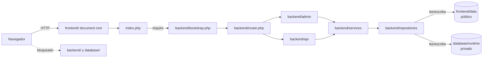

# PLAN DE REESTRUCTURACIÓN DEL PROYECTO

> **Estado:** propuesta para aprobación. No se ha movido ningún archivo.
> **Fecha:** 2026-11-16 · **Rama de trabajo sugerida:** `refactor/estructura` (parte de `develop`)
> **Objetivo:** que se entienda de un vistazo qué es cada cosa (frontend, backend, datos), **sin cambiar el comportamiento** y manteniendo correctas todas las rutas que hoy usan PHP, HTML y JavaScript.

---

## 1. Resumen ejecutivo

La raíz del proyecto mezcla router, endpoints, vistas, JavaScript, CSS, imágenes, teselas, datos públicos y documentación. Además existe una copia obsoleta (`PHP/public/`) y la forma actual de servir el proyecto (`php -S` desde la raíz) **expone al navegador todo lo que haya bajo la raíz**.

La propuesta separa el proyecto en tres bloques con una regla simple:

| Carpeta | Qué contiene | ¿Lo sirve el servidor web? |
|---|---|---|
| `frontend/` | Todo lo que recibe el navegador: HTML, CSS, JS, imágenes, teselas y los datos públicos del mapa | **Sí. Es el *document root*** |
| `backend/` | Todo el PHP: router, vistas del panel, endpoints, autenticación, repositorios, servicios | **No** |
| `database/` | JSON privado (usuarios, ajustes, auditoría, sugerencias), respaldos y fuentes GIS | **No** |

**Beneficio de seguridad principal:** con `php -S 127.0.0.1:8000 -t frontend`, `backend/` y `database/` dejan de ser alcanzables por HTTP, y el único archivo PHP ejecutable desde el navegador es `frontend/index.php`.

**Complejidad relativa:** media. Es un cambio mecánico, pero toca muchas rutas; por eso se divide en etapas pequeñas, cada una con su comprobación y su `commit`.

---

## 2. Diagnóstico verificado

### 2.1 Problemas de organización

| # | Hallazgo | Evidencia |
|---|---|---|
| P1 | La raíz mezcla ≈ 20 elementos de naturaleza distinta (router, 5 endpoints PHP, página HTML, página PHP del mapa, CSS, JS, datos, teselas, documentación) | listado de `git ls-files` |
| P2 | **`PHP/public/` es una copia obsoleta** con más de una docena de archivos de código y datos (varios ya difieren de los de la raíz) y 3,9 MB de teselas duplicadas. `AGENTS.md` prohíbe borrarla sin autorización explícita | `AGENTS.md`, comparación de archivos |
| P3 | Dos hojas de estilo del mapa: `styles.css` (690 líneas, usada por `index.html`) y `css/styles.css` (204 líneas, solo usada por `mapa.php`) | `grep` de referencias |
| P4 | `mapa.php` (página del mapa en PHP con JS incrustado) es el destino por defecto del router, pero `AGENTS.md` y `start-server.ps1` indican `index.html` como entrada. **Requiere decisión** | `index.php:11`, `AGENTS.md` |
| P5 | `PHP/admin/procesar.php` no está enlazado en el router y usa rutas que ya no existen (`../datos.json`, `../img/edificios`) | `index.php`, `procesar.php:9,53` |
| P6 | `404.php` se referencia en el router pero **no existe** | `index.php:45,51` |
| P7 | `PHP_public_README.md` suelto en la raíz y `PHP/public/README.md` | listado |
| P8 | `GeometriaITL.geojson` y `Geometria_TEC_GOOGLE_EWI.geojson` en la raíz no son leídos por ningún código (parecen fuentes de QGIS/Google) | `grep` |
| P9 | `pathfinding.js` depende de `distanciaMetros()`, definida en `beacons-simulation.js` | `js/beacons-simulation.js:122` |
| P10 | El directorio de teselas tiene espacios (`Teselas ITL Satelital`) y la URL lleva doble barra (`...Satelital//{z}`) | `js/main.js:13`, `js/editor.js:61`, `mapa.php:36` |

### 2.2 Problema de seguridad asociado a la estructura

`php -S` desde la raíz sirve cualquier archivo estático que exista bajo la raíz. En consecuencia, `PHP/data/users.json` (con hashes de contraseña), `audit-log.jsonl` y `suggestions.json` **deberían ser descargables**. `AGENTS.md` dice que "no debe exponerse por HTTP en producción", pero la estructura actual no lo impide.

**Compruébalo antes de empezar** (con el servidor en marcha):

```powershell
curl.exe -I http://127.0.0.1:8000/PHP/data/users.json
```

Un `200 OK` confirma la exposición; esta reestructuración la elimina.

### 2.3 Acoplamiento de rutas actual (lo que hay que actualizar al mover)

**PHP → PHP (dependen del directorio de trabajo, que es la raíz con `php -S`):**
`index.php`, `deleteEdificio.php`, `saveGeometria.php`, `send-suggestion.php` y `PHP/admin/panel.php` usan `require_once 'PHP/...'` y rutas relativas como `'datos.json'`.

**PHP → archivos de datos (calculados con `dirname(__DIR__, 2)`):**

| Archivo | Referencia |
|---|---|
| `PHP/services/BuildingService.php:22` | `dirname(__DIR__, 2) . '/datos.json'` |
| `PHP/repositories/BuildingGeometryRepository.php:26` | `dirname(__DIR__, 2)` (para `GeoTec.js`) |
| `PHP/repositories/BaseRepository.php:15` | `__DIR__ . '/../data'` (usuarios, ajustes, auditoría, sugerencias) |
| `PHP/admin/saveEdificio.php:41` | `dirname(__DIR__, 2)` (imágenes y `datos.json`) |
| `PHP/admin/imagelist.php:27` | `dirname(__DIR__, 2) . '/img/' . $folder` |
| `PHP/admin/panel.php:14` | `$rutaJson = 'datos.json'` |

**Navegador → servidor (URLs relativas a la página):**

| Origen | Referencia |
|---|---|
| `index.html` | `GeoTec.js`, `styles.css`, `img/logo-tecnm.png`, `js/*.js` |
| `js/main.js` | `datos.json`, `caminitos.geojson`, `check-session.php`, `send-suggestion.php`, teselas |
| `js/editor.js` | `index.php?p=saveGeometria`, teselas |
| `PHP/admin/*.php` (vistas) | `css/panel.css`, `css/login.css`, `css/editor.css`, `js/editor.js`, `img/...`, y `../../index.html` en `login.php:93` |
| `datos.json` | rutas de imágenes `img/<id>/<archivo>` (**deben seguir siendo válidas**) |

---

## 3. Estructura propuesta

```
MAPA-INTERACTIVO-TEC-LAGUNA/
├── frontend/                       ← DOCUMENT ROOT (único directorio servido)
│   ├── index.html                  mapa público
│   ├── index.php                   front controller (delgado: carga el backend)
│   ├── data/                       datos públicos del mapa (los lee el navegador y los escribe PHP)
│   │   ├── datos.json
│   │   ├── GeoTec.js
│   │   └── caminitos.geojson
│   ├── css/
│   │   ├── public.css              (antes styles.css de la raíz)
│   │   ├── admin/  panel.css · login.css · editor.css
│   │   └── vendor/leaflet-geoman/
│   ├── js/
│   │   ├── public/                 main.js · beacons-simulation.js
│   │   ├── shared/                 pathfinding.js · geo-utils.js
│   │   ├── admin/                  editor.js
│   │   ├── workers/                (reservado; ver decisión D4)
│   │   └── vendor/leaflet-geoman/
│   ├── img/                        logo-tecnm.png · <id>/… (misma disposición interna)
│   └── tiles/                      teselas (ver decisión D3; hoy "Teselas ITL Satelital")
│
├── backend/                        ← PHP, NO servido por HTTP
│   ├── bootstrap.php               constantes de rutas + carga común
│   ├── router.php                  tabla de rutas (la lógica que hoy está en index.php)
│   ├── admin/                      vistas del panel: panel · login · logout · editar-geometria
│   ├── api/                        endpoints: save-edificio · save-geometria · delete-edificio ·
│   │                               list-images · check-session · send-suggestion
│   ├── auth/                       auth_middleware · csrf · rate_limit
│   ├── repositories/
│   ├── services/
│   └── views/                      404.php
│
├── database/                       ← JSON privado, NO servido
│   ├── runtime/                    users.json · settings.json · audit-log.jsonl · suggestions.json
│   ├── backups/                    respaldos automáticos (GeoTec, datos, caminitos)
│   └── sources/                    GeometriaITL.geojson · Geometria_TEC_GOOGLE_EWI.geojson
│
├── tests/                          pruebas y listas de verificación
├── tools/                          scripts de un solo uso (migraciones)
├── docs/                           architecture/ · plans/
├── start-server.ps1                se queda en la raíz (comodidad); usa -t frontend
├── AGENTS.md · README.md · .gitignore
```



### 3.1 Por qué los datos públicos van en `frontend/data/` y no en `database/`

`datos.json`, `GeoTec.js` y `caminitos.geojson` los **escribe PHP pero los lee directamente el navegador** (`fetch` y `<script src>`). Si vivieran en `database/` (fuera del *document root*), el navegador no podría pedirlos.

| Opción | Descripción | Pros | Contras |
|---|---|---|---|
| **A (recomendada)** | Datos públicos en `frontend/data/`; datos privados en `database/` | Cero cambios de comportamiento; `frontend/` sigue siendo publicable como sitio estático | La "base de datos" queda repartida en dos carpetas (con nombres que lo explican) |
| B | Todo en `database/` y un enrutador que sirva `/data/*` desde ahí | Una sola carpeta de datos | Requiere configurar el servidor en producción; rompe la publicación estática |

### 3.2 Sobre los "workers de JS"

Hoy no hay *Web Workers* ni procesos en segundo plano: todo el JavaScript es de página. Se propone **no crear una carpeta `workers/` real todavía** y organizar el JS por función (`public/`, `shared/`, `admin/`, `vendor/`). Si lo que se quería era aislar el cálculo de rutas del hilo principal, `js/workers/pathfinding.worker.js` se puede añadir más adelante sin reestructurar nada. Queda como decisión D4.

---

## 4. Mapa de equivalencias (actual → nueva)

| Actual | Nueva | Notas |
|---|---|---|
| `index.html` | `frontend/index.html` | actualizar `src`/`href` |
| `index.php` | `frontend/index.php` + `backend/router.php` | el router pasa a `backend/`; `index.php` solo hace `require` |
| `mapa.php` | *(D2)* eliminar o `backend/views/` | página legacy |
| `check-session.php` | `backend/api/check-session.php` | se invoca por `index.php?p=check-session` |
| `send-suggestion.php` | `backend/api/send-suggestion.php` | `index.php?p=send-suggestion` |
| `saveGeometria.php` | `backend/api/save-geometria.php` | ya se invoca por el router |
| `deleteEdificio.php` | `backend/api/delete-edificio.php` | ya se invoca por el router |
| `PHP/admin/saveEdificio.php` | `backend/api/save-edificio.php` | |
| `PHP/admin/imagelist.php` | `backend/api/list-images.php` | |
| `PHP/admin/{panel,login,logout,editar-geometria}.php` | `backend/admin/` | vistas |
| `PHP/admin/procesar.php` | *(D2)* eliminar | no enlazado |
| `PHP/auth/*` | `backend/auth/*` | |
| `PHP/repositories/*`, `PHP/services/*` | `backend/repositories/*`, `backend/services/*` | |
| `PHP/data/*` | `database/runtime/*` | **ignorado por Git: se mueve a mano** |
| `datos.json`, `GeoTec.js`, `caminitos.geojson` | `frontend/data/*` | |
| `GeometriaITL.geojson`, `Geometria_TEC_GOOGLE_EWI.geojson` | `database/sources/` | |
| `styles.css` | `frontend/css/public.css` | |
| `css/{panel,login,editor}.css` | `frontend/css/admin/` | |
| `css/styles.css` | *(D2)* eliminar con `mapa.php` | |
| `css/vendor/`, `js/vendor/` | `frontend/css/vendor/`, `frontend/js/vendor/` | |
| `js/main.js`, `js/beacons-simulation.js` | `frontend/js/public/` | |
| `js/pathfinding.js` | `frontend/js/shared/pathfinding.js` | + `geo-utils.js` con `distanciaMetros` |
| `js/editor.js` | `frontend/js/admin/editor.js` | |
| `img/` | `frontend/img/` | **misma disposición interna**: `datos.json` guarda rutas `img/<id>/…` |
| `Teselas ITL Satelital/` | `frontend/tiles/satelital/` | opcional (D3) |
| `PHP/public/`, `PHP_public_README.md` | *(D2)* eliminar | requiere autorización explícita |
| `start-server.ps1` | se queda en la raíz | pasa a `php -S … -t frontend` |
| `docs/`, `AGENTS.md`, `README.md` | sin cambio de lugar | actualizar contenido |

---

## 5. Diseño de rutas en PHP

### 5.1 `backend/bootstrap.php`

Un único punto que define las ubicaciones. **Ningún archivo vuelve a usar `dirname(__DIR__, n)` ni rutas relativas al directorio de trabajo.**

```php
<?php
define('ROOT_PATH',        dirname(__DIR__));
define('BACKEND_PATH',     __DIR__);
define('FRONTEND_PATH',    ROOT_PATH . '/frontend');
define('PUBLIC_DATA_PATH', FRONTEND_PATH . '/data');     // datos.json, GeoTec.js, caminitos.geojson
define('IMG_PATH',         FRONTEND_PATH . '/img');
define('DATABASE_PATH',    ROOT_PATH . '/database');
define('RUNTIME_PATH',     DATABASE_PATH . '/runtime');  // users, settings, audit, suggestions
define('BACKUPS_PATH',     DATABASE_PATH . '/backups');

foreach ([RUNTIME_PATH, BACKUPS_PATH] as $dir) {
    if (!is_dir($dir)) {
        http_response_code(500);
        exit("Falta la carpeta de datos: $dir");   // falla visible, no silenciosa
    }
}
```

### 5.2 Cambios por archivo

| Archivo | Antes | Después |
|---|---|---|
| Todos los `require_once 'PHP/...'` | ruta relativa al directorio de trabajo | `require_once BACKEND_PATH . '/…'` |
| `BaseRepository` | `__DIR__ . '/../data'` | `RUNTIME_PATH` |
| `BuildingService` | `dirname(__DIR__, 2) . '/datos.json'` | `PUBLIC_DATA_PATH . '/datos.json'` |
| `BuildingGeometryRepository` | `dirname(__DIR__, 2)` para `GeoTec.js` | `PUBLIC_DATA_PATH . '/GeoTec.js'`; respaldo en `BACKUPS_PATH` (en lugar de `.bak` junto al archivo) |
| `save-edificio.php` | `$raiz = dirname(__DIR__, 2)` | `IMG_PATH` y `PUBLIC_DATA_PATH` |
| `list-images.php` | `dirname(__DIR__, 2) . '/img/'` | `IMG_PATH . '/' . $folder` (mantener la sanitización contra *path traversal*) |
| `panel.php` | `$rutaJson = 'datos.json'` | `PUBLIC_DATA_PATH . '/datos.json'` |
| `login.php` | `href="../../index.html"` | `href="index.html"` |
| Router | `$archivo = 'PHP/admin/…'` | rutas con `BACKEND_PATH`; incorpora `check-session` y `send-suggestion` como rutas |

### 5.3 Router y endpoints

`frontend/index.php` queda así (único PHP ejecutable desde el navegador):

```php
<?php
require __DIR__ . '/../backend/bootstrap.php';
require BACKEND_PATH . '/router.php';
```

`check-session` y `send-suggestion` pasan a ser rutas del router. Son **públicas** (el mapa las llama sin sesión); conservan su CSRF y *rate limit* actuales.

### 5.4 Rutas en el navegador

Con `frontend/` como *document root*, las URLs relativas del mapa y del panel **siguen funcionando** porque ambos se sirven desde `/`. Cambios necesarios:

| Archivo | Cambio |
|---|---|
| `index.html` | `data/GeoTec.js`; `css/public.css`; `js/shared/geo-utils.js` → `js/shared/pathfinding.js` → `js/public/beacons-simulation.js` → `js/public/main.js` (**el orden importa**) |
| `main.js` | `fetch('data/datos.json')`, `fetch('data/caminitos.geojson')`, `check-session.php` → `index.php?p=check-session`, `send-suggestion.php` → `index.php?p=send-suggestion`; teselas si se renombran |
| `editor.js` | teselas si se renombran |
| Vistas del panel | `css/admin/panel.css`, `css/admin/login.css`, `css/admin/editor.css`, `js/admin/editor.js` |
| `datos.json` | **sin cambios** (`img/<id>/…` sigue siendo válido) |

> El orden de carga original era `GeoTec.js → beacons-simulation.js → pathfinding.js → main.js`. Al extraer `distanciaMetros` a `geo-utils.js`, `beacons-simulation.js` ya no es requisito de `pathfinding.js`.

---

## 6. Etapas de ejecución

**Regla general:** cada etapa es un `commit` independiente en `refactor/estructura`, se mueve con `git mv`, se ejecuta la verificación de la etapa **antes** de pasar a la siguiente, y si falla se revierte ese commit. Los archivos existentes mezclan finales de línea CRLF y LF (p. ej. `panel.php`, `login.php`): **al editar, conservar el final de línea de cada archivo** para no generar diffs enormes.

### Etapa 0 — Preparación y línea base
- **Tareas:** crear la rama; copiar `PHP/data/` **fuera del repositorio** (está ignorado por Git y no hay otra copia); registrar la línea base de la lista de verificación (apartado 7); ejecutar `php -l` sobre todos los `.php`.
- **Aceptación:** lista de verificación completa en verde sobre la estructura actual y respaldo de `PHP/data/` hecho.
- **Complejidad:** baja.

### Etapa 1 — Constantes de rutas (sin mover nada)
- **Tareas:** crear `bootstrap.php` con las constantes apuntando a la ubicación **actual**; sustituir `dirname(__DIR__, n)`, rutas relativas y `require_once 'PHP/…'` por las constantes.
- **Aceptación:** lista de verificación en verde; `grep -rn "dirname(__DIR__" PHP *.php` sin resultados.
- **Por qué primero:** después de esta etapa, mover una carpeta solo requiere cambiar una constante, no decenas de archivos.
- **Complejidad:** media.

### Etapa 2 — Backend
- **Tareas:** mover `PHP/{admin,auth,repositories,services}` a `backend/`; mover los endpoints de la raíz a `backend/api/` con nombres en *kebab-case*; extraer la lógica de `index.php` a `backend/router.php`; crear `backend/views/404.php` (P6); ajustar `BACKEND_PATH` en `bootstrap.php`.
- **Aceptación:** lista de verificación en verde (aún con la raíz como *document root*).
- **Complejidad:** media.

### Etapa 3 — Base de datos privada
- **Tareas:** mover **a mano** `PHP/data/*` → `database/runtime/` (no lo mueve Git); crear `database/backups/` y `database/sources/`; mover los dos `.geojson` de la raíz a `database/sources/`; apuntar `RUNTIME_PATH`/`BACKUPS_PATH`; actualizar `.gitignore` (`database/runtime/`, `database/backups/`, y borrar las entradas de `PHP/data/` y `GeoTec.js.bak`).
- **Aceptación:** inicio de sesión correcto con tu usuario actual; enviar una sugerencia y verla en `database/runtime/suggestions.json`; auditoría escribiendo en `database/runtime/audit-log.jsonl`.
- **Riesgo:** si `database/runtime/` queda vacío, `bootstrap.php` falla con mensaje claro (por diseño) en lugar de crear un `users.json` vacío.
- **Complejidad:** baja-media.

### Etapa 4 — Frontend y *document root*
- **Tareas:** crear `frontend/`; mover `index.html`, `css/`, `js/`, `img/`, teselas y datos públicos según el apartado 4; reordenar `js/` en `public/`, `shared/`, `admin/`; extraer `distanciaMetros` a `geo-utils.js`; actualizar `index.html`, `main.js` y las vistas del panel (apartado 5.4); actualizar `PUBLIC_DATA_PATH`/`IMG_PATH`; cambiar `start-server.ps1` a `php -S 127.0.0.1:8000 -t frontend` y las URLs que imprime.
- **Aceptación:** lista de verificación en verde **y** comprobaciones de seguridad (apartado 7.2) en verde.
- **Complejidad:** media-alta (es la etapa con más referencias).

### Etapa 5 — Limpieza de código legacy *(requiere aprobación explícita, ver D2)*
- **Tareas:** eliminar `PHP/public/`, `PHP_public_README.md`, `procesar.php` y, según D2, `mapa.php` + `css/styles.css`; quitar del código cualquier referencia restante.
- **Aceptación:** `grep -rn "PHP/public" .` sin resultados; lista de verificación en verde.
- **Nota:** al ser un repositorio recién creado, no se pierde historial; aun así la etapa es separada para poder revertirla sola.
- **Complejidad:** baja.

### Etapa 6 *(opcional)* — Teselas con nombre limpio (D3)
- **Tareas:** `Teselas ITL Satelital/` → `frontend/tiles/satelital/`; actualizar la URL de teselas en `main.js` y `editor.js` (3 apariciones contando `mapa.php` si sigue vivo) y eliminar la doble barra.
- **Aceptación:** el mapa y el editor cargan las teselas (pestaña *Network* sin 404, zoom 15–19).
- **Complejidad:** baja.

### Etapa 7 — Documentación
- **Tareas:** actualizar `AGENTS.md` (estructura, URLs, regla "no tocar `database/`"), `README.md` y `docs/architecture/`.
- **Aceptación:** ningún documento menciona rutas antiguas.
- **Complejidad:** baja.

---

## 7. Verificación

### 7.1 Lista de humo funcional (ejecutar en la Etapa 0 y al cerrar cada etapa)

1. `php -l` sobre todos los `.php`: sin errores de sintaxis.
2. `http://127.0.0.1:8000/index.html` carga el mapa, con teselas (sin 404 en la pestaña *Network*).
3. Se ven los edificios y al hacer clic abre el popup con **imágenes**.
4. Calcular una ruta puerta → edificio dibuja la polilínea y la distancia.
5. Buscar un edificio por nombre/aula funciona.
6. El botón ⚙️ llama a `check-session` y, sin sesión, abre el formulario de sugerencias.
7. Enviar una sugerencia: respuesta correcta y registro en `suggestions.json`.
8. `index.php?p=login`: credenciales erróneas fallan; las correctas entran al panel.
9. El panel lista los edificios y el buscador filtra.
10. Editar metadatos de un edificio de prueba y subir/quitar una imagen (`list-images` y `save-edificio`).
11. Crear un edificio de prueba (`TEST-1`) con geometría; comprobar que se actualizaron `datos.json` y `GeoTec.js` **en `data/`**, y eliminarlo después.
12. `logout` cierra la sesión y las rutas protegidas redirigen a login.
13. La auditoría registra los eventos de los pasos 8, 10 y 11.

### 7.2 Comprobaciones de seguridad (desde la Etapa 4)

Todas deben devolver **404** (o equivalente), nunca 200:

```powershell
foreach ($u in @(
  '/PHP/data/users.json', '/database/runtime/users.json', '/database/runtime/audit-log.jsonl',
  '/backend/bootstrap.php', '/backend/services/AuthService.php', '/backend/auth/auth_middleware.php'
)) { "{0} -> {1}" -f $u, (curl.exe -s -o NUL -w "%{http_code}" "http://127.0.0.1:8000$u") }
```

### 7.3 Búsquedas de residuos

```powershell
git grep -n -E "dirname\(__DIR__, *[0-9]\)"       # sin resultados
git grep -n "PHP/(admin|auth|data|repositories|services|public)"   # solo docs históricos
git grep -n -E "(datos\.json|caminitos\.geojson|GeoTec\.js|check-session\.php|send-suggestion\.php)" -- frontend   # revisar que usen data/ o index.php?p=
```

---

## 8. Riesgos y mitigaciones

| Riesgo | Impacto | Mitigación |
|---|---|---|
| `PHP/data/` no está en Git | Perder usuarios y auditoría | Copia fuera del repo (Etapa 0); movimiento manual en la Etapa 3; `bootstrap.php` falla si falta |
| Rutas relativas en vistas del panel | CSS/JS 404 | Se sirven desde `/` en ambos esquemas; comprobación 7.1 y pestaña *Network* |
| Orden de carga de scripts | Mapa roto (`distanciaMetros` no definida) | Orden explícito en 5.4; `geo-utils.js` primero |
| `datos.json` guarda rutas `img/<id>/…` | Imágenes rotas | `frontend/img/` conserva la disposición interna |
| Sesión/cookies | Pérdida de sesión | Cookie con `path=/`: no depende de carpetas |
| Mezcla CRLF/LF | Diffs ilegibles | Respetar el final de línea de cada archivo |
| Edición masiva sin comprobar | Regresiones difíciles de localizar | Un commit por etapa + lista de humo tras cada una |
| Producción (Apache/Nginx) | Exponer carpetas | Apuntar el *document root* a `frontend/`; nada más |

---

## 9. Criterios de aceptación globales

- La lista de humo (7.1) pasa completa sobre la estructura nueva.
- Las comprobaciones de seguridad (7.2) devuelven 404.
- No quedan `dirname(__DIR__, n)` ni rutas relativas al directorio de trabajo en PHP.
- `git grep "PHP/public"` sin resultados (tras la Etapa 5).
- `AGENTS.md` y `README.md` describen la estructura nueva y el comando `php -S 127.0.0.1:8000 -t frontend`.
- El comportamiento visible del mapa público y del panel **no cambia**.

---

## 10. Decisiones pendientes de aprobación

| ID | Decisión | Opciones | Recomendación |
|---|---|---|---|
| D1 | Ubicación de los datos públicos | (A) `frontend/data/` + `database/` privada · (B) todo en `database/` con enrutador | **A** |
| D2 | Código legacy | Borrar `PHP/public/`, `procesar.php`, `PHP_public_README.md`, y decidir sobre `mapa.php` + `css/styles.css` | Borrar los tres primeros. Para `mapa.php`, **confirmar si alguien lo usa**; si no, borrar |
| D3 | Renombrar teselas | Dejar `Teselas ITL Satelital` · mover a `frontend/tiles/satelital/` | Renombrar (Etapa 6), como paso aparte |
| D4 | "Workers" de JS | No crear carpeta · crear `js/workers/` vacía · mover Dijkstra a un Web Worker | No crear todavía |
| D5 | Endpoints | Nombres *kebab-case* en `backend/api/` · mantener los nombres actuales | *kebab-case* |
| D6 | `start-server.ps1` | Raíz · `tools/` | Raíz |
| D7 | Orden respecto a la gestión de la red | Reestructurar primero · gestión de red primero | **Reestructurar primero** (las Etapas 0–4 son mecánicas); si el plazo no lo permite, aplicar la tabla del apartado 4 a posteriori |

---

## 11. Seguimiento de ejecución (checklist)

> **Cómo retomar tras una interrupción:** lee el bloque «Estado actual», ve a la etapa indicada y continúa desde la primera casilla sin marcar. Marca `[x]` al terminar cada tarea y actualiza el bloque al cerrar una etapa. Cada etapa termina con su propio `commit`.
>
> - `[ ]` pendiente · `[x]` hecho · `[!]` incidencia (anotar el motivo justo debajo)
> - Los archivos de cada etapa se mueven con `git mv`; los datos privados (`PHP/data/`) se mueven a mano porque están ignorados por Git.
> - **Regla de borrado:** por indicación del usuario **no se elimina nada**. Todo lo obsoleto, legacy o inútil se mueve a `DUMP/` en la raíz.

### Estado actual

| Campo | Valor |
|---|---|
| Rama de trabajo | `refactor/estructura` (creada desde `RaMaik`, que equivale a `develop`) |
| Etapa en curso | Etapa 3 — Base de datos privada (Etapas 0–2 completadas) |
| Último commit de etapa | `47faf69` (Etapa 2) |
| Decisiones aplicadas | D1 = A · D2 = mover a `DUMP/` (no borrar) · D3 = renombrar teselas · D4 = sin `workers/` · D5 = kebab-case · D6 = raíz · D7 = reestructurar primero |
| Incidencias abiertas | `tests/grafo-huella.mjs --geometria` y `tests/red/analisis-cliente.mjs` fallan por desfase **preexistente**: `caminitos.geojson` en `HEAD` tiene 313 segmentos / 646 vértices, mientras los tests esperan 312 / 644. No lo provoca la reestructuración; no se modifica la red. |

### Etapa 0 — Preparación y línea base
- [x] Crear la rama `refactor/estructura`
- [x] Copiar `PHP/data/` fuera del repositorio (respaldo en `%TEMP%\opencode\phpdata-backup-20261118-0130`)
- [x] Ejecutar `php -l` sobre todos los `.php` (0 errores)
- [x] Registrar la línea base de la lista de humo (7.1) sobre la estructura actual
- [x] Commit de la etapa (incluye este checklist) → `406f103`

### Etapa 1 — Constantes de rutas (sin mover nada)
- [x] Crear `PHP/bootstrap.php` con `ROOT_PATH`, `BACKEND_PATH`, `FRONTEND_PATH`, `PUBLIC_DATA_PATH`, `IMG_PATH`, `DATABASE_PATH`, `RUNTIME_PATH`, `BACKUPS_PATH` apuntando a la ubicación actual
- [x] Hacer que cada punto de entrada cargue `bootstrap.php` (`index.php`, `saveGeometria.php`, `deleteEdificio.php`, `check-session.php`, `send-suggestion.php`, `save-red.php`)
- [x] Sustituir `BaseRepository`: `__DIR__ . '/../data'` → `RUNTIME_PATH`
- [x] Sustituir en servicios y repositorios: `BuildingService`, `BuildingGeometryRepository`, `PathNetworkRepository`, `NetworkRepository`, `RouteService`
- [x] Sustituir en vistas y endpoints: `panel.php`, `imagelist.php`, `saveEdificio.php`, `rutas.php`, `editar-ruta.php`, `editar-red.php`, `NetworkService`
- [x] Cambiar `require_once 'PHP/...'` por rutas absolutas basadas en `BACKEND_PATH`
- [x] Verificar: `php -l` (0 errores), `grep "dirname(__DIR__" PHP *.php` solo aparece en `PHP/bootstrap.php` (única fuente de `ROOT_PATH`), pruebas PHP 131/131 y humo HTTP correcto
- [x] Commit de la etapa
- Nota: los tests de huella del grafo fallan por el desfase preexistente descrito en «Incidencias abiertas».

### Etapa 2 — Backend
- [x] Crear `backend/`
- [x] Mover `PHP/{admin,auth,repositories,services}` → `backend/`
- [x] Mover `PHP/bootstrap.php` → `backend/bootstrap.php`
- [x] Mover endpoints de la raíz → `backend/api/` con nombres kebab-case
- [x] Mover endpoints de `PHP/admin/` → `backend/api/` (edificios, imágenes, rutas y red)
- [x] Extraer la lógica de `index.php` a `backend/router.php` y dejar `index.php` como *front controller* delgado
- [x] Añadir rutas públicas `check-session` y `send-suggestion`
- [x] Crear `backend/views/404.php` (P6)
- [x] Ajustar `BACKEND_PATH` y las rutas del router
- [x] Actualizar `js/main.js` (`check-session.php` y `send-suggestion.php` → `index.php?p=…`)
- [x] Actualizar los `require` de `tests/` a `backend/`
- [x] Verificar: `php -l` (0 errores), 131 pruebas PHP OK, regresión general 24/24 y seguridad S-01…S-10 OK
- [x] Commit de la etapa → `47faf69`

### Etapa 3 — Base de datos privada
- [ ] Crear `DUMP/` y mover allí `PHP/public/`, `PHP_public_README.md`, `backend/admin/procesar.php` y los respaldos sueltos de la raíz
- [ ] Mover **a mano** `PHP/data/*` → `database/runtime/` (usuarios, ajustes, auditoría, sugerencias, rutas)
- [ ] Mover `PHP/data/backups/` → `database/backups/`
- [ ] Crear `database/sources/` y mover los dos `.geojson` de fuentes GIS
- [ ] Apuntar `DATABASE_PATH`, `RUNTIME_PATH` y `BACKUPS_PATH`
- [ ] Actualizar `.gitignore` (`database/runtime/`, `database/backups/`)
- [ ] Actualizar `scripts/migrar_red_caminos.php` y `scripts/migrar_red_v2.php`
- [ ] Actualizar pruebas que leen `PHP/data/`
- [ ] Verificar: login con el usuario real, sugerencia y auditoría en `database/runtime/`
- [ ] Commit de la etapa

### Etapa 4 — Frontend y *document root*
- [ ] Crear `frontend/`
- [ ] Mover `index.html`, `index.php`, `img/` y `css/`
- [ ] Reorganizar `css/` (`public.css`, `admin/`, `vendor/`)
- [ ] Reorganizar `js/` (`public/`, `shared/`, `admin/`, `vendor/`)
- [ ] Mover `datos.json`, `GeoTec.js` y `caminitos.geojson` → `frontend/data/`
- [ ] Mover teselas → `frontend/tiles/satelital/` y quitar la doble barra de las URLs (Etapa 6 absorbida)
- [ ] Actualizar `index.html` (orden de scripts y rutas)
- [ ] Actualizar `js/main.js` (`data/…`, endpoints y teselas)
- [ ] Actualizar vistas del panel (CSS, JS, imágenes, enlaces)
- [ ] Actualizar `PUBLIC_DATA_PATH` e `IMG_PATH`
- [ ] Cambiar `start-server.ps1` a `php -S 127.0.0.1:8000 -t frontend router.php`
- [ ] Actualizar `router.php` (bloquear `backend/`, `database/`, `DUMP/`)
- [ ] Actualizar pruebas con las rutas nuevas y el nuevo *document root*
- [ ] Verificar humo 7.1 y seguridad 7.2 (404 en todo lo privado)
- [ ] Commit de la etapa

### Etapa 5 — Limpieza legacy → `DUMP/`
- [ ] Mover `mapa.php` y `css/styles.css` a `DUMP/` (la raíz pasa a redirigir a `index.html`)
- [ ] Comprobar que no queda ninguna referencia a `PHP/public`, `procesar.php` ni `mapa.php`
- [ ] Verificar humo 7.1
- [ ] Commit de la etapa

### Etapa 6 — Teselas con nombre limpio
- [x] Absorbida por la Etapa 4 (`frontend/tiles/satelital/`, sin espacios ni doble barra)

### Etapa 7 — Documentación
- [ ] Actualizar `AGENTS.md` (estructura, URLs, comandos, regla «no tocar `database/`»)
- [ ] Actualizar `README.md`
- [ ] Actualizar `docs/architecture/ARQUITECTURA_PERSISTENCIA_JSON.md`
- [ ] Revisar que ningún documento describa rutas antiguas
- [ ] Cerrar este checklist con el estado final y el commit de cierre

### Bitácora

| Fecha | Etapa | Commit | Notas |
|---|---|---|---|
| 2026-11-18 | 0 | `406f103` | Rama creada y respaldo de `PHP/data/` verificado |
| 2026-11-18 | 1 | `bfced7f` | `PHP/bootstrap.php` creado; rutas centralizadas; 131 pruebas PHP OK; humo OK |
| 2026-11-18 | 2 | `47faf69` | Backend en `backend/`; router y API kebab-case; tests y JS actualizados; regresión y seguridad OK |
